# Vacuum Table Assembly — AltMill 4×8

The Vacuum Table uses a pump and piping installed beneath your AltMill 4×8, along with a machined MDF grid board on top of the machine. This guide walks through installing the pump, assembling the piping, and cutting the grid board.

**Estimated time:** approximately 4.5 hours: 1.5 hours of assembly and about 3 hours of CNC cutting. Allow additional time for preparation and checks.

## Before you begin

- Make sure your AltMill 4×8 is assembled, connected, and able to home and run a job. You should be comfortable setting your work zero and running G-code in gSender.
- Leave room to access both sides and the underside of the machine while installing the pipe assemblies.
- If you are replacing an existing wasteboard, remove it before fitting the new MDF grid board.
- Have a **3/4-inch, 4×8-foot MDF sheet** ready for the grid board. If you plan to use a full-sheet bleeder board, have a second matching sheet ready.
- **Joinery configuration:** Cut 4 inches off the specified end of the MDF grid board (and bleeder board, if used) *before* beginning assembly. Confirm the correct end and orientation for your machine.
- Avoid storing the MDF in a humid shop for an extended period before cutting; swelling can affect alignment.
- The source notes specify a **single-phase 220 V, 30 A circuit**, separate from the spindle, CNC machine, and dust collection, and a pump connection rated **250 V / 30 A with an L6-30P plug**. Have a qualified electrician confirm the actual pump label, circuit, compatible receptacle, and any extension cord needed for your shop. Keep the pump unplugged during assembly.

### Tools and materials

- Drill and driver bits (Robertson and flathead)
- Allen key set
- **3/8-inch flat end mill, downcut**, for the locating pockets
- **3/8-inch flat end mill, upcut**, for the grid
- 3/4 " MDF board to make the grid and, a separate 3/4 " MDF bleeder board
- Vacuum Table kit: pump, filter, fittings, pipe assemblies, short hoses, hose clamps, mounting hooks, positioning guides, screws and T-nuts, clamping flanges, and flange fastening tool

## Assembly

### Place the pump beneath the machine

1. From the **right side** of the machine, position the vacuum pump underneath the table, roughly between the front and rear legs.
1. Keep the pump toward the right-hand side rather than pushing it all the way left. Leave enough space to access the filter and hose connections.

    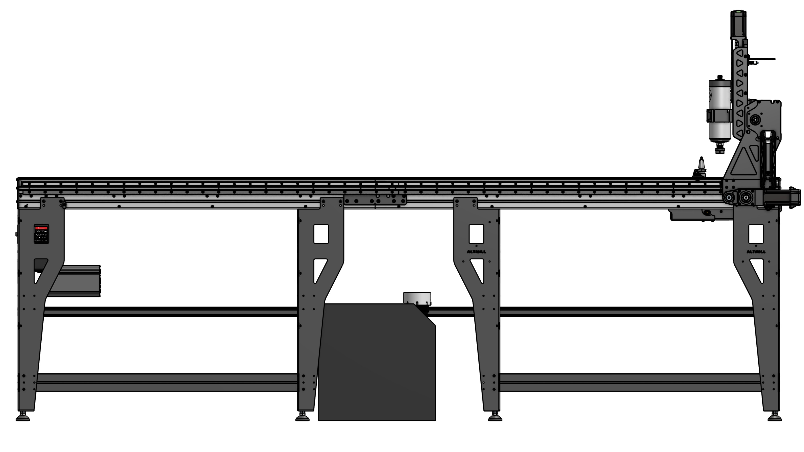{.aligncenter .size-medium}

### Install the pump fittings and filter

1. Remove the **red protective cap** from the vacuum pump inlet.

    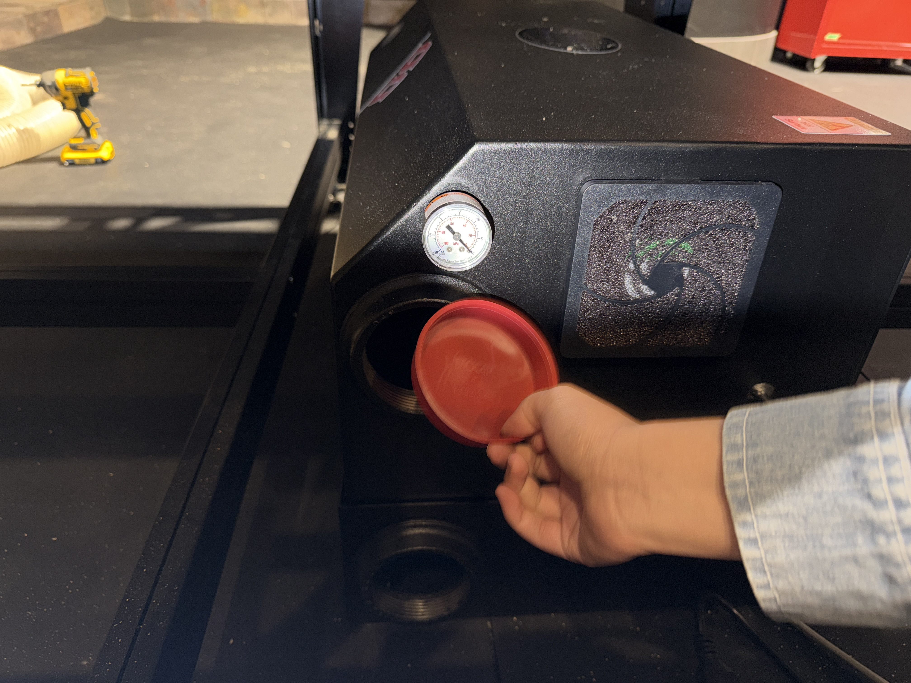{.aligncenter .size-medium}

1. Attach the **larger fitting** to the connection at the back of the pump at the top opening.

    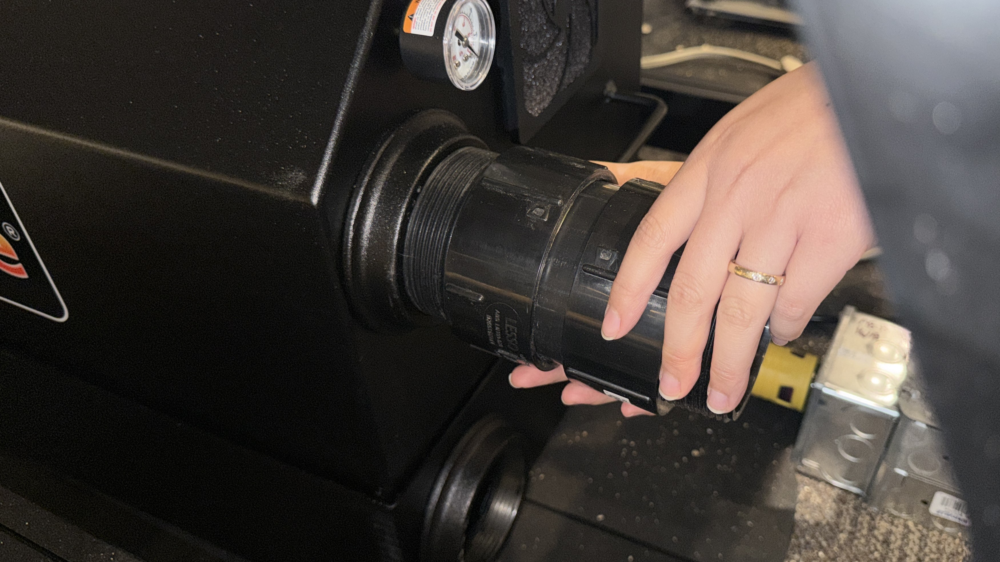{.aligncenter .size-medium}

1. Connect the **vacuum filter** to that fitting.

    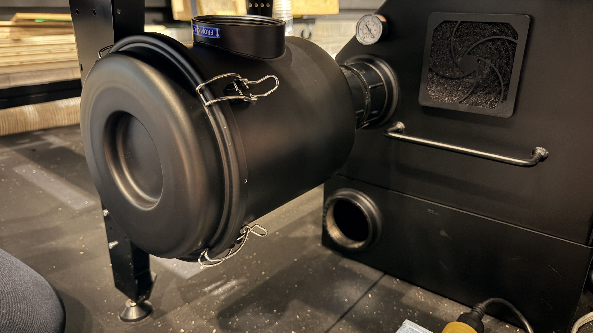{.aligncenter .size-medium}

1. Install the **smaller fitting** at the top of the filter.

    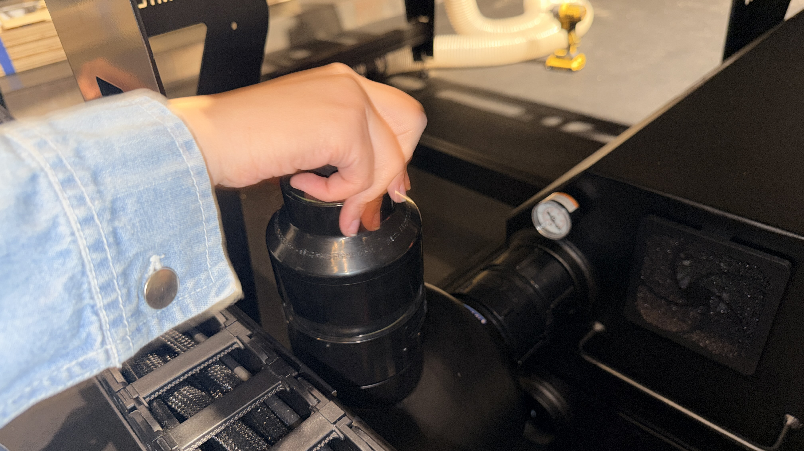{.aligncenter .size-medium}

### Install the MDF positioning guides

1. Locate the six positioning guides supplied with the kit. Prepare the **four side guides with one** M5 × 14 mm screw and one T-nut each, and the **two rear guides with two** M5 × 14 mm screws and two T-nuts each. Ensure the T-nuts are oriented correctly to engage the machine's T-slots.

    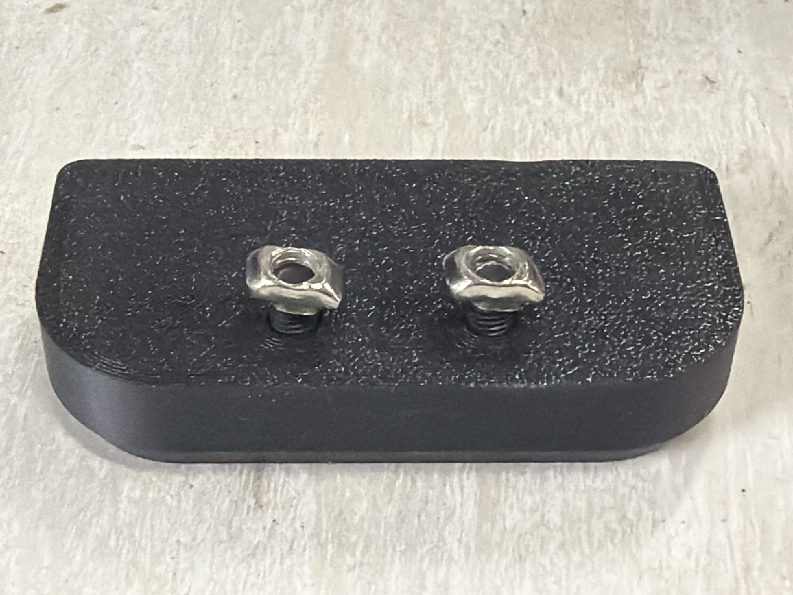{.aligncenter .size-medium}

1. Install two positioning guides along the back of the machine and two along each side, spacing them evenly. Align each guide with its T-slot, ensuring it sits against the machine rail, then tighten securely. The guides act as stops to keep the MDF board consistently positioned.

    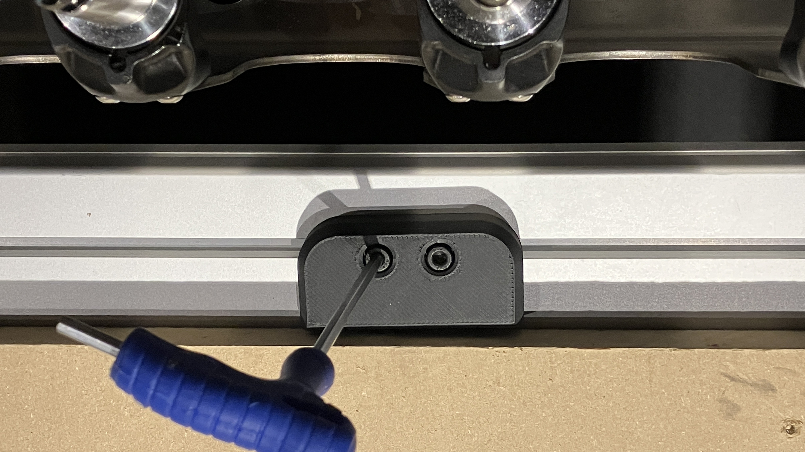{.aligncenter .size-medium}

    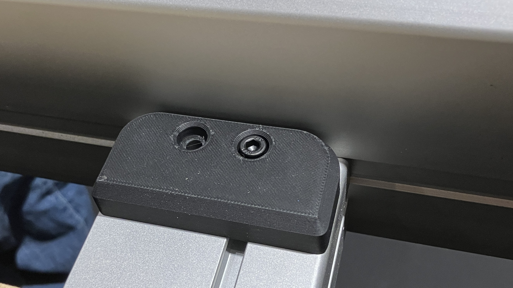{.aligncenter .size-medium}

    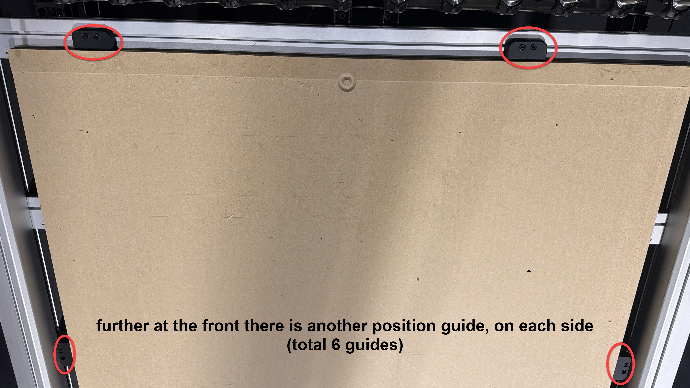{.aligncenter .size-medium}

### Secure the MDF and cut the grid

1. Set the new MDF grid board against the positioning guides.

    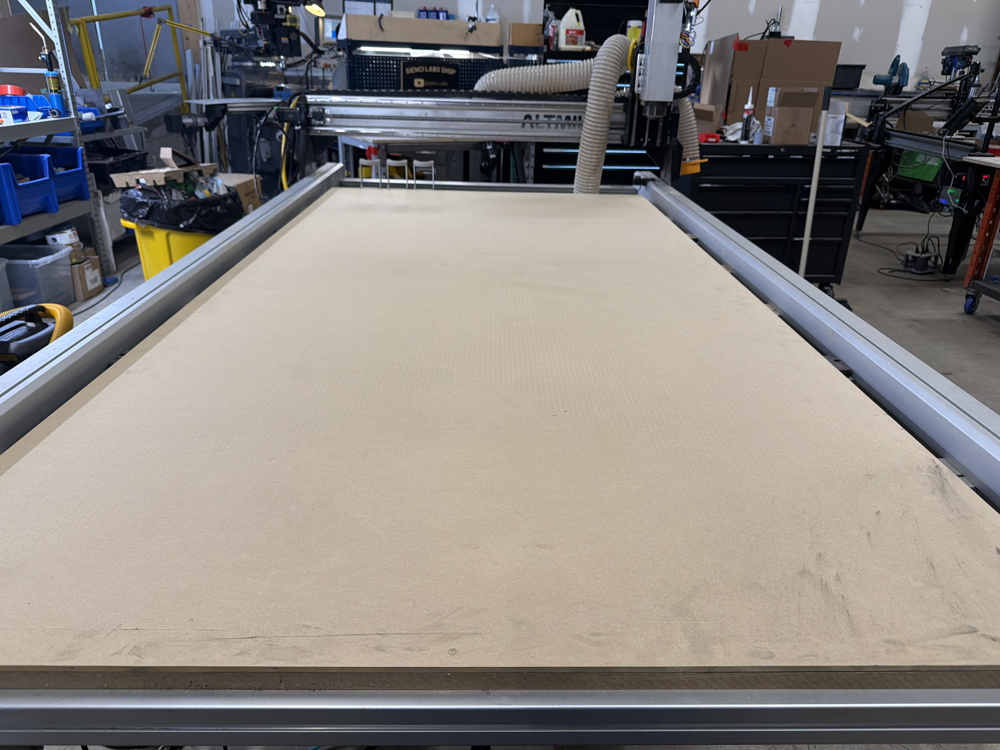{.aligncenter .size-medium}

1. Fasten the board from underneath using the machine's crossbeams. We recommend **at least two fasteners per crossbeam** because holes will be machined into the MDF. Check fastener lengths and locations to avoid interference with the cutting area. 8 screws should be plenty to secure the board.
1. Connect to the machine and home it.
1. Install the specified **3/8-inch downcut flat end mill** and load the correct **pocketing G-code** for either the standard or joinery configuration.

### Download the Vacuum Table G-code

For a standard AltMill 4×8 installation, use the **Full Size Grid and Mounts** G-code file. This file includes the mounting holes for the vacuum plumbing and the vacuum grid pattern.

Download [Full Size - Grid and Mounts (Standard)](https://drive.google.com/file/d/1gN2iRrZfKrhiHZ1w_FnuRqJwFGojoqLs/view?usp=drive_link) gCode

If you're using the standard full-size MDF board without a rotary accommodation, this is the file you'll need.

### Alternative G-code Files

Select the G-code file that matches your Vacuum Table configuration.

| Configuration | When to Use | G-code File |
|---|---|---|
| **Full Size — Grid + Mounts (Standard)** | Recommended for standard full-size installations. Includes the mounting holes and vacuum grid. | [Download](https://drive.google.com/file/d/1gN2iRrZfKrhiHZ1w_FnuRqJwFGojoqLs/view?usp=drive_link) |
| Full Size — Mounting Holes Only | Use when creating your own vacuum grid pattern. | [Download](https://drive.google.com/file/d/1obWakz_Y6qKdrmU4kUrFTObaRRXcT5lp/view?usp=drive_link) |
| Full Size — Grid + Rotary | Use when your setup needs to accommodate a rotary attachment. | [Download](https://drive.google.com/file/d/1ZUCmMDtB2kVO3ewhmzj5Ll1ETLownDx3/view?usp=drive_link) |
| **Joinery — Grid + Mounts (Standard)** | Recommended for joinery installations. Includes the mounting holes and vacuum grid. | [Download](https://drive.google.com/file/d/16BJSYs7G-AcbRjFOUHtJozjybG09pIQo/view?usp=drive_link) |
| Joinery — Mounting Holes Only | Use when creating your own vacuum grid pattern with the joinery configuration. | [Download](https://drive.google.com/file/d/1TZ6uGTmq_7RNqxA52lSXJ9UdTPKt7V-e/view?usp=drive_link) |
| Joinery — Grid + Rotary | Use when your joinery setup needs to accommodate a rotary attachment. | [Download](https://drive.google.com/file/d/1UwZC-NVghKbffOfFlNc55-UIPzNB0KHZ/view?usp=drive_link) |

**Note:** All files are designed around a 3/8-inch (9.5 mm) cutting tool. Confirm the correct tool requirements, work zero, and machine configuration before running the selected G-code. [Joinery configurations](https://resources.sienci.com/view/am4x8-joinery-configuration/) require the MDF board to be prepared to the specified dimensions before machining.

### Cut the holes & grid

1. Remove the dust shoe as needed to set the **work zero at the front-left corner, on the top surface of the MDF**. Reinstall the dust shoe before cutting.

    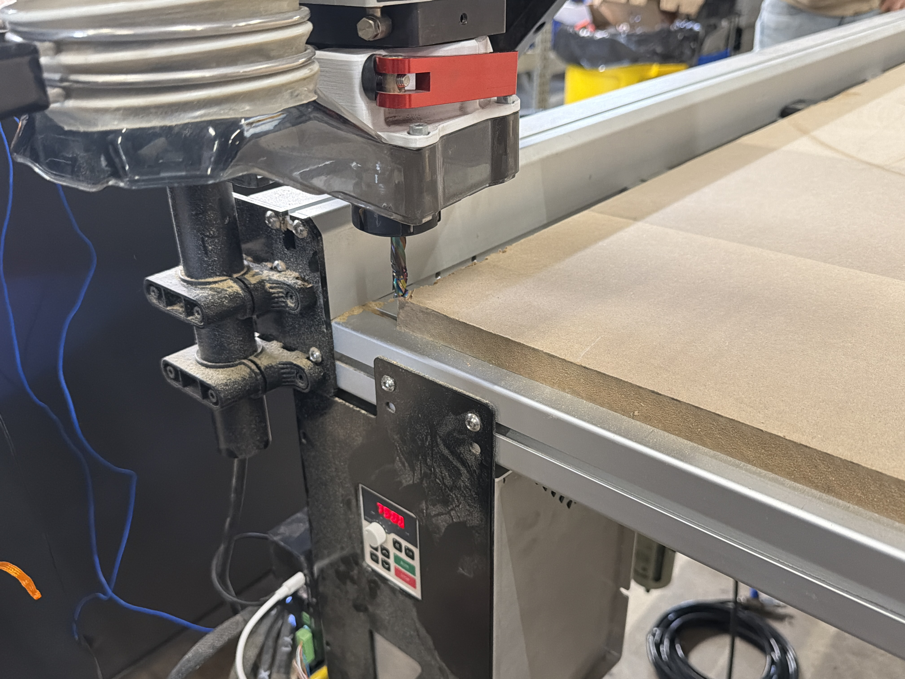{.aligncenter .size-medium}

    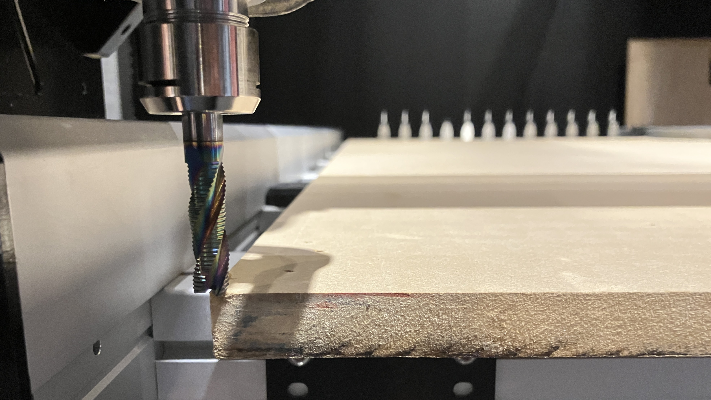{.aligncenter .size-medium}

1. Confirm tool clearance, work zero, stock security, and toolpath before running the program. Run the Full Size Grid and Mounts G-code. **Estimated cutting time: 1 hour 5 minutes.**

    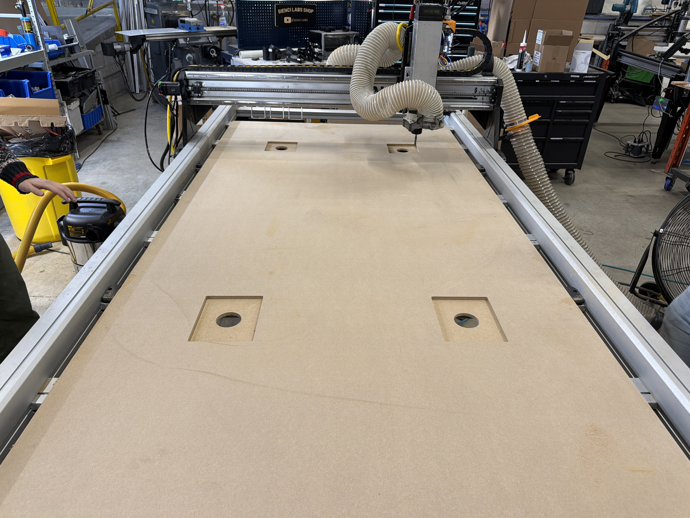{.aligncenter .size-medium}

    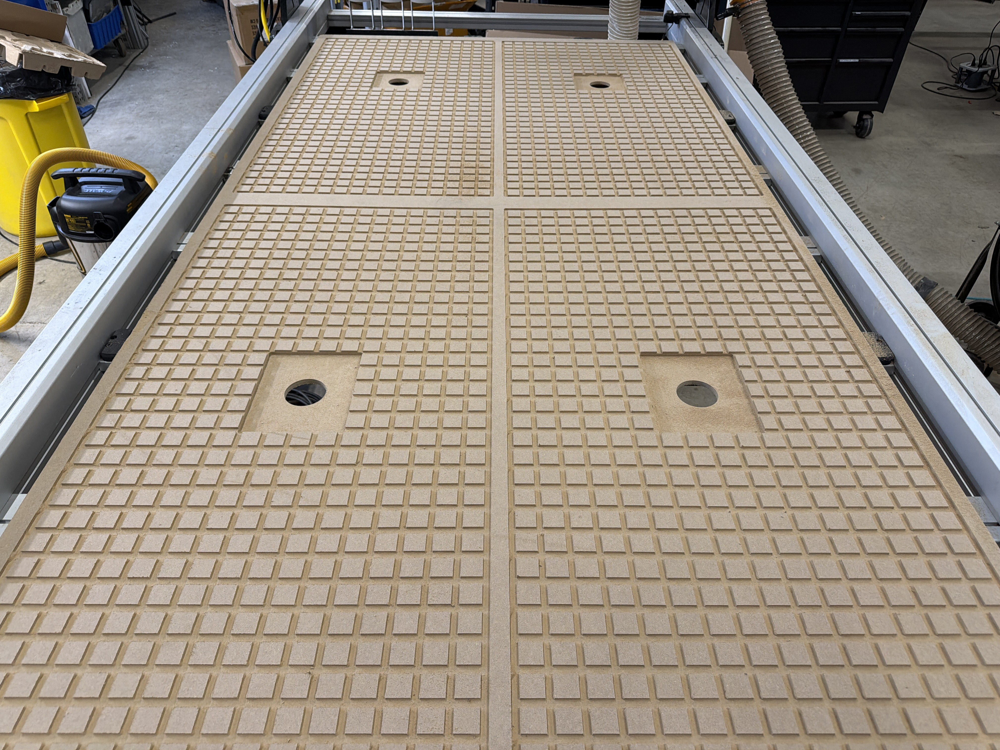{.aligncenter .size-medium}

    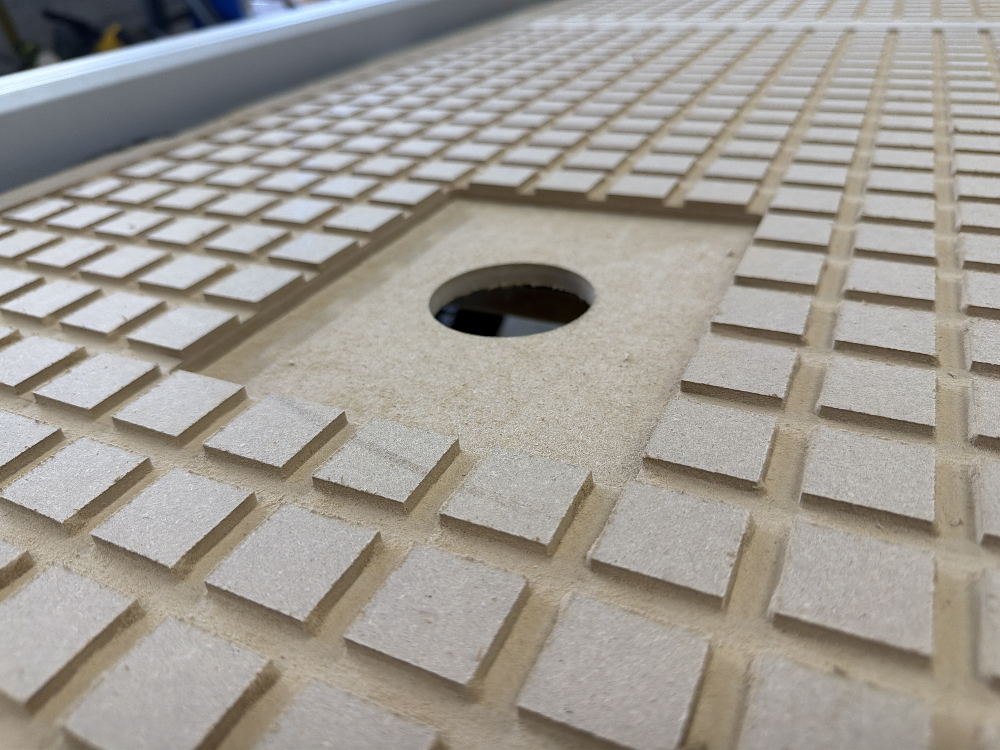{.aligncenter .size-medium}

### Remove the MDF and prepare the mounting hooks

1. Remove the screws from beneath the MDF and lift the board off the machine, keeping the positioning guides in place. We will be installing mounting brackets to a front position 1 and the back position 2 cross beams.

    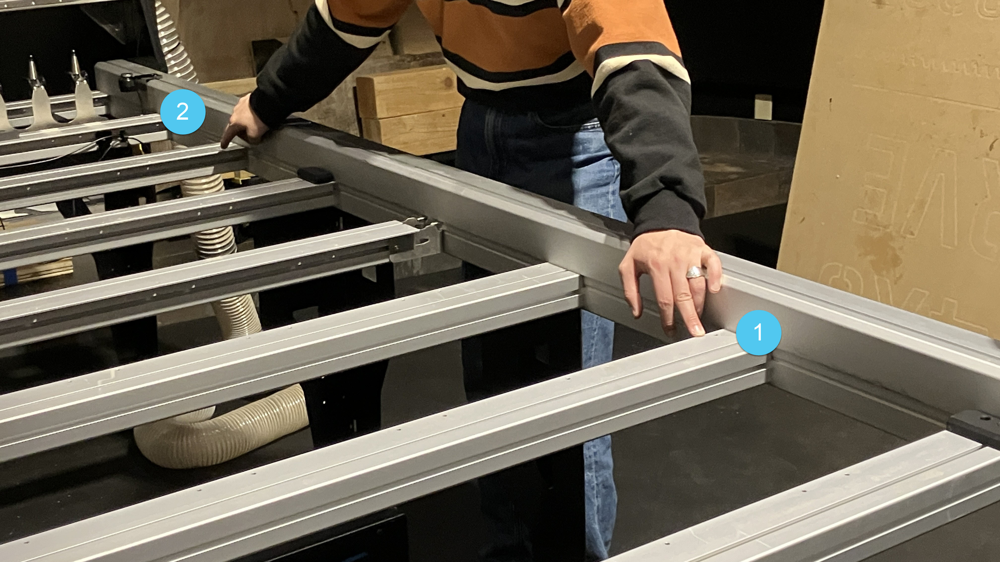

1. Feed the hose clamps through the slots in each mounting hook. Orient the clamp tightening screws **outward** so they will be accessible after installation.

    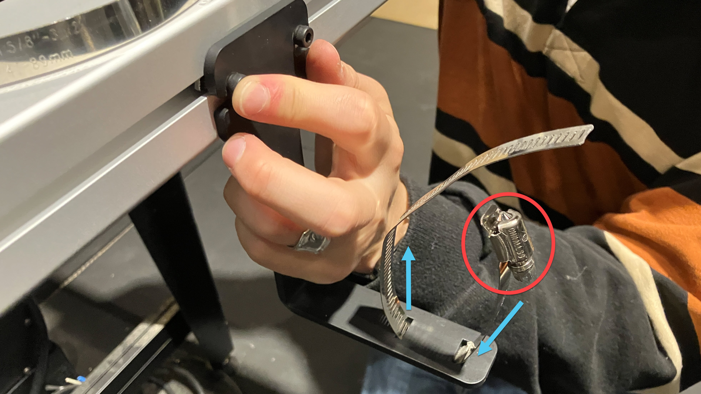{.aligncenter .size-medium}

1. Install the supplied screws and T-nuts into the mounting hooks. Do not fully tighten the hooks to the machine yet; they must still move for alignment.

    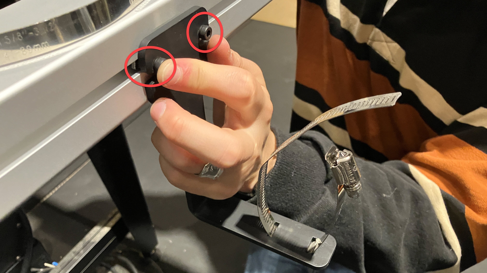{.aligncenter .size-medium}

### Install the front pipe assembly — Position 1

1. Attach **two mounting hooks** to the front and back side of the first crossbeam at **Position 1**. Leave their T-slot fasteners loose.

    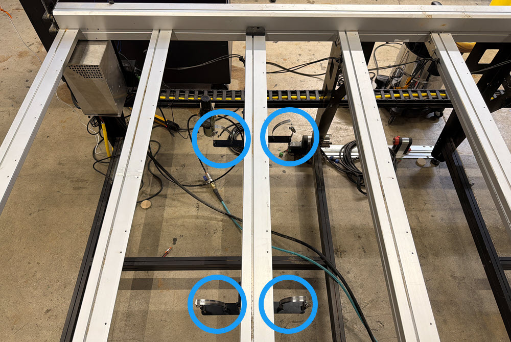{.aligncenter .size-medium}

1. Rest the **front pipe assembly** in their hose clamps. The **gate faces the right side of the machine**, and the **inlets point upward** toward the MDF pockets.
1. Position the clamps in the grooves **between the pipe fittings**. Adjust the pipe so it rests correctly inside all four hose clamps.

    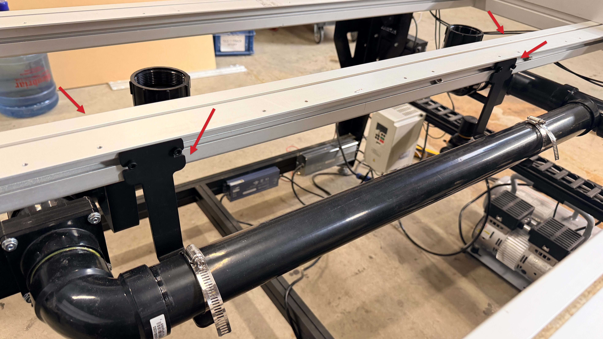{.aligncenter .size-medium}

1. Tighten the **hose clamps** slowly with the appropriate driver, but **leave the mounting hooks loose in their T-slots** so the pipe can still align with the pockets above.

    

### Install the rear pipe assembly — Position 2

1. At **Position 2**, attach **two mounting hooks on each side** of the crossbeam, for **four hooks total**. Leave the T-slot fasteners loose.

    

1. Place the **rear pipe assembly** in the hose clamps, again with the **gates toward the right** and the **inlets upward**.
1. Seat the designated mounting hook in the groove between the pipe fittings. Position the remaining hooks as shown in the approved assembly images.
1. Tighten the hose clamps, while leaving the mounting hooks loose for final alignment.

    

### Align and secure both pipe assemblies

1. Place the MDF grid board back against its positioning guides and refasten it in the same screw holes.
1. Move the front and rear pipe assemblies until the upward-facing inlets are **centred beneath the machined pockets**.
1. Using the provided tool, screw a **threaded clamping flange** into each pocket and its matching pipe connection.

    

1. Check that every flange sits **flush with or below the MDF surface**. If a flange protrudes or sits crooked, readjust the pipe assembly before proceeding.

    

1. Once everything is aligned, securely tighten **all eight mounting hooks** to the machine.
1. Gently push and pull on the gates to confirm that the pipe assemblies do not shift.

### Connect the front, rear, and central piping

1. Fit the **short hoses** onto the front and rear pipe assemblies and tighten their hose clamps.
1. Connect the **central pipe assembly** between the front and rear assemblies and the fitting on top of the vacuum filter.

    

1. Check that the central pipe and hose connections are routed without undue strain, then tighten the remaining hose clamps.

    

### Cut the MDF vacuum grid

1. Confirm that the MDF grid board is firmly fastened to the machine.
1. **Remove all threaded clamping flanges** so the cutting tool cannot strike them.
1. Change to the specified **3/8-inch upcut flat end mill** and load the correct **grid-cutting G-code** for the standard or joinery machine configuration.
1. **Do not change the X/Y work zero** established for the locating pockets. Because the cutting tool has changed, verify the Z reference / tool length for the new bit according to the approved program and machine setup before running the grid.
1. Check the toolpath, clamps, travel clearance, and cut depth, then run the grid program. **Estimated cutting time: 2.5 hours.**
1. When the cutting is complete and the machine is stopped, reinstall the threaded clamping flanges. Check again that they sit flush with or below the MDF surface.

<!-- IMAGE NEEDED — Finished grid board showing pattern and inlet flanges. This image is not present in the Resources tab's 24 assembly pictures. Suggested filename: images/addons_vactable-grid-finished.jpg -->

## Final inspection

- [ ] Pump and filter are accessible beneath the right side of the machine.
- [ ] All eight mounting hooks and all hose clamps are securely tightened.
- [ ] Front and rear pipe inlets align with the MDF pockets.
- [ ] All clamping flanges are installed and sit flush or below the board surface.
- [ ] MDF is fastened securely, and the grid has been cut without damaging piping or hardware.
- [ ] Power supply and pump installation have been checked against the product rating and local electrical requirements.

Before using vacuum hold-down for cutting, follow the separate **Vacuum Table Usage Guide** for gate selection, material preparation, proper use of primary/secondary pump switches, hold-down verification, and maintenance. **Never operate the secondary pump switch on its own.**

