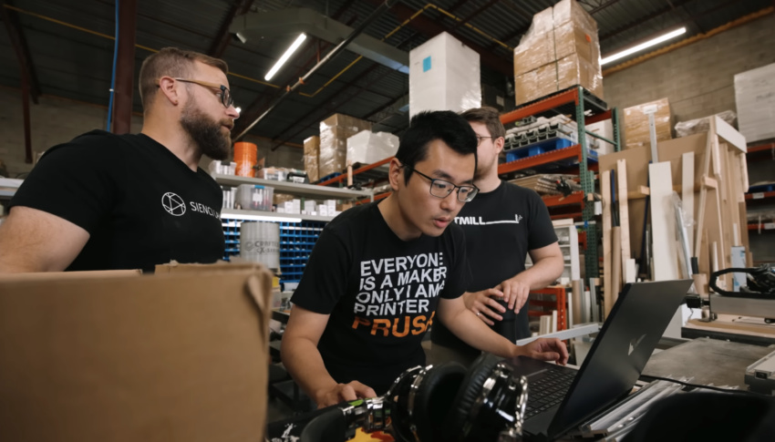
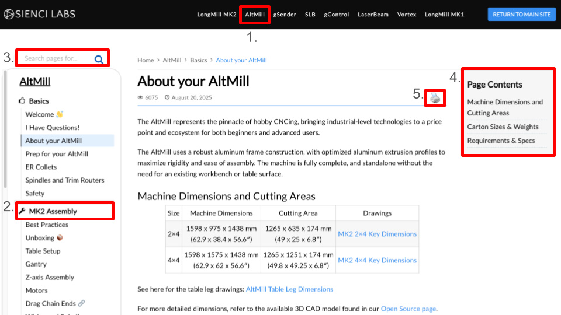
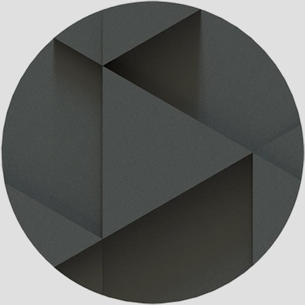
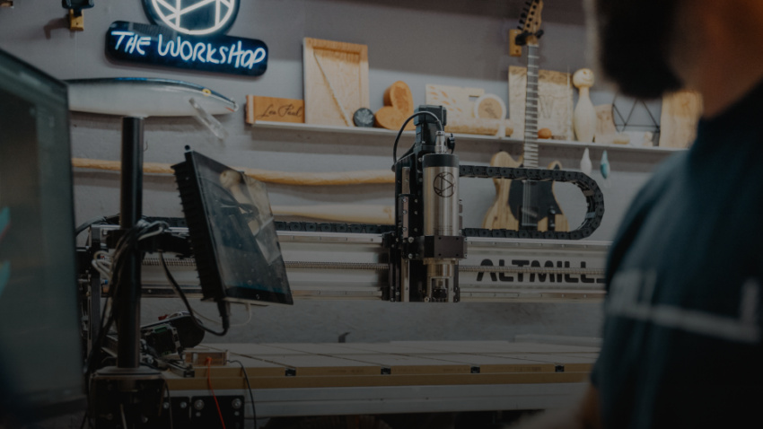

Welcome to your AltMill resources!

These resources are designed to help you understand your AltMill CNC machine, so you can get started seamlessly. We update these pages regularly to provide you with the most up-to-date information about your machine.

### What to Expect

For complete beginners, the AltMill requires a steep learning curve, due to its use of sensors, closed loop steppers, and a spindle, which add additional complexity to the CNC-ing workflow. That's why we typically recommend beginners to start familiarizing themselves with [fundamental CNC concepts](https://resources.sienci.com/view/cnc-welcome/) before their first cut on the machine. We have written an [entire knowledge base of articles](https://resources.sienci.com/view/cnc-welcome/) to prepare you for this new CNC journey.

When you first start out, you will **most likely encounter issues**, whether that be [alarms showing up](https://resources.sienci.com/view/am-troubleshooting-homing-and-machine-limits/#alarm-10-during-homing), or the [spindle not spinning](https://resources.sienci.com/view/am-troubleshooting-spindle/). Just know that understanding and learning CNC is a continuous process, and that it will take some time to understand its quirks and what is normal machine behaviour.

### New to CNCs?

If this is your first CNC, be sure to review these guiding resources — **skipping them may limit your success and make your experience more difficult**. Be sure to watch the video and to read the articles; they work hand-in-hand.

- Software Basics - [Video Link](https://youtu.be/m6ymuF8soTU?si=pcY3RppdkjI7313h), [Article Link](https://resources.sienci.com/view/am-software-explained/)
- First Movements with your AltMill - [Video Link](https://youtu.be/w9mRrniH6S8?si=e715sXzqgxDSTGgs), [Article Link](https://resources.sienci.com/view/am-mk2-first-movements/)
- Machine Coordinates and Setting Zero - [Article Link](https://resources.sienci.com/view/cnc-machine-coordinates/)
- Surfacing your AltMill 🟫 - [Video Link](https://youtu.be/w9mRrniH6S8?si=p8ifO1Z10ua5skNB&t=738), [Article Link](https://resources.sienci.com/view/am-mk2-wasteboard/)
- Using the AutoZero Touchplate - [Video Link](https://youtu.be/I1EhAPNXdzQ?si=y3puAipQ_AdHTpVM), [Article Link](https://resources.sienci.com/view/am-autozero-touch-plate/)
- Common Alarms and Errors (you will get these) - [Article Link](https://resources.sienci.com/view/am-troubleshooting-homing-and-machine-limits/)

Key things to understand about using a CNC.

1. There are a hundred different ways to get to the end goal for a project. Don't be afraid to try different techniques. Follow along with your favourite content creator for inspiration.
1. When assembling your machine, there will always be slight adjustments to components during the final setup.

### Quick Links

We have compiled these helpful pages for you to refer to, please bookmark them for easy reference. It’s likely that the information you need can be found there.

- Find the [packing list](https://resources.sienci.com/view/am-mk2-unboxing/) and check for missing parts 📋
- Start [assembling](https://resources.sienci.com/view/am-mk2-best-practices/) your machine 🛠
- Complete your [first carve](https://resources.sienci.com/view/am-mk2-final-checks/) 🥇
- Look for [solutions](https://resources.sienci.com/view/am-troubleshooting-machine-control/) when things go wrong 🤔

{.aligncenter .size-medium}

### Navigation

If you’re not in a rush, take a moment to understand how to navigate through your online manual, so you can easily find the information you need in the future:

1. Our resources are divided by product/software, feel free to explore these pages for more detailed specifications and how-tos. Right now you are on the AltMill resources.
1. Our AltMill resources are divided into sections like chapters in a book. Scroll through and click on the articles you want to read, these will always be available on the left side of the screen.
1. Search for key words using the search bar, which can help you find the relevant pages.
1. Use the ‘Page Contents’ to quickly go to a section within an article. On smaller screens this will appear at the top rather than the right side.
1. Any page can be saved or ‘printed’ if you’d like to reference them offline.

{.aligncenter .size-medium}

### Community

If you’d like to converse and learn from others, please check out either our Forum or Facebook communities. Remember to encourage and help others as you receive so that we can continue to support positive learning.

| Community Forum | Facebook Group |
|:---:|:---:|
| [{.aligncenter .size-medium}](https://forum.sienci.com/) | [{.aligncenter .size-medium}](https://www.facebook.com/groups/mill.one/) |

We wish you the best on your CNC journey!

{.aligncenter .size-medium}
