

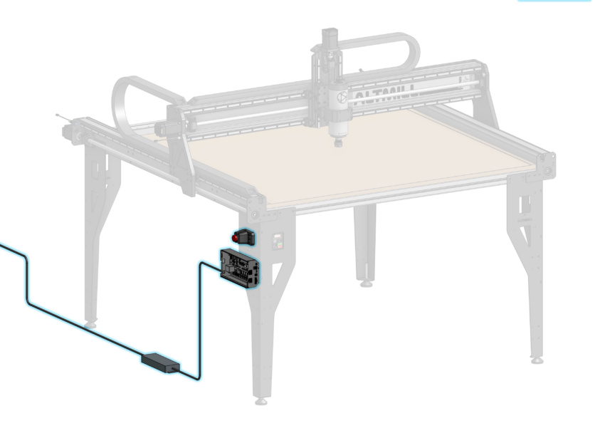{.aligncenter .size-medium}

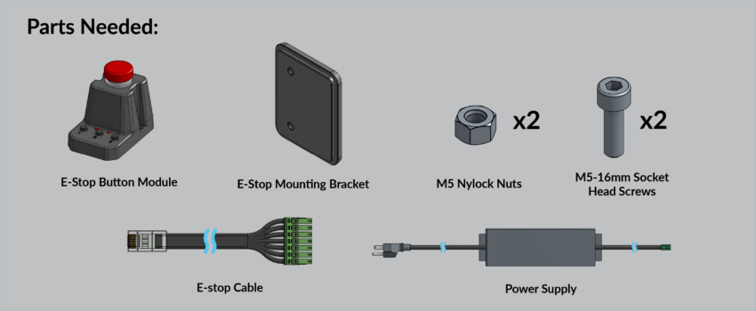{.aligncenter .size-medium}

If you already mounted the E-stop during the enclosed-VFD installation, leave it installed and continue with removing the controller’s acrylic face plate below. Use the mounting instructions here only if the E-stop is not yet installed.

The E-stop is located in the SLB-EXT box.

Fasten the E-stop to the VFD Mounting Bracket on the side of the left table leg, using two (2) M5-16mm socket head screws.

**If** you did not purchase the Spindle Kit, you will use the E-stop mounting plate provided in the SLB-EXT box to fasten the E-stop to the side of the left table leg. The E-stop Mounting plate is inserted into the left pocket from the inside of the Table Leg with the two holes oriented toward the back of the machine.

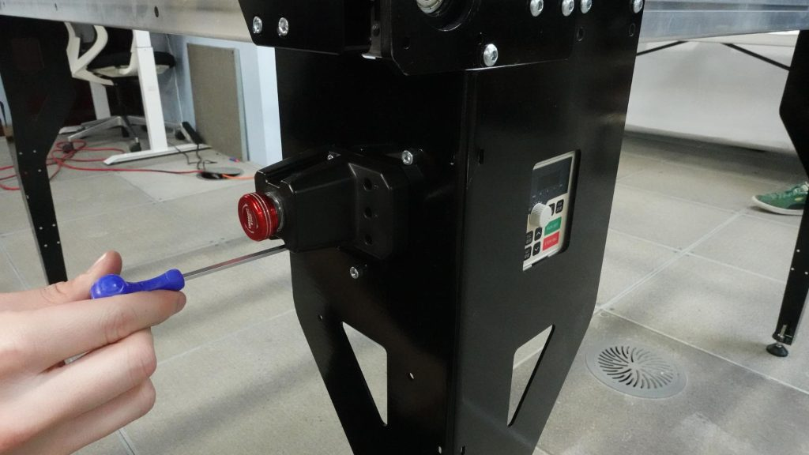{.aligncenter .size-large}

<em>Fastening E-stop into E-stop mounting bracket 
</em>

Insert M5 nylock nuts into the E-stop mounting plate. Use two M5-16mm socket head screws to fasten the E-stop to the mounting plate.

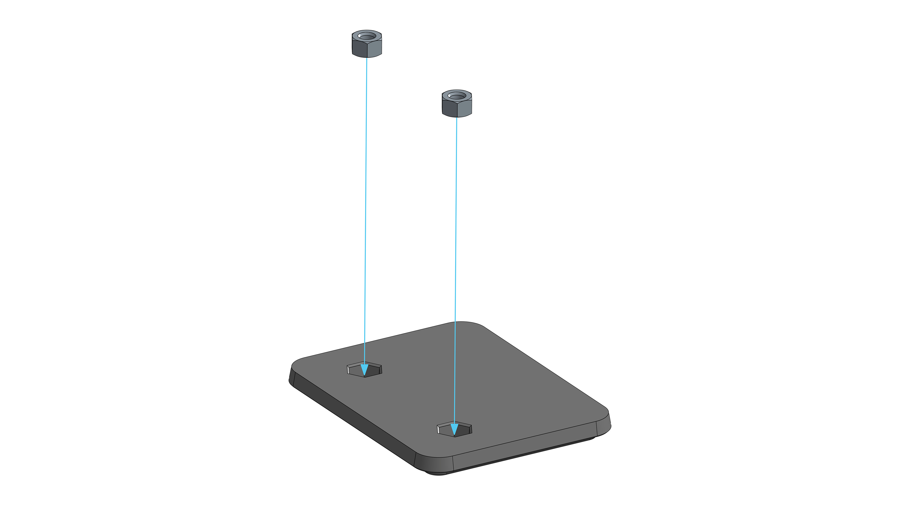{.alignnone}

<i>Nylock nuts into E-stop mounting plate</i>

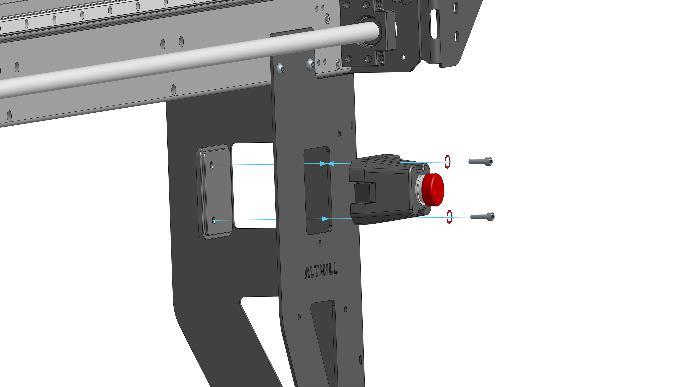{.alignnone .size-full}

<i>E-stop installed on left side table leg</i>

Loosen the thumb screw on the front of the SLB-EXT enclosure and remove the acrylic face plate.

<!-- Q-CONTROLLER-01: Sequence is grounded in the published SLB-EXT port maps (right-to-left X, Y1, Y2, Z). Confirm the target board revision and the proposed right-to-left POWER-port assignment before publication. No SLB-EXT V2/HV change is assumed; the source PDF’s Y3 was corrected to Z. -->

Connect one complete motor harness at a time, beginning with X, then Y1, Y2 and Z. Identify each harness by its axis label. On the SLB-EXT illustrated below, the motor-control and sensor pairs run from right to left in that order; follow the printed port labels when making each connection.

Route the X and Z harnesses through the top cutout on the right side of the enclosure. Route the Y1 and Y2 harnesses through the bottom cutout on that side.

1. **X:** Plug the green two-pronged motor-power connector into an available port in the MOTOR POWER bank, then plug the black motor-control connector into X and the white sensor connector into X LIM.
2. **Y1:** Connect the green motor-power plug to the next available MOTOR POWER port, the black motor-control plug to Y1, and the white sensor plug to Y1 LIM.
3. **Y2:** Connect the green motor-power plug to the next available MOTOR POWER port, the black motor-control plug to Y2, and the white sensor plug to Y2 LIM.
4. **Z:** Connect the green motor-power plug to the remaining MOTOR POWER port, the black motor-control plug to Z, and the white sensor plug to Z LIM.

The four motor-power ports supply the same output. The motor-control and sensor ports are axis-specific: match the printed axis labels and connector shapes as well as the colours.

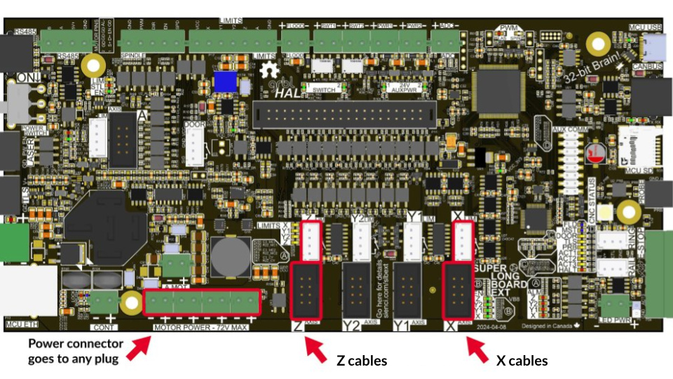{.alignnone .size-full}

<em>SLB-EXT port reference: X and Z signal ports and the motor-power bank</em>

**For Y1 and Y2, do not mix the motor-control connector from one harness with the sensor connector from the other.** Keep each harness connected to its matching Y1 or Y2 port pair. Incorrect pairing can cause an alarm during operation.

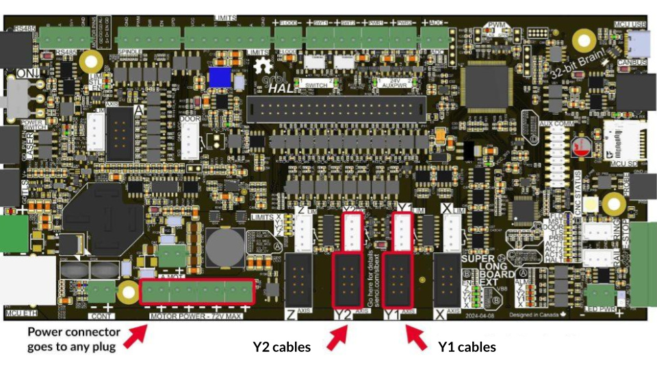{.alignnone .size-full}

<em>SLB-EXT port reference: keep each Y motor-control and sensor pair together</em>

<!-- R08-R10: Refresh controller artwork for the confirmed board revision: labelled port overview, complete X harness, and completed four-harness wiring. Existing port references are retained; this final image still uses the older power-cable layout. -->

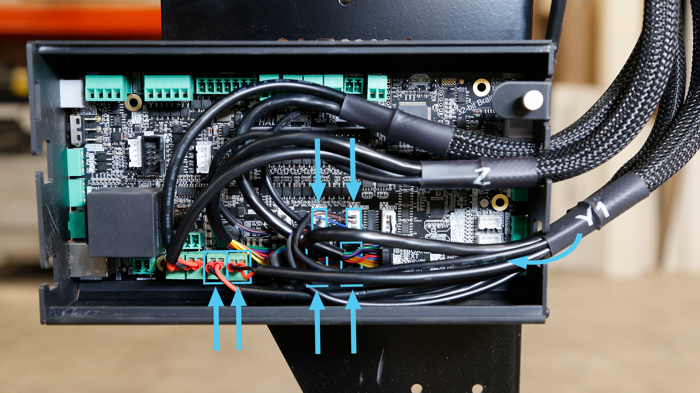{.alignnone .size-full}

<em>Completed controller wiring</em>

Reinstall the acrylic face plate of the SLB-EXT onto the enclosure. Tighten the thumb screw by hand.

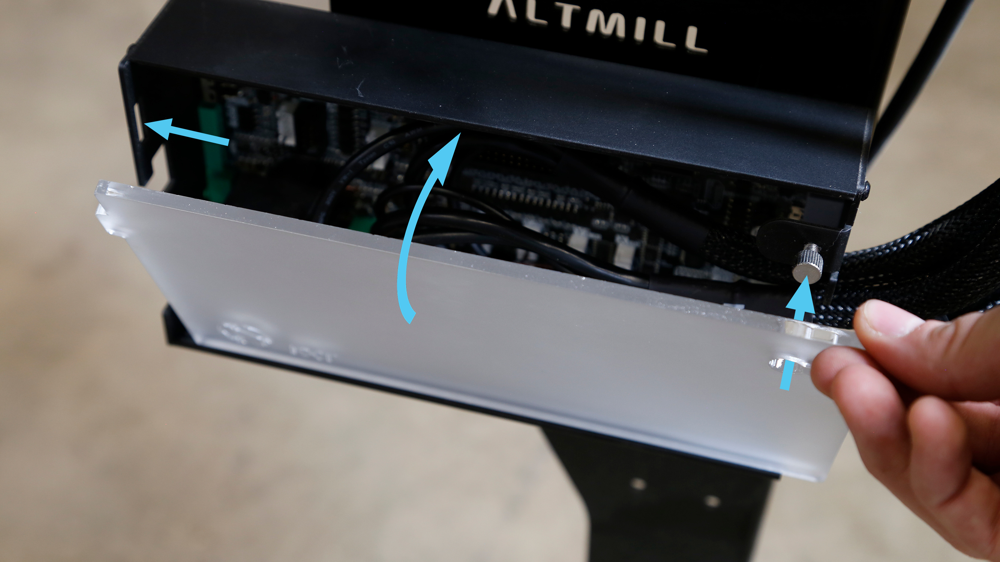{.alignnone .size-full}

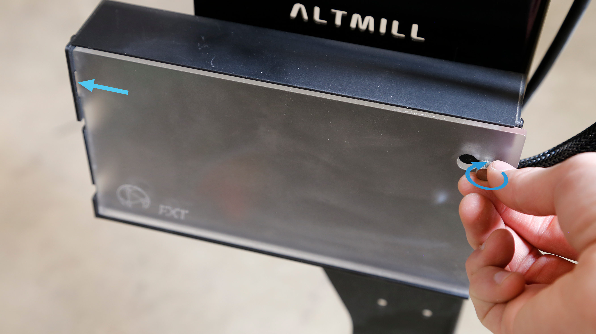{.alignnone .size-full}

<em>Reinstalling acrylic cover</em>

Plug the green connector of the E-stop cable into the port labeled E-stop on the right side of the controller, and the other side of the cable into the E-stop.

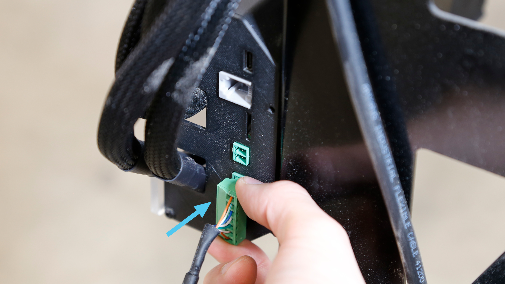{.alignnone .size-full}

<em>Green connector plugged into controller</em>

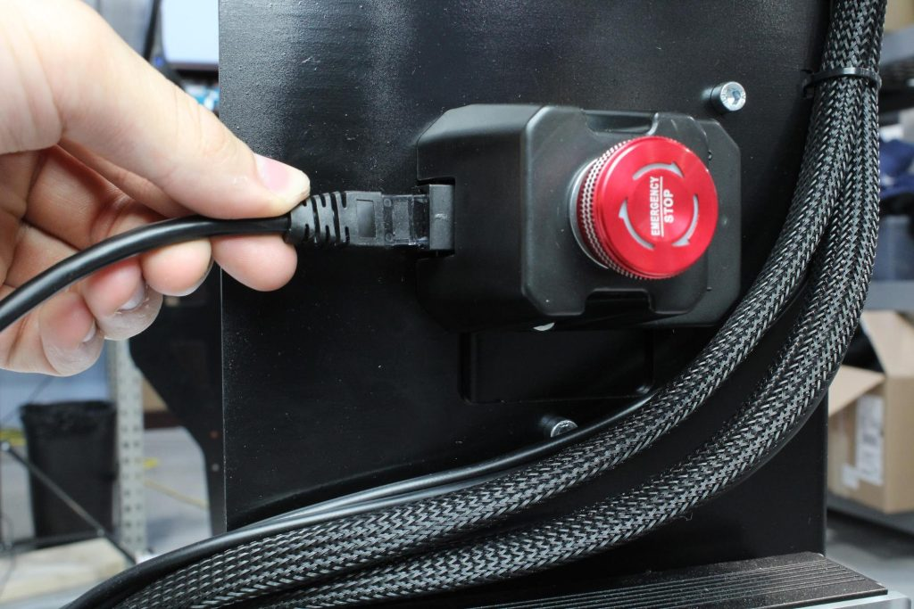{.aligncenter .size-large}

<em>Jack connector plugged into E-stop</em>

**If** you have installed the Sienci Labs Spindle Kit, plug the clear connector of the spindle control cable that is attached to the VFD unit, and plug this into the port labelled **‘RS485’** on the left side of the controller.

**If** you’re installing your own spindle, you may need to connect your own spindle control cable as explained [here](https://resources.sienci.com/view/slb-manual/#spindlers485).

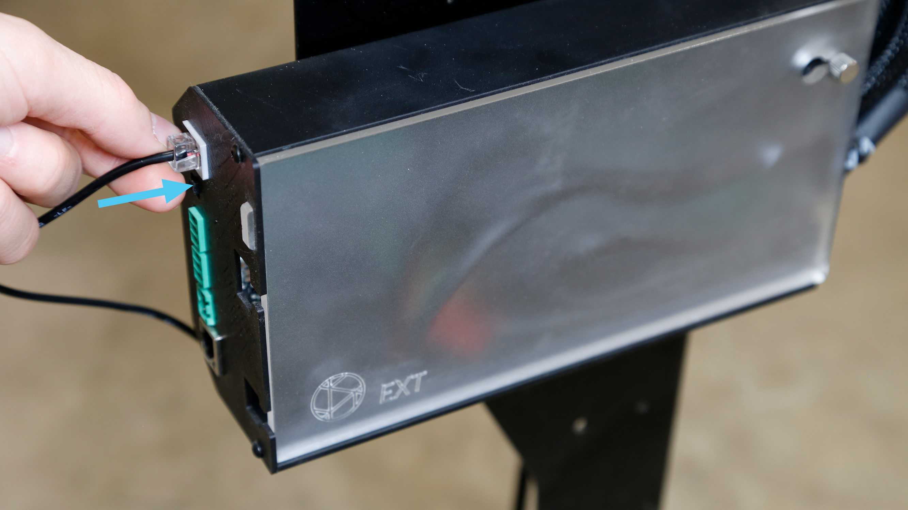{.alignnone .size-full .aligncenter}

<em>Plugging spindle control connector into RS485 port</em>

Plug the green connector of the 48V power supply into the port labelled **Power**.

Plug the power supply into a 110V outlet.

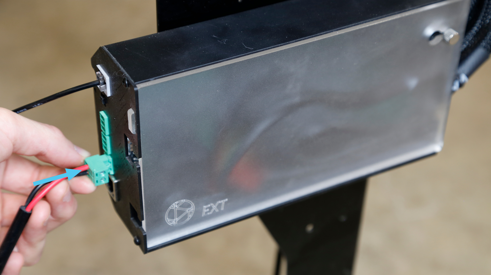{.alignnone .size-full}

<em>Power supply connector into SLB-EXT</em>

The machine is now put together and you can move onto your first movements. Congratulations!
