Drag chains and drag chain ends are packed inside the X-rail. Ensure to remove the drag chains first.

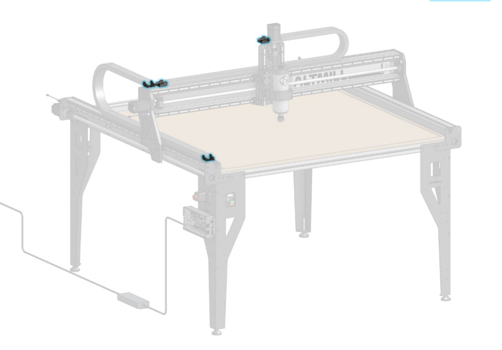

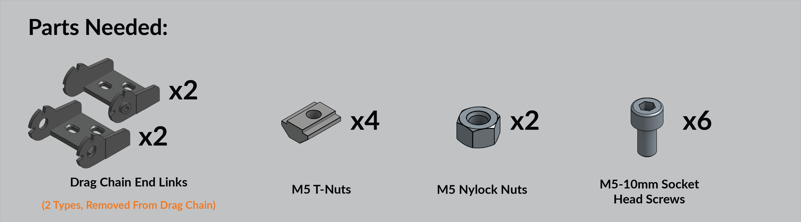

Remove the four (4) drag chain end links from the drag chains.

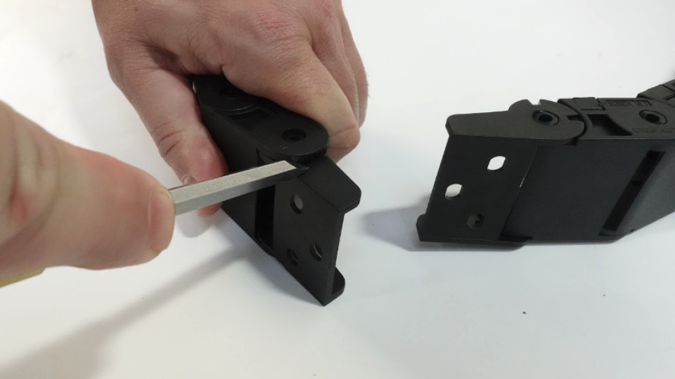

<i>Removing end link with flathead screwdriver</i>

See the image below for locations of drag chain end links, to be attached on the machine.

**Note:** You will notice one drag chain end link has a flange with holes and the other link has a flange with knobs. It is important you use one of each type for each axis’s drag chain.

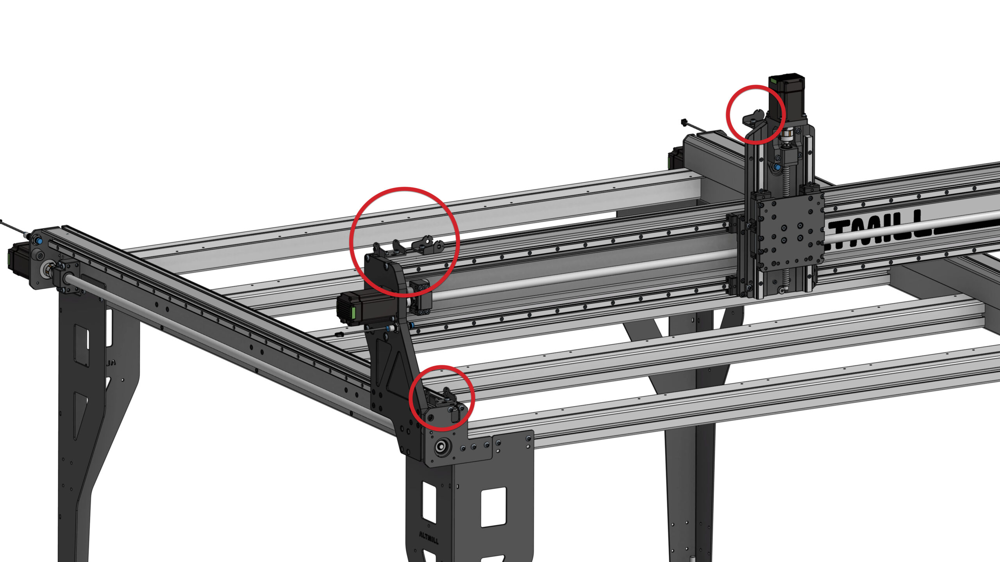

<i>General location of drag chain ends on the AltMill</i>

Insert three (3) M5 T-nuts into the T-slot on the left side of the X-axis rail via the opening in the Y-axis gantry plate.

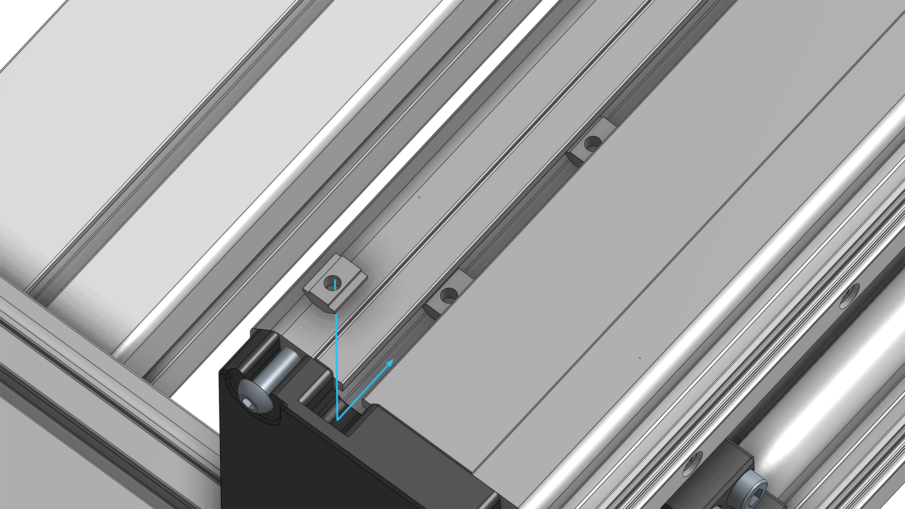

<i>T-nuts in X-axis extrusion</i>

Install two (2) drag chain end links using three (3) M5-10mm socket head screws and the three (3) M5 T-nuts pre-installed. Do not overtighten – these ones do not sit completely flat and may break if there is too much tension.

The X-axis drag chain end link will utilize one (1) T-nut located furthest along the length of the X-axis rail.  Insert the screw into the left side slot in the drag chain end link, so the link fits into the shallow recessed valley on the top of the rail.

The Y-axis drag chain end link will utilize the two (2) T-nuts located nearest to the edge of the X-axis rail. Refer to the below image to note the orientation of each drag chain end link.

In the illustration below, the end link facing toward the upper left must have tabs/studs rather than holes. Keep one studded end and one holed end for each drag chain.

<!-- R07: Replace this original illustration before publication: the end facing upper left must show tabs/studs, not holes. Check the overview and downstream routing images against the corrected hardware. -->

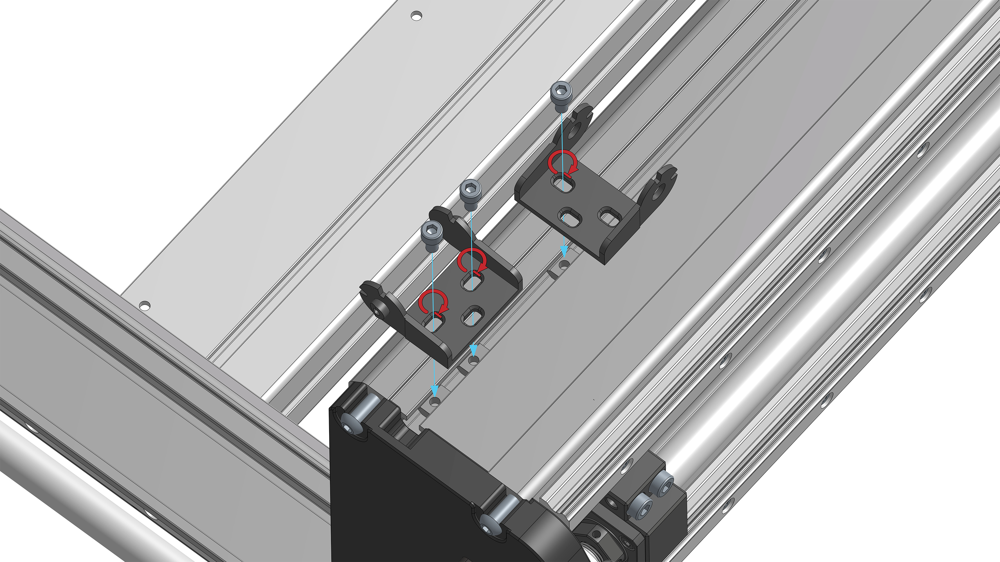

<i>Orientation of drag chain ends links on X-axis rail</i>

Insert one (1) M5 T-nut into the front of the left Y-axis rail T-slot.

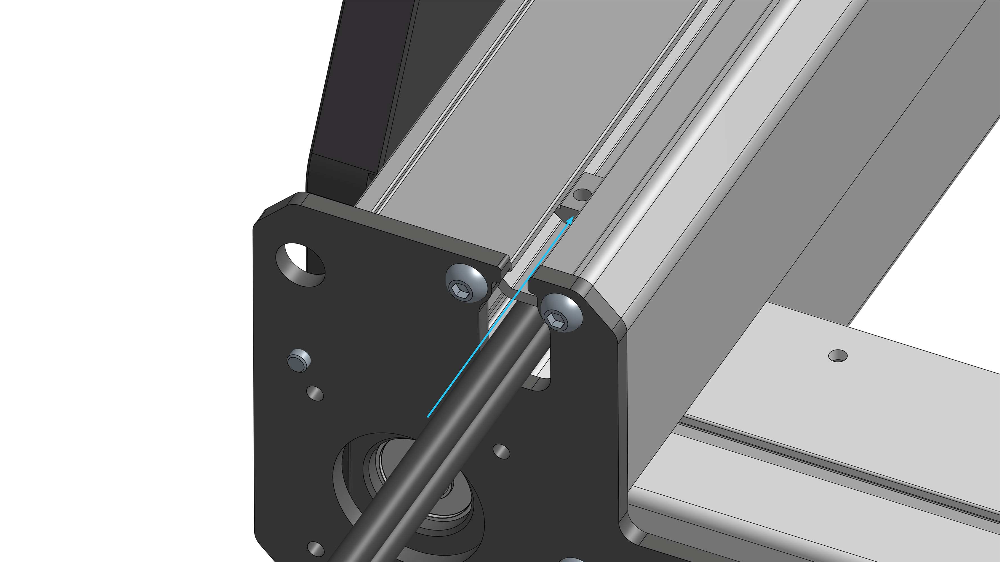

<i>T-nut in left Y-axis rail</i>

Install one (1) Drag chain end link at the front of the Y-axis rail using one (1) M5-10mm socket head screw and the one (1) pre-installed T-nut. Insert the screw into the right side slot in the drag chain end link so the link fits into the shallow recessed valley on the top of the rail.

**Note:** Remember that each axis will have a pair of drag chain end links, one with holes and the other with knobs in the flanges.

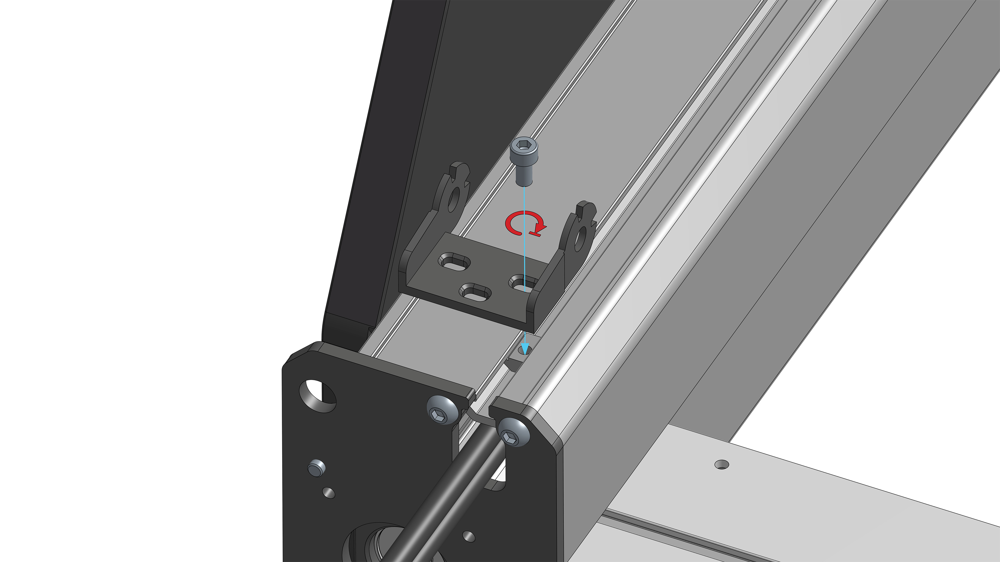

<i>Securely fastening drag chain end on left Y rail</i>

Install a drag chain end link on the Z-axis drag chain bracket, using two M5-10mm socket head screws and M5 nylock nuts. Orient the link such that the two flanges are pointed toward the right side of the machine.

**Note:** Remember that each axis will have a pair of drag chain end links, one with holes and the other with knobs in the flanges.

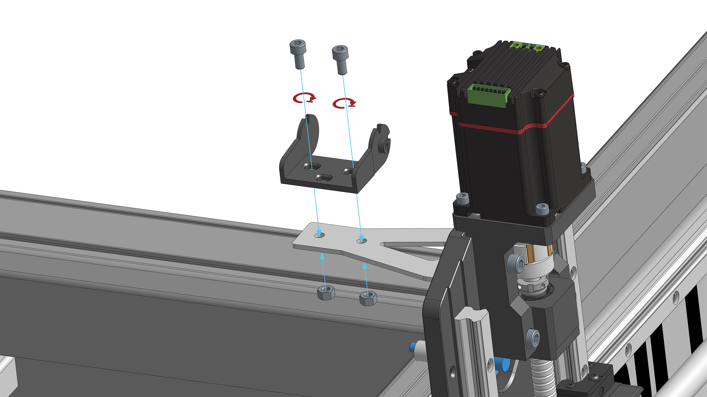

<i>Securely installing drag chain end on bracket at the Z-axis</i>

For the 4×4 AltMil the length of the Drag Chains are both **51 links** long, for both the Y-axis and X-axis.

For the 2×4 AltMill, the length of the Drag Chains are **36 links** long for the Y-axis and **51 links** long for the X-axis.

Using a small flat head screwdriver, unclip the top retaining clips of the drag chain to allow the wire harnesses to be installed into the drag chain.

Leave the prepared drag chains to the side at this point as they will be used later on.

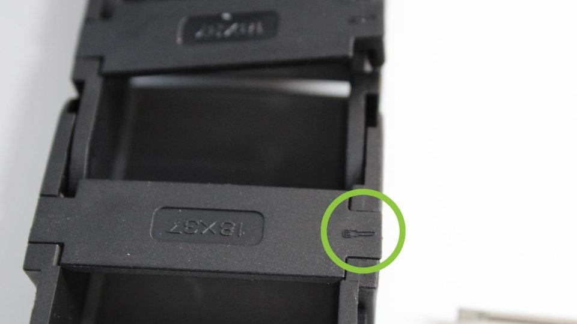

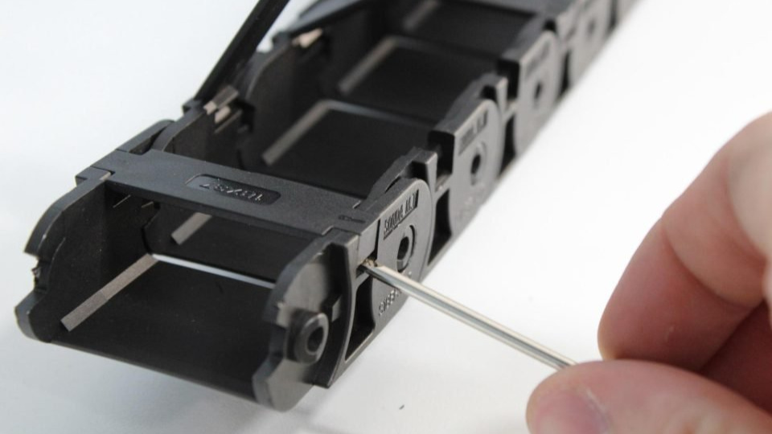

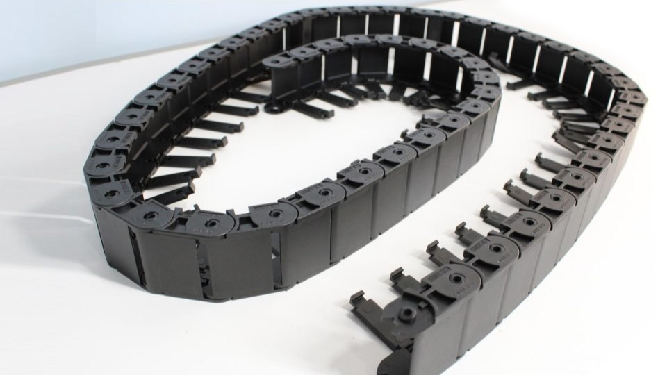

<em>Opening drag chain clips, please use the side circled in green to open</em>

