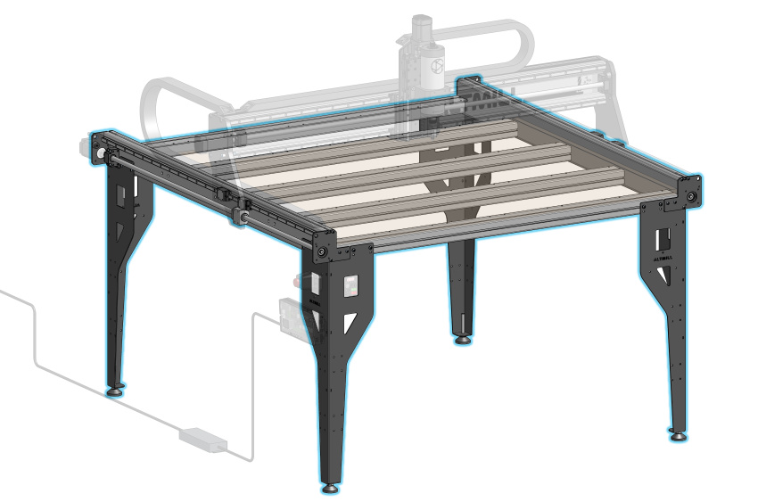
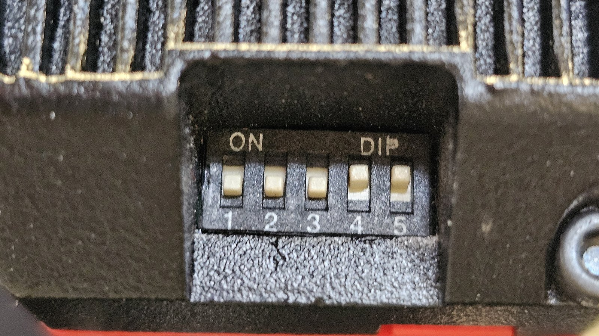
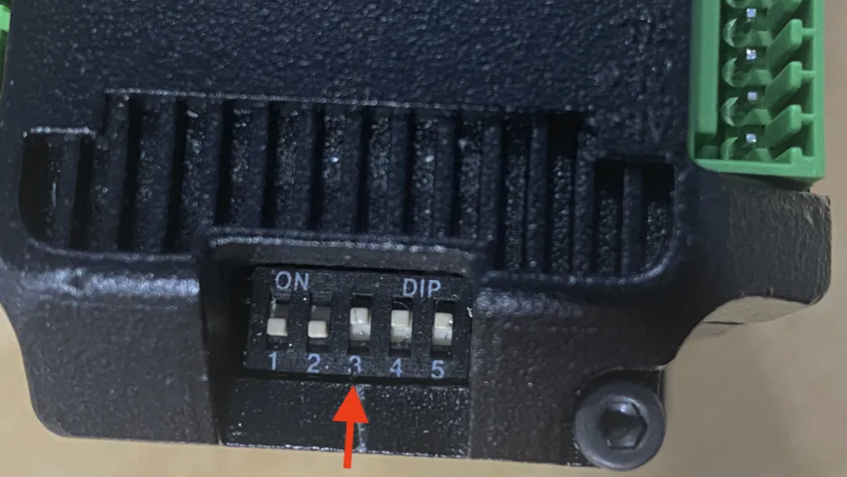
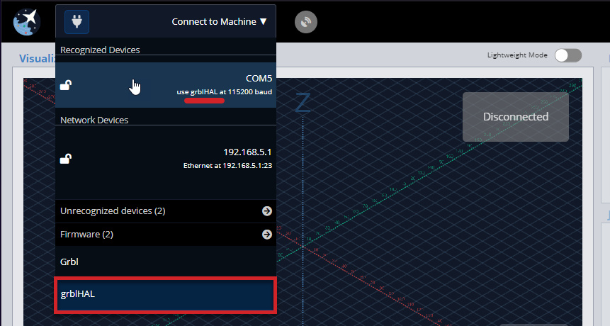
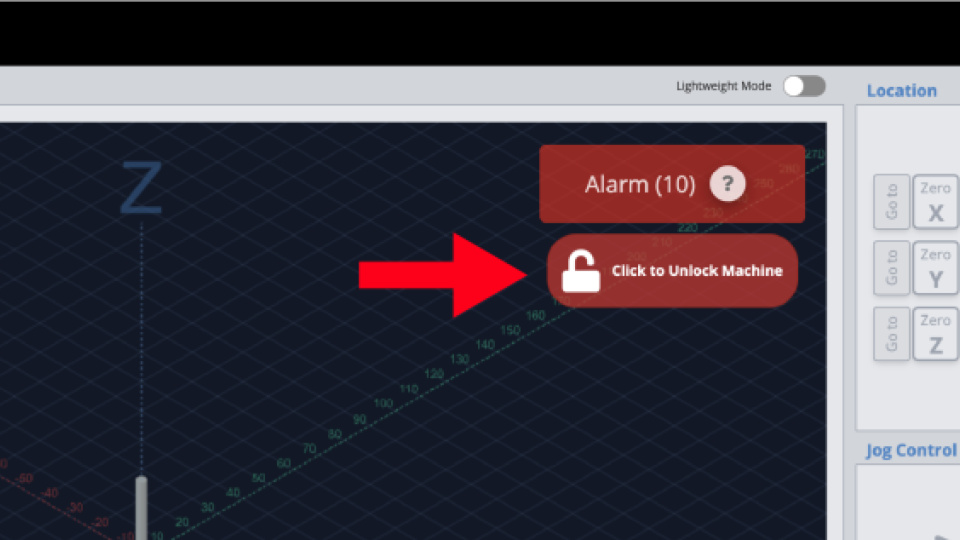
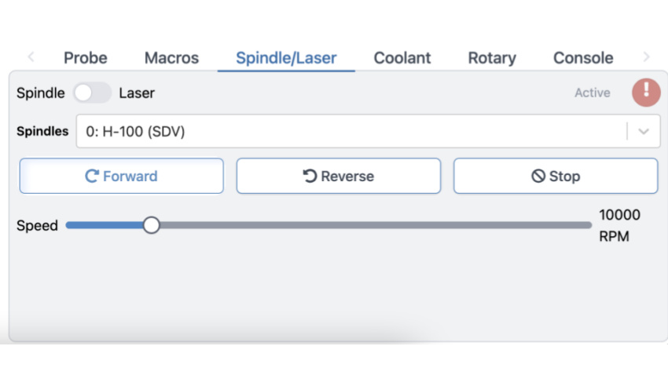
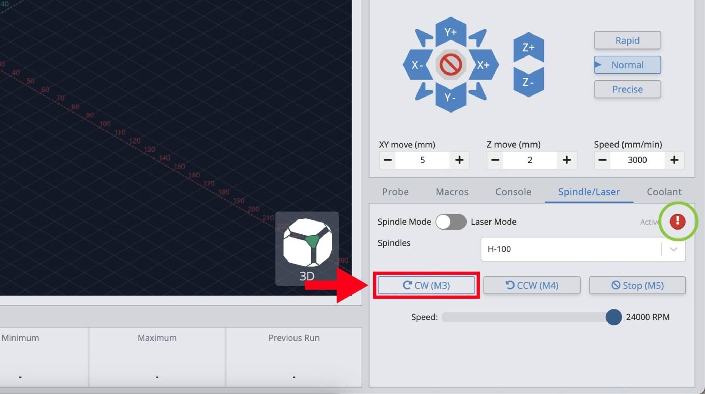
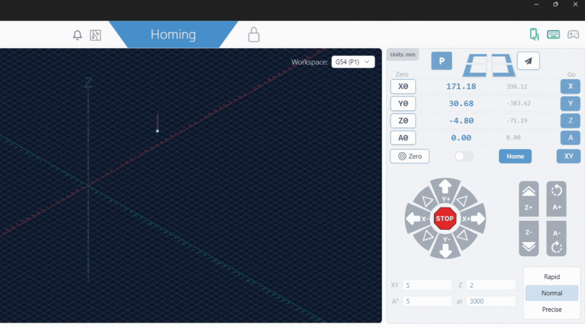
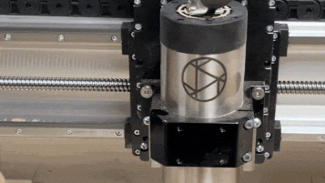

We’re sure you’re itching to start cutting! Before you begin making chips fly, we recommend going through these final checks to ensure you are set up for success.

### Mechanical

- All screws in the [table frame](https://resources.sienci.com/view/am-mk2-table-setup/) have been tightened
  - End plates with T-nuts
  - End plates to Y rails
  - Crossbeams to Y rails
  - Levelling feet
  - Legs to frame

{.aligncenter}

<em>Table assembly</em>

- All [couplers](https://resources.sienci.com/view/am-mk2-motors/) are secure on both the motor-shaft and ball-screw sides. For factory-fitted couplers, this is an inspection check, not an instruction to remove or refit them. Confirm the rear end plates are secured after the motor-installation sequence is complete.

### Electrical

- Motor DIP switch positions are correct for each axis

{.aligncenter}

<em>X and Y-axis motor, from 1-5: OFF, OFF, OFF, ON, ON</em>

{.aligncenter}

<em>Z-axis motor, from 1-5: OFF, OFF, ON, ON, ON</em>

- Motor cable wires are not frayed or detached from connectors
  - If they are simply detached, you can use a small screwdriver to press each orange spring terminal release to insert the wire back in
- Inductive sensors are functional
  - Check by putting a metal object near the blue sensor face and see if a small red light triggers on the back
<!-- Q-POWER-01: Confirm approved kit-specific electrical requirements; a universal 15A spindle-circuit claim is not retained. -->- The spindle VFD is connected to a separate circuit from the SLB-EXT controller, with the voltage and current capacity required by the specific spindle/VFD kit.

### Software

- You are using [gSender version 1.4.12 or newer](https://sienci.com/gSender/)
- grblHAL is selected upon [startup and connection to machine](https://resources.sienci.com/view/am-mk2-first-movements/) (for gSender 1.4.12 and lower)

{.size-full .aligncenter}

- Alarm 10 can be cleared after pressing and releasing the E-stop button
  - If E-stop is unresponsive, check the connections: unplug the E-stop cable, then use a screwdriver to remove the 3 screws at the bottom of the unit

{.aligncenter}

- Machine can move in the X, Y and Z directions smoothly using the jog control buttons
- Spindle can [spin up](https://resources.sienci.com/view/am-mk2-spindle-kit-setup/) to speed, without alarms or errors, using the CW or Forward button

{.size-medium .aligncenter}

<em>gSender 1.5.10 and above</em>

{.aligncenter}

<em>gSender 1.4.12 and lower</em>

- Machine is able to successfully home without alarms or errors
  - Jog the machine **away** from the X, Y and Z sensors
  - Then press “Home”
  - If you encounter alarms or errors see this [troubleshooting page](https://resources.sienci.com/view/am-troubleshooting-homing-and-machine-limits/)

{.alignnone}

{.alignnone}

<em>Default homing at back left corner on AltMill</em>

If you have gone through the checks above, then you are ready to start cutting!

### **What’s next?**

You can use this [pre-flight checklist](https://resources.sienci.com/view/am-cnc-preflight-checklist/) to prepare for each job you do.

Then, follow along this video as Ben goes through the steps to successfully carve a simple, first project.

<iframe allow="accelerometer; autoplay; clipboard-write; encrypted-media; gyroscope; picture-in-picture; web-share" allowfullscreen="" frameborder="0" height="675" loading="lazy" referrerpolicy="strict-origin-when-cross-origin" src="https://www.youtube.com/embed/xbVuRSMwJcI?feature=oembed&amp;enablejsapi=1&amp;origin=https://resources.sienci.com" title="How to Make Your First Carve on the AltMill CNC | AltMill Beginner Series" width="1200"></iframe>

- Learn how to [maintain your AltMill](https://resources.sienci.com/view/am-maintenance/)
- Understand how to [use and maintain your spindle](https://resources.sienci.com/view/spindlevfd-quickstart/)
