We’re now ready to power on the machine for the first time!

### Controller Power and USB Connection

Toggle the small black switch on the rear of the controller downwards to the ON position, and you should see lights come on at the controller. Then press the E-stop button, and rotate the button clockwise. This is the complete process to turn on the machine.

The SLB-EXT controller uses a latching emergency stop switching circuit. This is a safety feature to ensure that if the controller loses power, the machine will not automatically be on when power is restored. To enable power afterwards, simply press the E-stop button, then rotate the button clockwise.

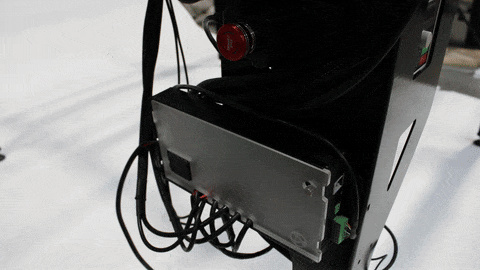

<em>Power on procedure</em>

Connect to the machine by plugging in the USB-C cable to the controller, on the side facing the front of the machine. Then connect the other end to your computer.

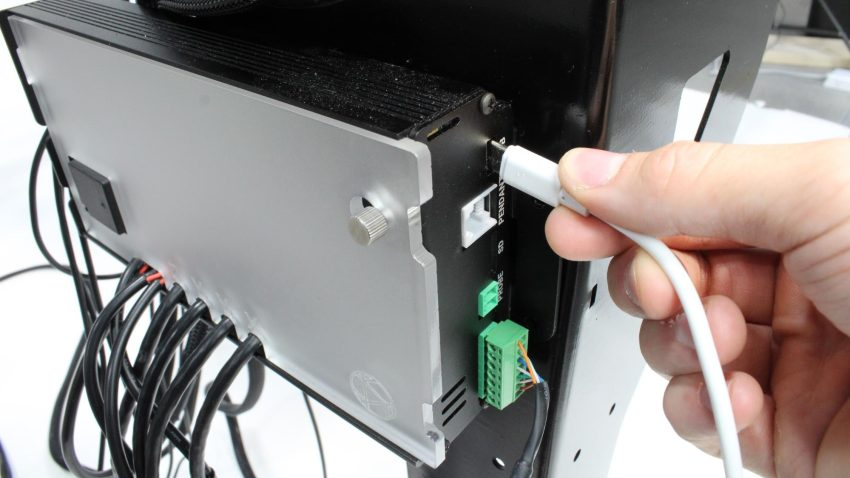

<em>Plugging USB-C cable into controller</em>

### **gSender Connection**

At this stage you will be using your computer (like the gControl panel) to test out the machine’s movement and sensors. **If you have the gControl panel, gSender is already downloaded and installed, and you can go to [this section](https://resources.sienci.com/view/am-mk2-first-movements/#gsender-1-5-0-and-above).**

Download gSender [through this page](https://sienci.com/gSender/) by selecting your computer’s operating system.

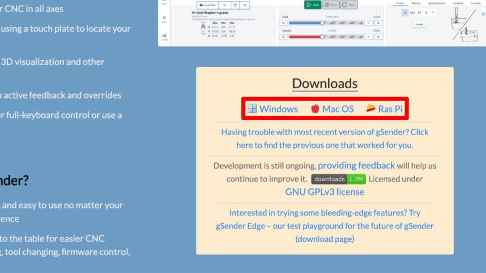

Then install the application, we have a guide on this in our [gSender resources page](https://resources.sienci.com/view/gs-installation/) which also covers some potential problems you may encounter.

#### gSender 1.5.0 and above

[su_spoiler title="<strong>gSender 1.5.0 and above</strong>" open="yes" style="fancy" icon="chevron" anchor_in_url="yes"]

Open the gSender app by double clicking the icon, this can be found on your desktop.  It may take a couple minutes for it to start up.

Hover over to ‘Connect to CNC’ and select the USB device, which is your SLB-EXT.

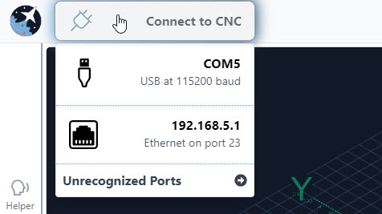

<em>Connecting to USB device</em>

You have successfully connected if you see a green checkmark and ‘grblHAL’!

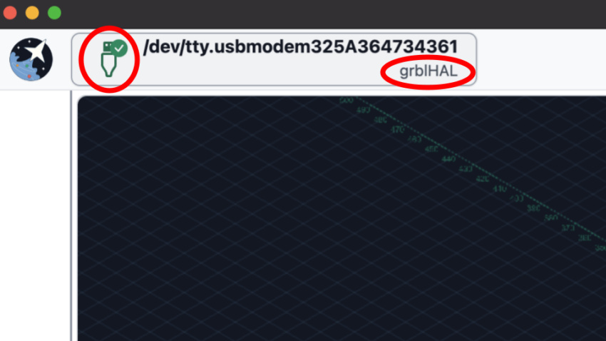

<em>Connection successful</em>

Upon connecting, you may see an active alarm in the top right corner. This is normal, and will always happen every time you connect to gSender! Press then rotate the E-stop. Then click the flashing button underneath to unlock the machine. If the alarm is persisting, click the flashing button again.

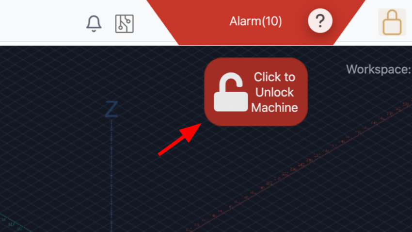

<em>Unlock machine to remove active alarm</em>

Try moving each of the axes on the machine using the X, Y, Z jogging buttons, making sure each axis moves in the correct direction.

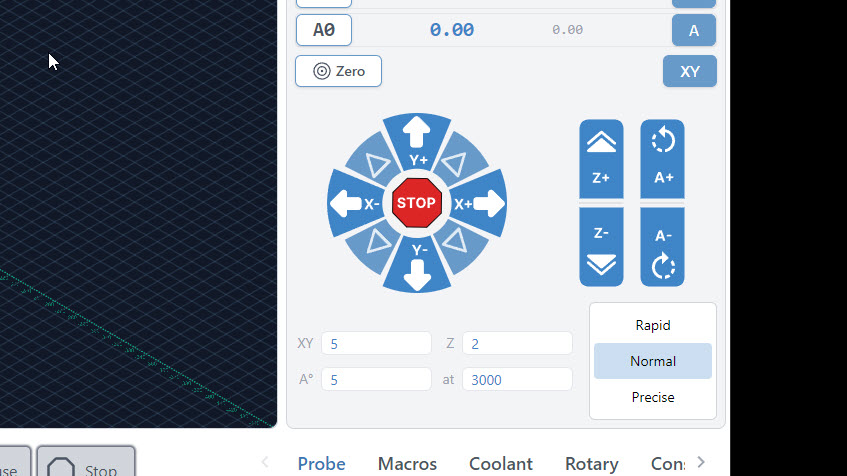

<em>Jog the machine using controls after alarm is removed</em>

If all seems to be functioning properly, we will now test the homing functionality. **You must home everytime you connect to gSender,** otherwise the machine does not know where the bounds of travel are.

Click the ‘Home’ button, this will cause the machine to move:

1. Upwards, stopping at the upper Z limit. <strong>Note:</strong> If you see an Alarm 10 after the Z-axis moves to the top, you will need to adjust the sensor. Follow the instructions <a href="https://resources.sienci.com/view/am-troubleshooting-homing-and-machine-limits/#alarm-10-during-homing" rel="noopener" target="_blank">here.</a> 
2. Diagonally to the back left corner of the machine, stopping at the X and Y limits. <strong>Note:</strong> If you see an Alarm 15 after the Y-axis moves, please follow the instructions <a href="https://resources.sienci.com/view/am-troubleshooting-homing-and-machine-limits/#alarm-15-during-y-axis-or-xyz-homing" rel="noopener" target="_blank">here. </a>

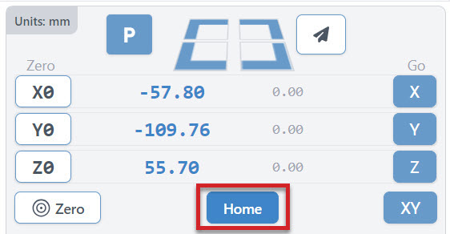

<em>Homing controls for all axes</em>

If you’re still seeing an error, press the E-stop button to cut power the motors, then gently turn the left or right Y-axis ball screw to make sure the left and right Y-axis gantry plates are equally close to the left and right inductive sensors, then release the E-stop button to power on the motors and try again.

[/su_spoiler]

#### **gSender 1.4.12 and below**

[su_spoiler title="<strong>gSender 1.4.12 and below</strong>" open="no" style="fancy" icon="chevron" anchor_in_url="yes"]

Open the gSender app by double clicking the icon, this can be found on your desktop.  It may take a couple minutes for it to start up.

Hover over the top left of the screen, then click ‘Firmware’ to select the type of firmware that gSender will connect to. With the AltMill, we always use **grblHAL** firmware, so please select this.

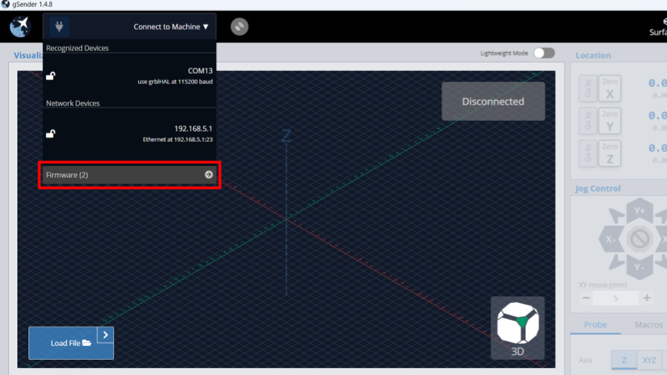

<em>Press ‘Firmware’ on the ‘Connect to Machine’ dropdown menu</em>

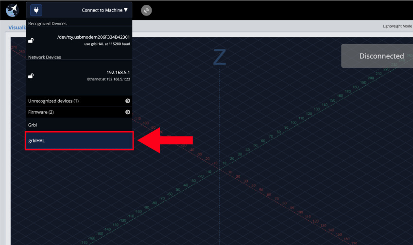

<em>Select ‘grblHAL’ as the firmware for AltMill</em>

Hover over this box again, and click on the detected device which should appear automatically.

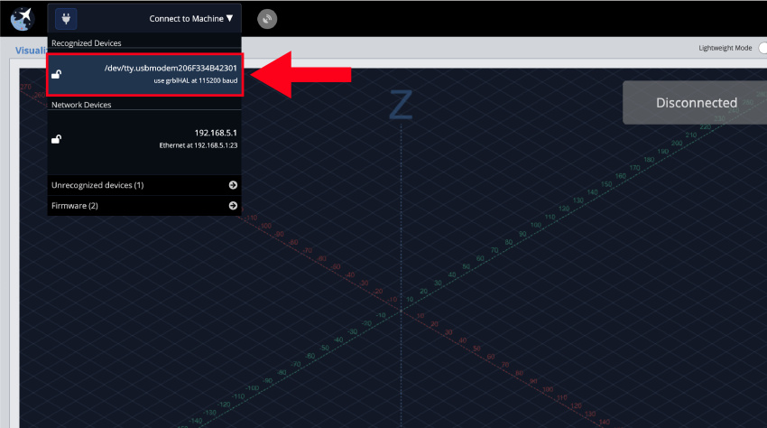

<em>Connect to the recognized device</em>

You should see a status indicating you have connected!

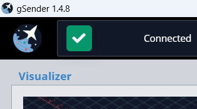

<em>‘Connected’ green checkmark</em>

Upon connecting, you may see an active alarm in the top right corner. This is normal, and will always happen every time you connect to gSender! Press then rotate the E-stop. Then click the flashing button underneath to unlock the machine. If the alarm is persisting, click the flashing button again.

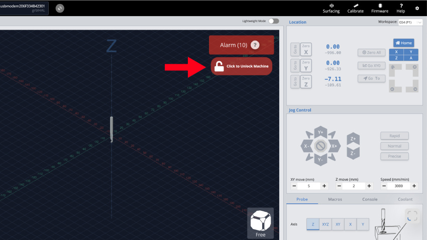

<em>Unlock machine to remove active alarm</em>

It’s now time to try moving each of the axes on the machine using the X, Y, Z jogging buttons, making sure each axis moves in the correct direction.

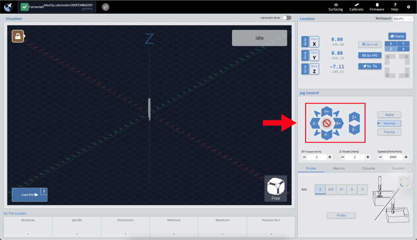

<em>Jog the machine using controls after alarm is removed</em>

If all seems to be functioning properly, we’ll next try out the homing functionality for each axis. Click the small ‘Z’ button below the ‘Home’ button in the top right corner of the screen to run the homing cycle for the Z-axis. You should see the spindle move upwards until it self-locates at its uppermost position. <strong>Note:</strong> If you see an Alarm 10 after the Z-axis moves to the top, you will need to adjust the sensor. Follow the instructions <a href="https://resources.sienci.com/view/am-troubleshooting-homing-and-machine-limits/#alarm-10-during-homing" rel="noopener" target="_blank">here.</a>  

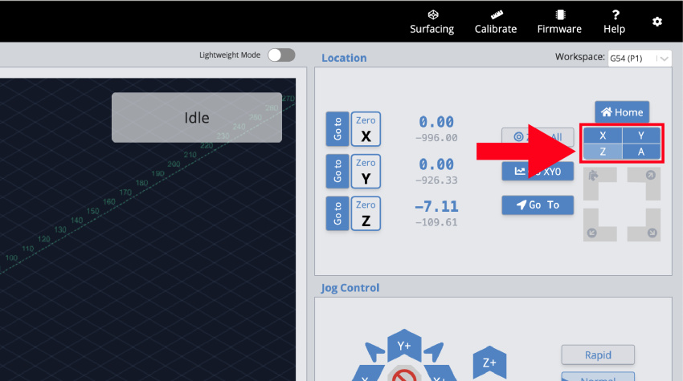

<em>Homing controls for all axes</em>

Next, click the ‘X’ homing button to try homing the X-axis. This should move the spindle all the way to the left, then self-locate.

Lastly, click the ‘Y’ homing button to try homing the Y-axis. The spindle should move backwards to the rear of the machine, then self-locate here. <strong>Note:</strong> If you see an Alarm 15 after the Y-axis moves, please follow the instructions <a href="https://resources.sienci.com/view/am-troubleshooting-homing-and-machine-limits/#alarm-15-during-y-axis-or-xyz-homing" rel="noopener" target="_blank">here. </a>

If you see an error occur, it could be because the left and right Y-axis inductive sensors or motor cables were plugged in incorrectly. Double check to make sure the left motor and sensor cables are connected to the ‘Y1’ plugs, and the right motor and sensor cables are connected to the ‘Y2’ plugs.

If you’re still seeing this error after double checking this, press the E-stop button to cut power the motors, then gently turn the left or right Y-axis ball screw to make sure the left and right Y-axis gantry plates are equally close to the left and right inductive sensors, then release the E-stop button to power on the motors and try again.

[/su_spoiler]
