

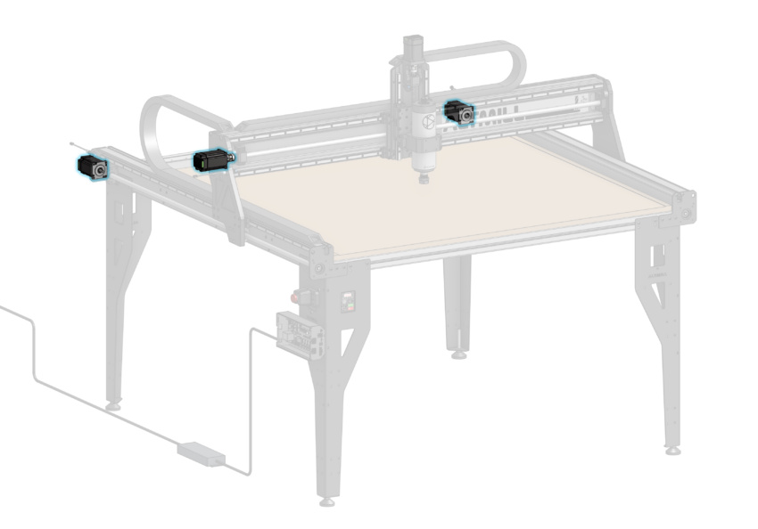{.aligncenter .size-medium}

<!-- R03-R04: Replace the parts-needed image with motors carrying pre-installed couplers and the supplied spacers. Add a spacer detail after Q-MOTOR-01 is resolved. -->

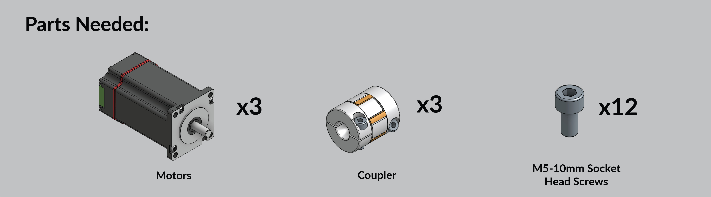{.alignnone .size-full}

On newer kits, the three motor couplers are pre-installed and arrive with spacers between the motors and couplers. Use the older-kit instructions below only if your couplers were supplied separately.

<!-- Q-MOTOR-01: Confirm whether the supplied motor-coupler spacers stay in place or are removed, and at which step. Add that instruction before Motor Installation; do not infer spacer handling from the older-kit instructions. -->

[su_spoiler title="<strong>Older kits: Motor Coupler Installation</strong>" open="no" style="fancy" icon="chevron" anchor_in_url="no"]

### Motor Coupler Installation

The coupler has two different diameter bores: 8mm and 10mm. The 8mm bore fits onto the motor shaft. Install a coupler on each of the three (3) motors. Insert the coupler onto the motor shaft until the coupler bottoms out. <strong>It’s important the motor coupler is fully seated, potential damage to the motor can happen with improper installation.</strong> Tighten the set screw on the motor side of the coupler to clamp the coupler to the shaft.

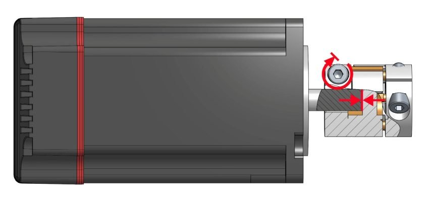{.alignnone .aligncenter}

<i>Motor shaft bottomed out inside coupler </i>

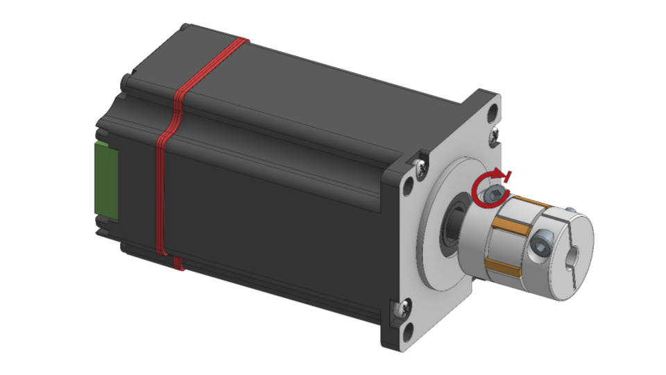{.aligncenter}

<em>Tighten coupler screw at motor end</em>

[/su_spoiler]

### Motor Installation

Install a motor with coupler onto the ball screw of the X-axis rail, and fasten the motor to the Y-axis Gantry Plate using four (4) M5-10mm socket head screws. **Orient** the motor such that the **DIP switches** are on the **bottom**.

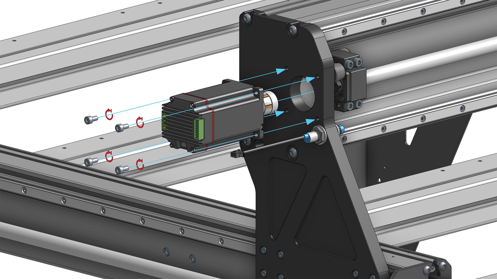{.aligncenter}

<em>Securely fastening motor onto X-axis ball screw</em>

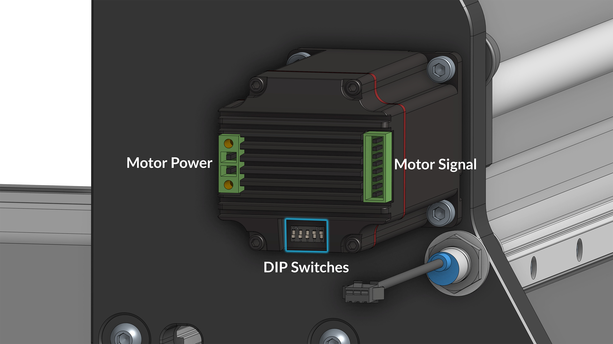{.aligncenter}

<i>X-axis Motor orientation</i>

Before tightening the motor coupler, ensure the motor is fully seated onto the y-axis gantry plate. **Potential damage** to the motor can occur if the motor is not fully seated before tightening. Clamp the coupler to the ball screw shaft by tightening the set screw on the shaft side.

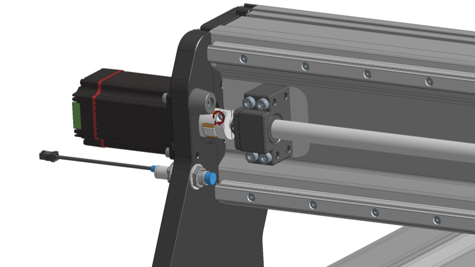{.aligncenter}

<i>X-axis motor coupler clamping to ball screw</i>

Install the remaining two (2) motors onto the Y-axis ball screws, fastening the motors to the face of the Y-axis end plates using M5-10mm socket head screws. **Orient** the motor such that the **DIP switches** are on the **bottom**.

Before tightening, ensure each motor is fully seated against its rear Y-axis end plate. **Potential damage to the motor can occur if it is not fully seated before tightening.**

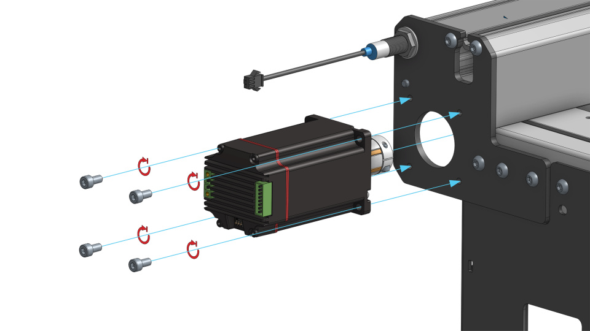{.size-full .aligncenter}

<em>Securely fastening motor onto Y-axis</em>

<!-- Q-MOTOR-02: Confirm the revised snug/final-tightening sequence. The original final rear-end-plate tightening instruction is retained after coupler clamping pending Engineering confirmation. -->

With each motor aligned on its ball screw, bring the rear end plate flush against the Y-axis rail and tighten the end-plate screws until snug.

<!-- R05: Check this existing rear-end-plate illustration against the new sequence; it must show the motor already mounted. -->

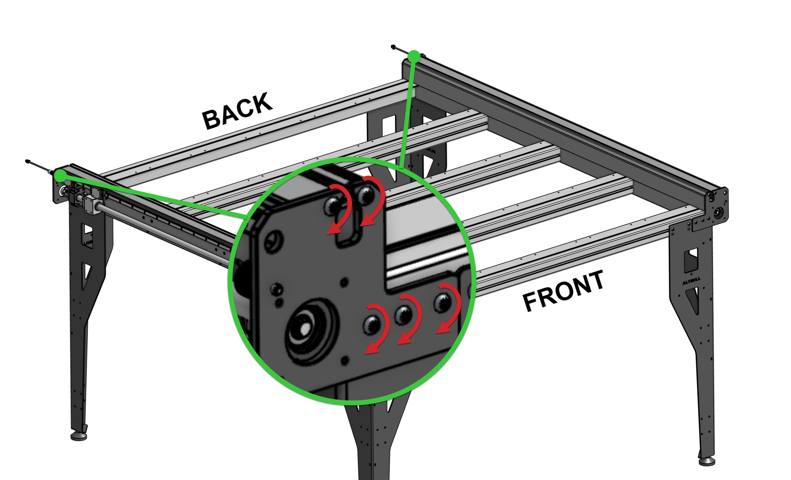{.alignnone .size-full}

Ensure both halves of each motor coupler are seated against the rubber insert. Clamp the coupler to the ball screw shaft by tightening the clamping screw on the ball-screw side.

<!-- R06: Add or revise a coupler detail to show both halves seated against the rubber insert and the ball-screw-side clamping screw. -->

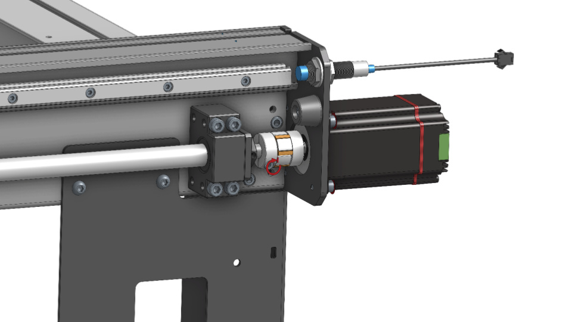{.alignnone .size-full}

<i>Y-axis motor coupler clamping to ball screw</i>

Finally, with the motors fully mounted, finish securing the back end plates on the table.

Now that we have our motors mounted, let’s do a final fit check. On both Y-axis sides, ensure that:

1. The motor coupler is <b>centered </b>to the circular cutout on the Y-end plate

2. The table leg <b>does not</b> interfere with the Y-end plate

Please re-assemble the table legs and Y-end plates until the components are properly aligned as specified in the check. You can loosen the fasteners, then slide the components into place before securing them again.

### Dip Switches

The motors should arrive with the DIP switches in the correct position for use with the AltMill stock settings.

Check to ensure the DIP switches on the X and Y axis motors follow the order of:

**1-5: OFF, OFF, OFF, ON, ON**

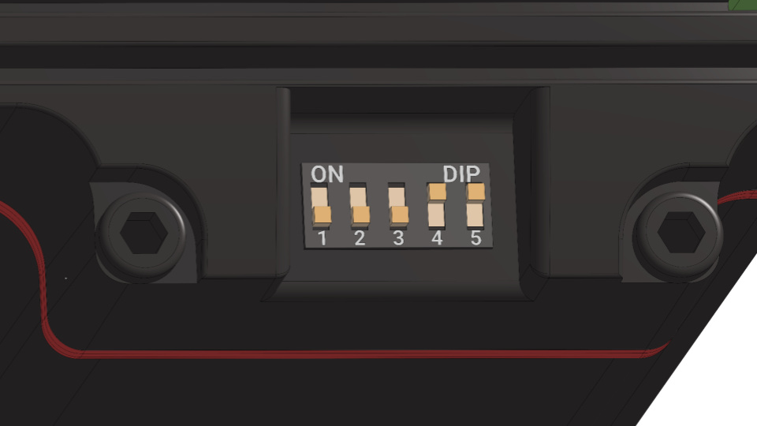{.size-full .aligncenter}

<em>Correct motor DIP switches setting for X and Y-axis</em>

Then set the Z-axis motor as follows from **1-5: OFF, OFF, ON, ON, ON**

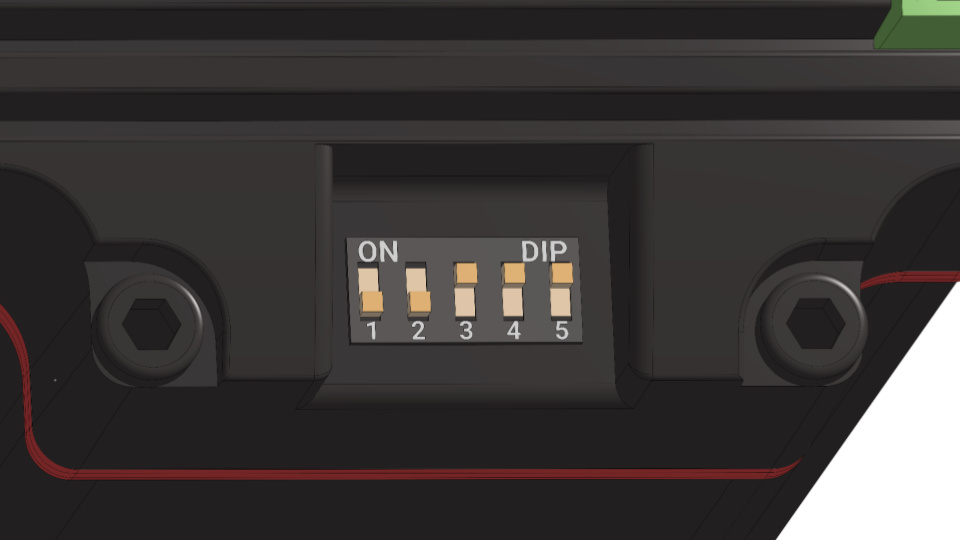{.size-full .aligncenter}

<em>Correct motor DIP switches setting for Z-axis</em>

 It is **highly recommended** that you **do not change** the firmware settings or DIP switch positions, unless you are instructed by Sienci Labs customer support or following instructions for installing another accessory.
