

### Spindle and Controller Connections

These instructions apply to the standard Sienci Labs spindle kit. If you are installing the ATC kit, use the [ATC software and spindle configuration instructions](https://resources.sienci.com/view/atc-software/) for that kit.

**The instructions below must be followed in the exact order they are presented, otherwise the controller won’t be able to communicate with the VFD and will present an ‘Alarm 14’ error.**

If your SLB-EXT is powered on, please turn it **OFF** now.

Ensure that the spindle cable connector is installed on top of the spindle.

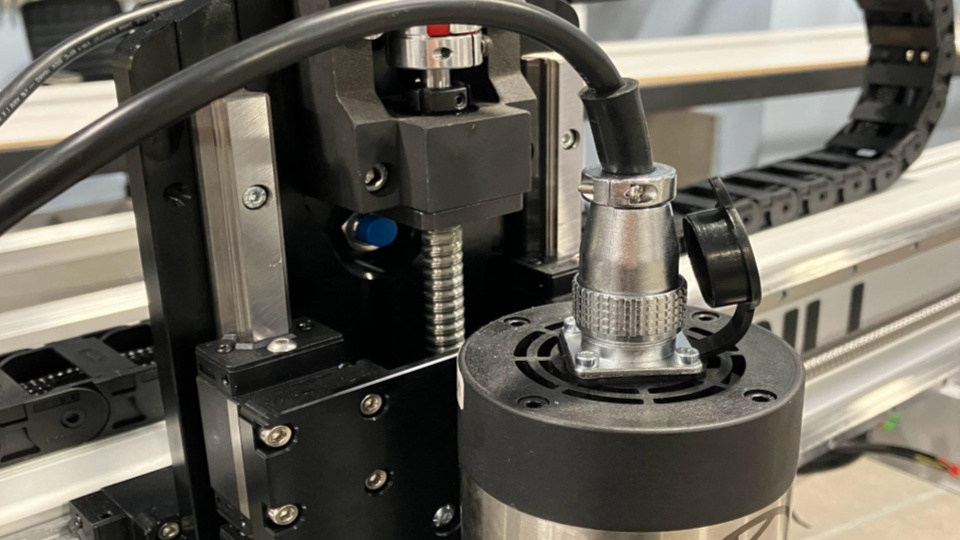{.alignnone .size-full}

<em>Connecting spindle cable to spindle</em>

Then check that the RS485 wire is plugged into the SLB-EXT controller.

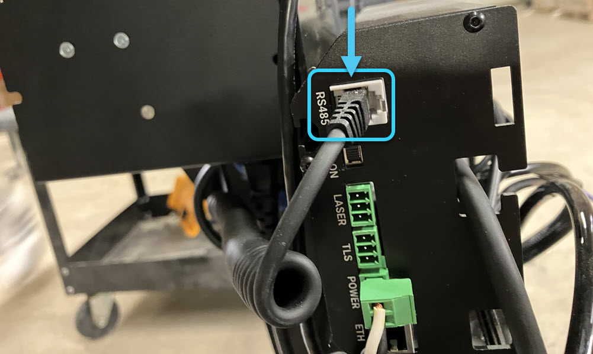{.alignnone .size-full}

<em>Connecting RS485 to SLB-EXT</em>

Ensure the RS485 cable is plugged into the connector above the OFF-ON switch and not the connector below the USB cable.

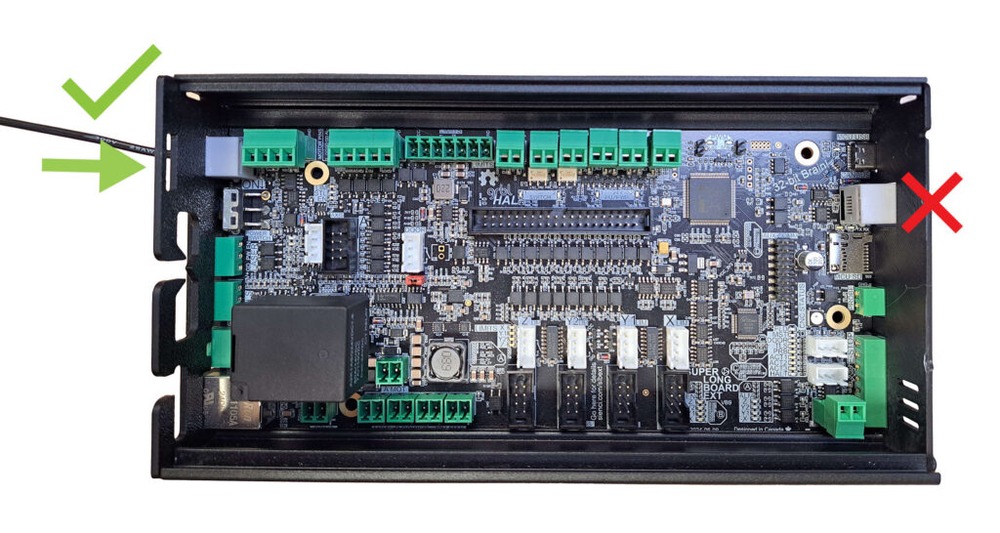{.aligncenter .size-large}

<em>RS485 Correct Connector Location</em>

<!-- Q-POWER-01: Confirm the approved circuit and extension-cord requirements for each supported 1.5kW, 2.2kW and ATC kit. The previous universal 1500W extension-cord claim has been replaced with kit-specific wording; no substitute rating is invented. -->

Plug in the power cord from the VFD unit into a suitable wall outlet or extension cord now. If you use an extension cord, ensure its voltage and current ratings meet the requirements of your specific spindle/VFD kit.

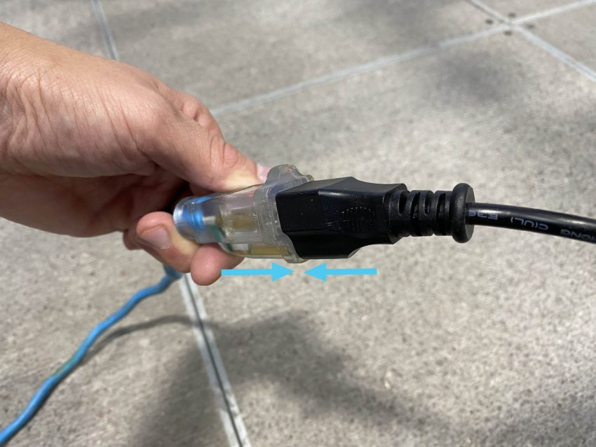{.aligncenter .size-medium}

<em>Connecting spindle to power</em>

The VFD screen should blink on with red text. Blinking text is normal behaviour for the VFD display.

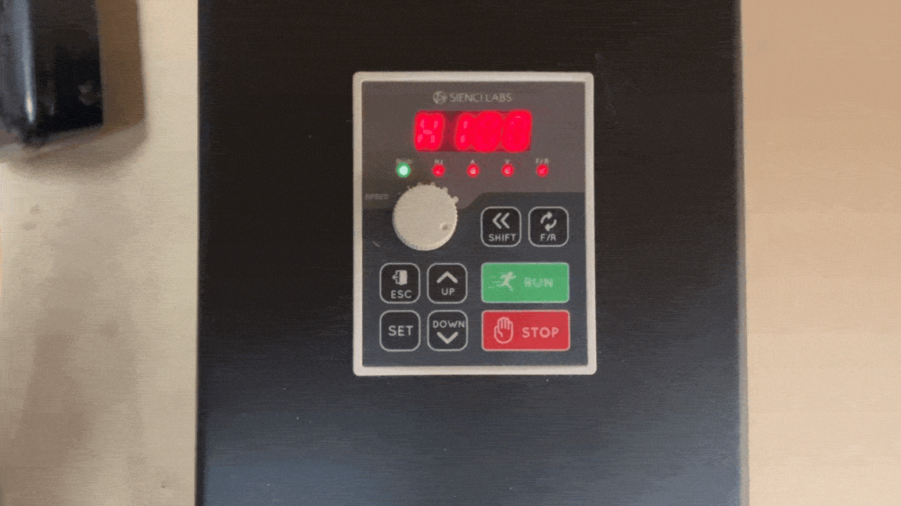{.alignnone .size-full}

Turn **ON** the controller using the power switch and make sure the E-stop is released. We will now move to setting things up on gSender.

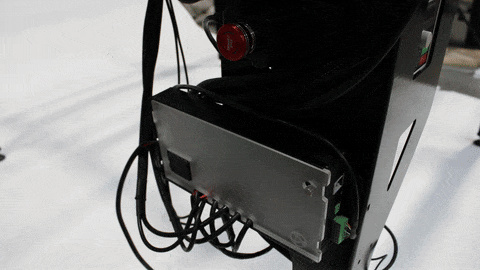

Connect to gSender, as you did in the [First Movements](https://resources.sienci.com/view/am-mk2-first-movements/) section.

### gSender Settings

**Open the dropdown menus below** to see the correct setup steps for the gSender version you have.

#### **gSender 1.6.0 and above**

[su_spoiler title="<strong>gSender 1.6.0 and above</strong>" open="yes" style="fancy" icon="chevron" anchor_in_url="yes"]

With your computer connected to your machine, and no alarms active, we’ll need to enable some settings to allow for communication between your controller and the spindle.

1. Go to **Tools,**then select **Accessory Installation**

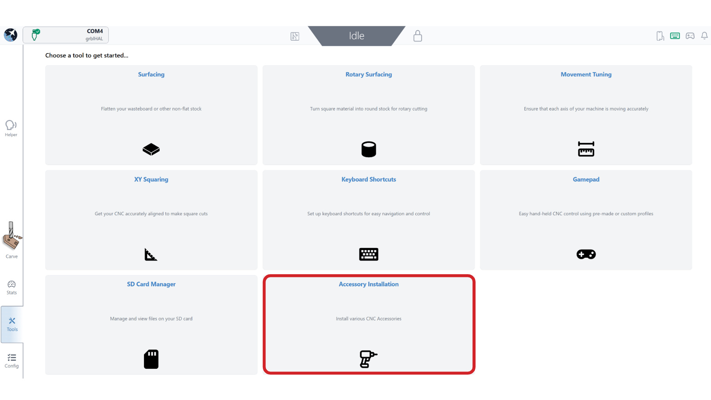{.alignnone}

2. Select **Sienci Spindle**. Then follow the instructions in the installation wizard to finish setting up your spindle.

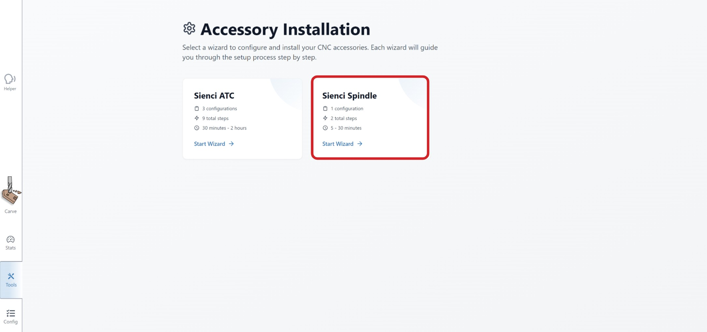{.alignnone}

3. Once you complete all the steps in the installation wizard, go back to the main page, Carve.

4. You should now see a ‘Spindle/Laser’ tab on the bottom right corner of gSender. Make sure **H-100** is selected in the ‘Spindles’ dropdown.

5. Then, you can try setting a desired RPM speed, then click ‘Forward’ to have the spindle start spinning up to the set speed. Ensure there are no obstacles in the way of the spindle or any loose parts nearby before turning this on. In the event of any emergency, press the physical E-stop button to immediately stop the spindle.

[/su_spoiler]

#### **gSender 1.5.0 to 1.5.9**

[su_spoiler title="<strong>gSender 1.5.0 to 1.5.9</strong>" open="no" style="fancy" icon="chevron" anchor_in_url="yes"]

With your computer connected to your machine, and no alarms active, we’ll need to enable some settings to allow for communication between your controller and the VFD.

1. In the **Console** at the bottom right corner, enter **$i** then press **Run.**

2. Check what **Driver Version** you have.

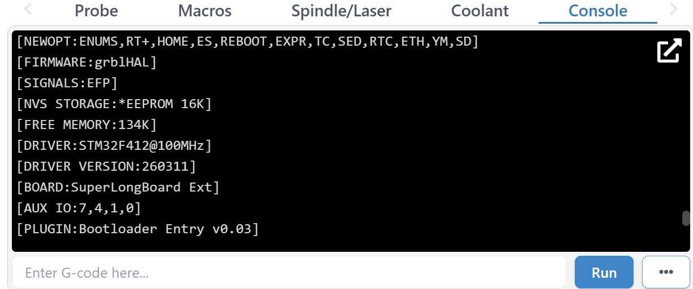{.alignnone .size-full}

- **230917** – Please Download [2023 Sienci Spindle Configuration (SLB-EXT).](https://resources.sienci.com/wp-content/uploads/2025/06/Sienci-Spindle-Configuration-SLB-EXT.gcode)
- **260311** – Download [2026-SLB-EXT_Config_File](https://resources.sienci.com/wp-content/uploads/2025/03/new_spindle.gcode)

3. Press ‘Load File’ and select the file you just downloaded.

Then press ‘Start.’

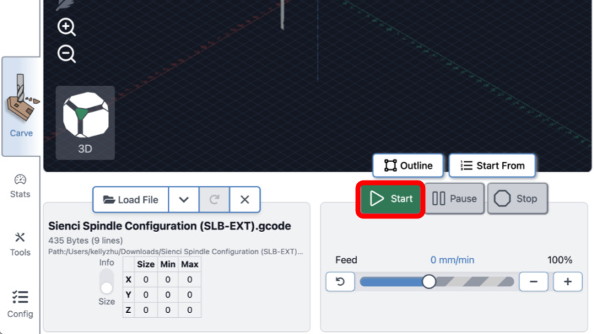{.alignnone .size-medium}

4. Once the file is done, turn **OFF** the controller at the power switch.

5. Unplug the VFD from power.

6. Close gSender.

7. Then, plug the VFD back into power, turn ON the controller, and open gSender and reconnect.

8. Navigate to ‘Config’ then at the left header select ‘Spindle/Laser.’

9. Turn ON ‘Enable Spindle/Laser functionalities’ toggle (or ‘Spindle/Laser controls’ if you are on gSender 1.5.4 and higher).

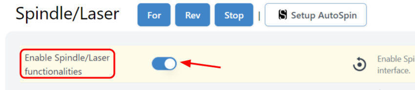{.alignnone .size-medium}

10. Go back to the main page, Carve.

11. You should now see a ‘Spindle/Laser’ tab on the bottom right corner of gSender. Make sure **H-100** is selected in the ‘Spindles’ dropdown.

12. Then, you can try setting a desired RPM speed, then click ‘Forward’ to have the spindle start spinning up to the set speed. Ensure there are no obstacles in the way of the spindle or any loose parts nearby before turning this on. In the event of any emergency, press the physical E-stop button to immediately stop the spindle.

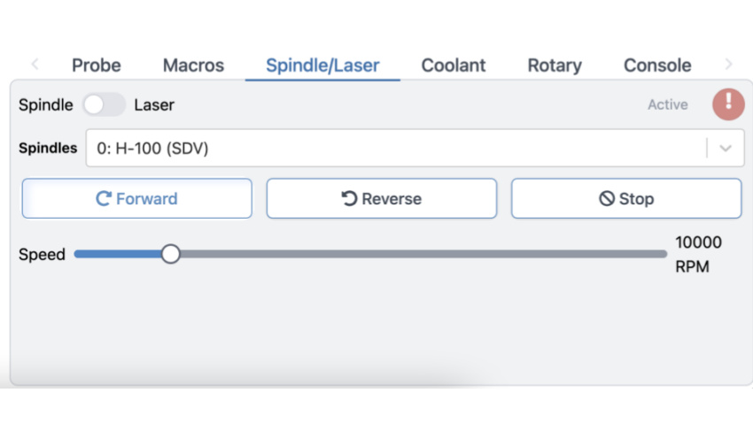{.alignnone .size-medium}

[/su_spoiler]

#### **gSender 1.4.12 and below**

[su_spoiler title="<strong>gSender 1.4.12 and below</strong>" open="no" style="fancy" icon="chevron" anchor_in_url="yes"]

1. With your computer connected to your machine, and no alarms active, we’ll need to enable some settings to allow for communication between your controller and the VFD. This can be done by downloading and running this file [Sienci Spindle Configuration (SLB-EXT).](https://resources.sienci.com/wp-content/uploads/2025/06/Sienci-Spindle-Configuration-SLB-EXT.gcode)

2. Press ‘Load Job’ and select the file you just downloaded.

3. Then press ‘Start.’

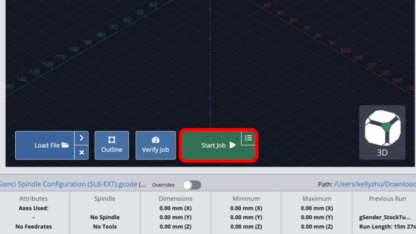{.alignnone .size-medium}

4. Once the file has finished, we will now reset everything so our changes can take effect. Turn **OFF** the controller at the power switch.

5. Unplug the VFD from power.

6. Close gSender.

7. Then, plug the VFD back into power, turn ON the controller, and open gSender and reconnect.

8. In gSender, click the small gear icon to open the settings menu, then select the ‘Spindle/Laser’ tab. Here, toggle the ‘Spindle/Laser’ option to enable this menu in gSender.

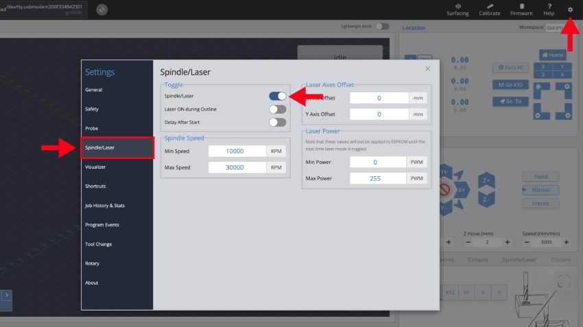{.aligncenter .size-medium}

<em>Toggling the spindle on</em>

9. Set the spindle’s ‘Min’ and ‘Max’ speeds as 7500 and 24,000 RPM, respectively.

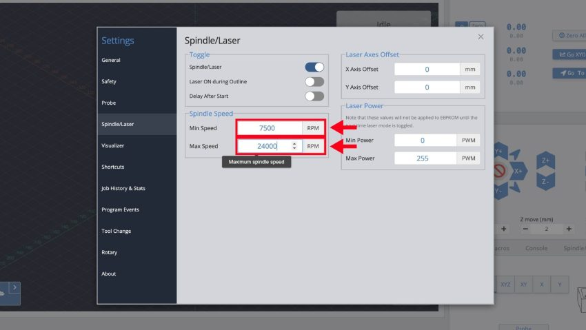{.aligncenter .size-medium}

<em>Correct AltMill spindle speed settings</em>

10. You should now see a ‘Spindle/Laser’ tab on the bottom right corner of gSender. Make sure **H-100** is selected in the ‘Spindles’ dropdown.

11. Then, you can try setting a desired RPM speed, then clicking ‘**CW (M3)**’ to have the spindle start spinning up to the set speed. Ensure there are no obstacles in the way of the spindle or any loose parts nearby before turning this on. In the event of any emergency, press the physical E-stop button to immediately stop the spindle.

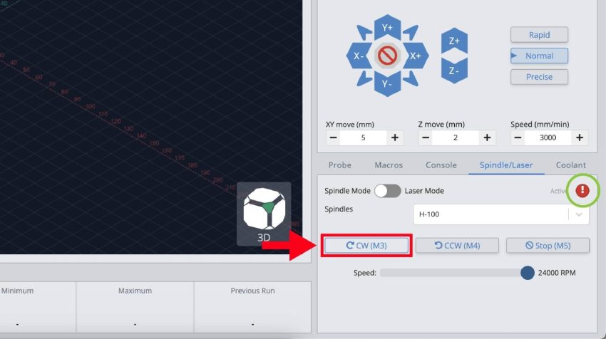{.aligncenter .size-medium}

[/su_spoiler]

### Spindle Direction

While testing, make sure the spindle is spinning the correct direction by watching as the spindle slows down to a stop once done.

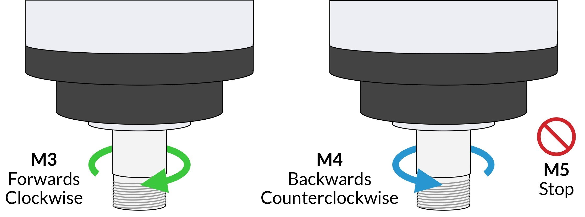

<em>Direction of spindle </em>

### Spindle Break-in

The grease inside the bearings may have shifted during transportation, it is recommended that you run a “break-in” cycle to redistribute the grease before using your spindle. To do this, you can download and run the g-code file below on gSender, which should take 1 hour 40 minutes to run.

[Sienci Spindle Break-in.gcode](https://drive.google.com/file/d/1JdrqfgkZxhhXIAjUMOi-5UXIDjNveZe3/view?usp=sharing)

To run the file connect to gSender and press ‘Load File’ at the bottom left corner. Select the file and you should see a ‘Start Job’ button appear, go ahead and click that.

For regular maintenance of your spindle, we recommend running a shorter “warm up” g-code.

[Sienci Spindle Warm up.gcode](https://drive.google.com/file/d/1u5Tu5QdECCNx7W3NW7HJd1eErZ1Ggvyv/view?usp=sharing)

### Finishing Up

Congratulations on completing spindle setup! This is one of the trickiest parts of getting the AltMill ready.

If you are done for the day, just turn off the SLB-EXT controller using the power toggle. You can leave the VFD plugged into wall power.

However, if you choose to unplug the VFD, please follow this precise order for starting up each time, to avoid alarms:

<strong>1. Make sure the controller is plugged into power but turned OFF</strong> 
<strong>2. Plug spindle into power, the VFD should blink with red text</strong> 
<strong>3. Then turn on the controller using the power toggle</strong>

If you have already set up your wasteboard, feel free to continue into the [Final Checks](https://resources.sienci.com/view/am-mk2-final-checks/) article. Otherwise, to the [Wasteboard](https://resources.sienci.com/view/am-mk2-wasteboard/) we go!
