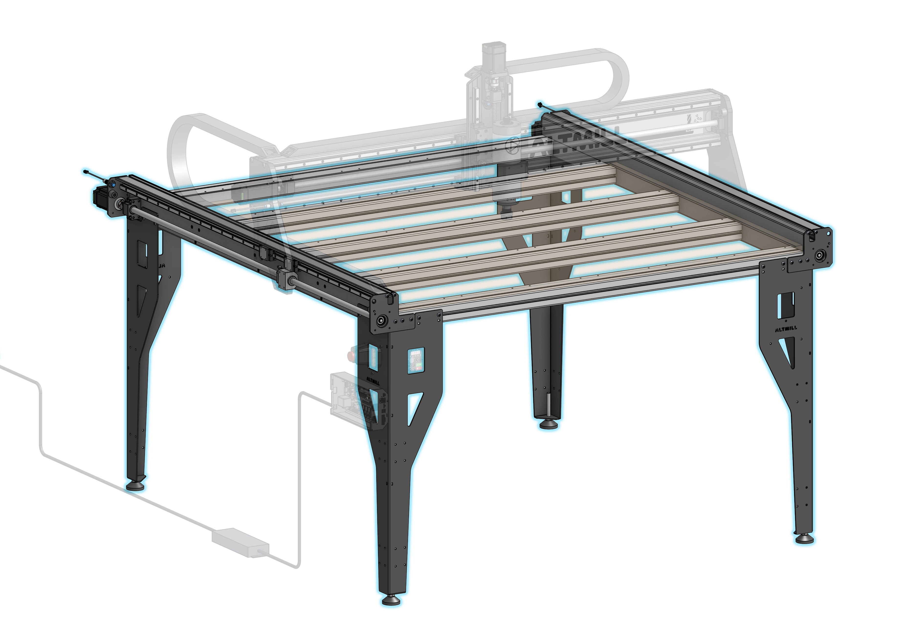

## Crossbeam Installation

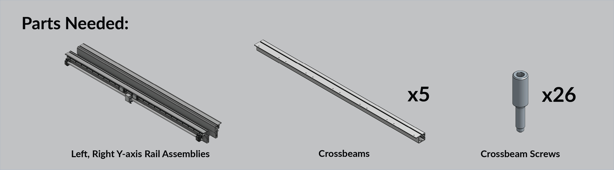

Before we begin:

<strong>Keep any wrapping around the linear guide blocks in place until table assembly is complete. If the blocks arrive unwrapped, secure them with painter’s tape so they cannot slide off the rails. Sliding a block off its rail can release its ball bearings and damage the assembly.</strong>

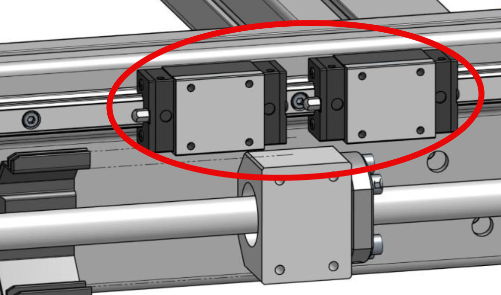

Place the left and right Y-axis rails on the floor parallel to the other, so the ball screws face away from each other, outwards.

Note the orientation of the machine’s front and rear when laying the Y-axis rails on the ground. The end with the 4-screw bearing block, is considered the **rear**, and the end with the smaller 2-screw bearing block, is considered the **front**.

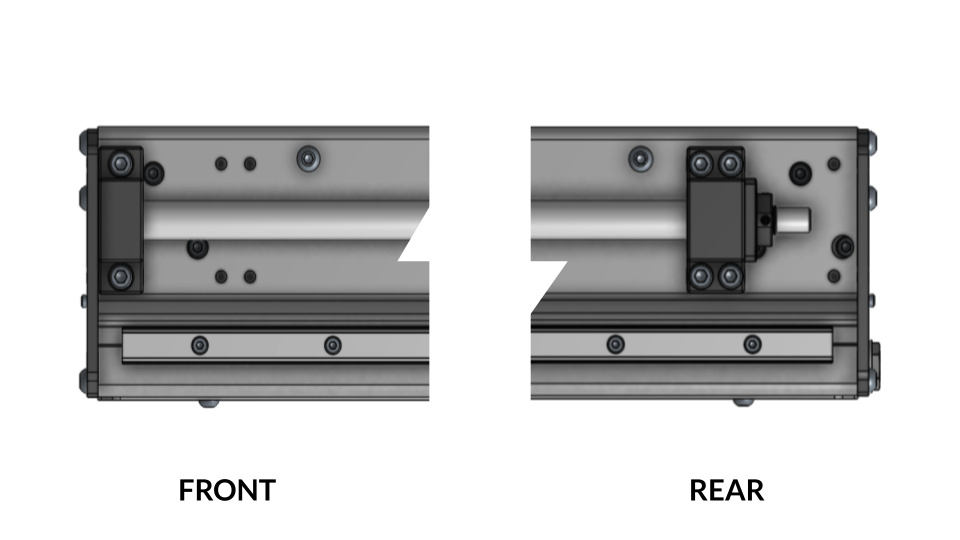

*Front and rear distinction on Y-axis*

Additionally, from this point on we will refer to the left and right sides of the machine based on the perspective when looking at the table from the front. Standing at the front, your left and right side is the machine's left and right side.

Keep in mind that the table will be flipped over the front or back side in a future step. Orient the machine so that it is opposite to how you want it once flipped over. This will allow you to avoid unnecessary adjustment in the future.

Depending on the AltMill model, whether it be 4x4 or 2x4, you will lay five (5) or three (3) crossbeams on the floor in between the left and right Y-axis rails.

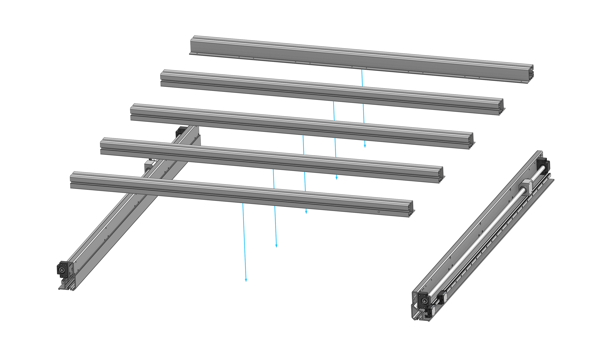

*Crossbeams and Y-rail assemblies for 4x4*

Position the front and rear crossbeam so that the flanges face towards the center of the machine. For the middle crossbeams, orient the flange pointing to the back of the machine, in the same direction as the front crossbeam.

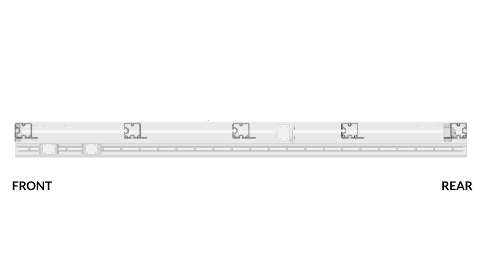

*Side view of crossbeams showing flange direction*

Move the crossbeams so they rest on the reference ledge of one Y-axis rail only (highlighted in blue). Loosely install one crossbeam screw into the top hole of each crossbeam, as the other end sits on the reference ledge of the other Y-axis rail. Then at the other end, loosely install the crossbeam screw into the top hole to keep the beam from falling off of the ledge.

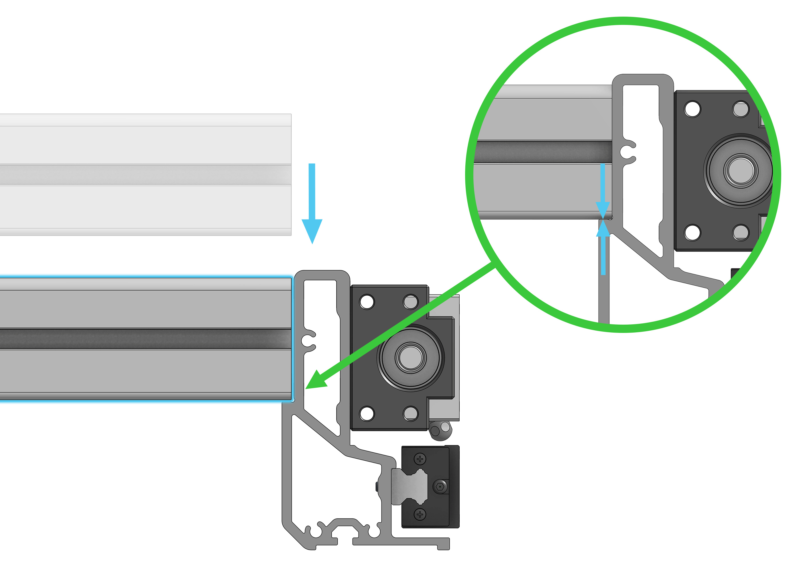

*Crossbeam resting on reference ledge*

Finally, install the remaining crossbeam screws. Ensure the crossbeam is pressed down and contacting the reference ledge. Tighten all remaining screws using the provided 4mm hex key.  Do not use an impact driver or drill for this step to avoid stripping the internal threads of the aluminum crossbeam.

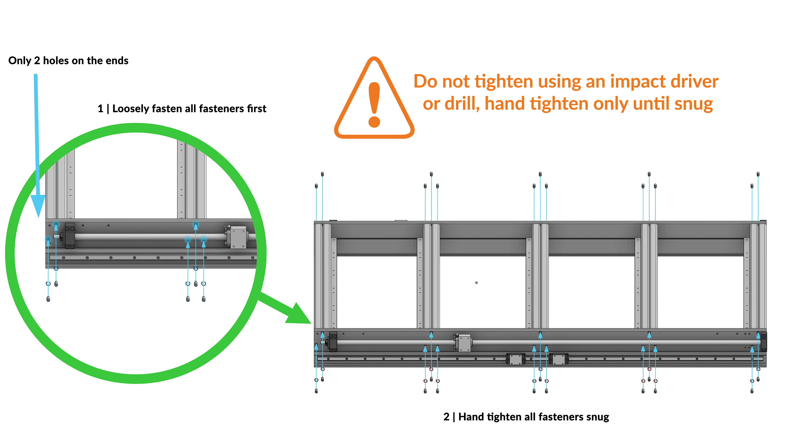

*Securing crossbeams to Y-rails*

## Table Legs Assembly

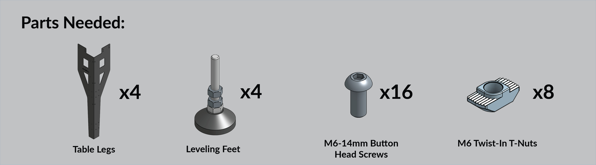

Remove the top hex nut from the leveling foot. Insert the threaded stud of the foot through the hole on the leg from the bottom, then reinstall the top hex nut over the hole, loosely securing the foot. You will need to adjust these two leveling nuts in a future step when leveling the table. Repeat for the remaining three (3) feet.

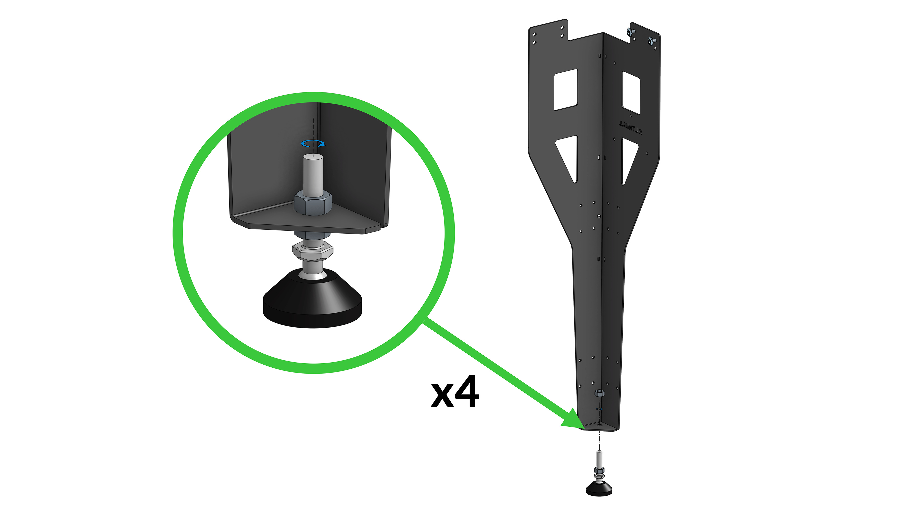

*Table leg with foot installation*

On each table leg, loosely install two (2) M6-14mm button head screws and two (2) M6 twist-in T-nuts on the **top row** of holes on the flange of the leg that will be **connected to the crossbeam**. Your leg pairs will be mirror opposites of the other after you install the two (2) screws and T-nuts.

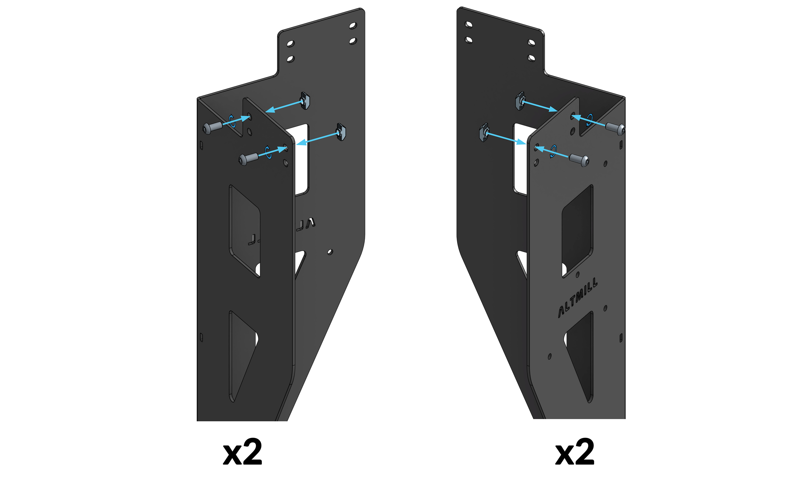

*Pair of legs with M6 T-nuts and screws*

Flip the leg upside down and insert the attached twist-in T-nuts into the T-slot of the crossbeam such that the perpendicular flange of the leg is contacting the outside face of the Y-axis rail. Tighten the screws until the leg is loosely fastened to the crossbeam. Insert two (2) M6-14mm button head screws through the two bottom holes of the leg flange contacting the Y-axis rail and tighten the screws into the rail. Tighten the two (2) screws fastening the leg to the crossbeam.

Install the mirrored second leg, on the same front or back side that the first leg is on. For ease of assembly, **do not** install a pair of legs on the left or right side the machine.

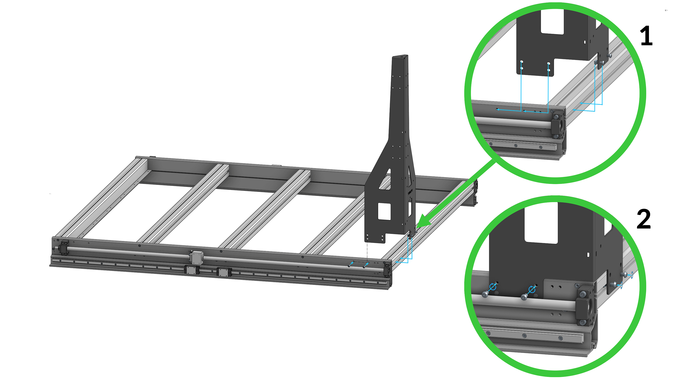

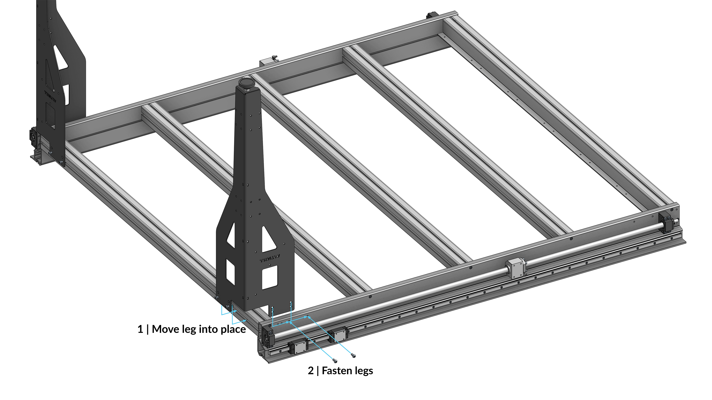

*Aligning and fastening first pair of legs*

Ensure you have sufficient work space available to flip the machine over the front or back edge of the table. You will need roughly 6 feet of space in front of the table edge that does not have the legs installed.

If your AltMill has been assembled on a work table, it is best to move it to the floor before flipping the machine for ease and safety.

**It is highly recommended to perform the table flip with a second person to help!**

Grab the table legs and flip the table over, pivoting about the opposite side from the legs, leaving the pivot edge on the ground during the flip. **Do not grab hold of the ball screw.**

Insert a stool or platform of a similar height underneath the unsupported end of the table.

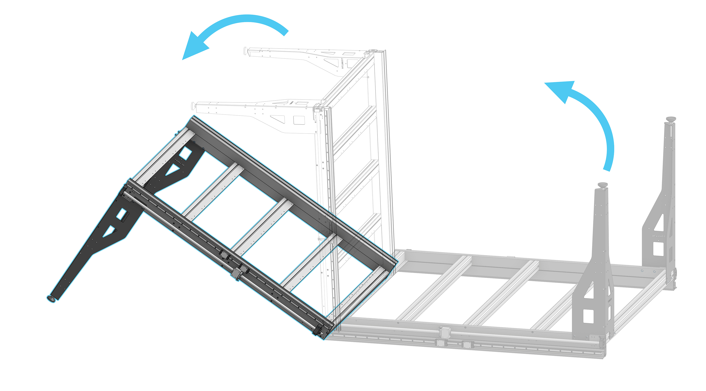

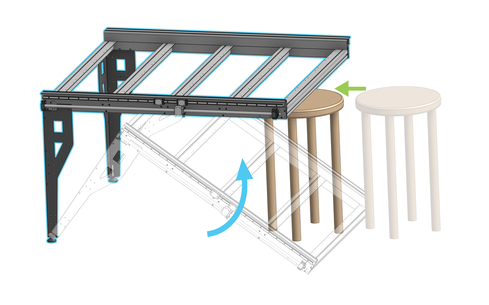

*Flipping and supporting the table*

Repeat table leg installation steps described above for remaining two table legs.

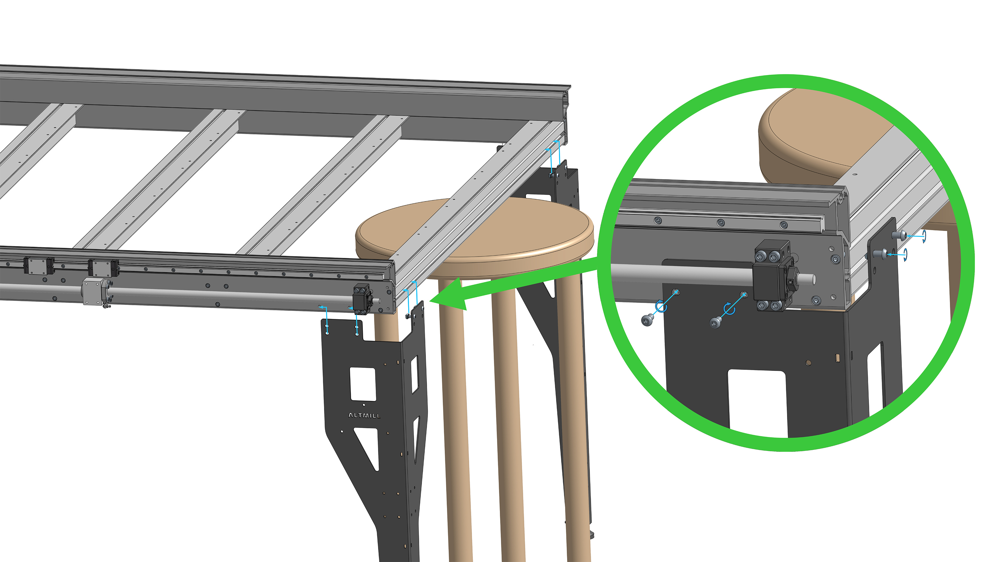

*Aligning and fastening second pair of legs*

Adjust the hex nuts on the leveling feet of each leg to ensure the table is level. Check the level along the **X-axis** at **front and back** of the machine, and check the **Y-axis** level on both the **left and right** side of the machine.

Use the side of the included wrench, along with a 17mm or adjustable wrench to adjust the levelling feet.

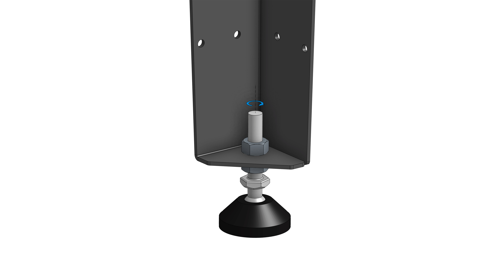

## Y-axis Cable Routing

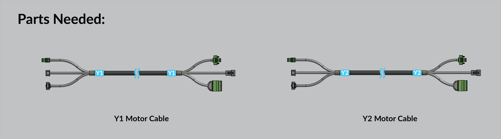

Refamiliarize yourself with the orientation of the machine, seeing which side is the front and back.

Then, identify the differences between each end of the wire harnesses and note which side will be plugged into the motor and which will be plugged into the SLB-EXT controller.

**Black, Green and White** → **SLB-EXT Controller**

**Green, Green and Black → Motor**

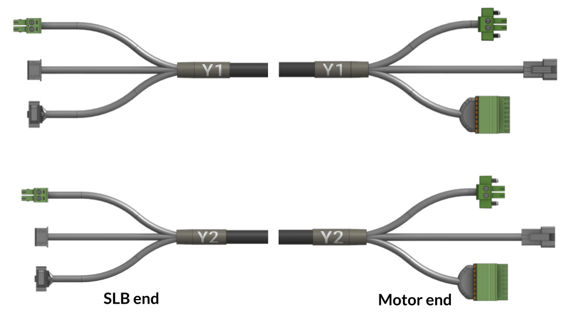

*Y-axis cables, SLB-EXT and motor end labelled*

Both Y-axis cable harnesses will be pushed through the upper section of the left side Y-axis rail. Remember, this is the left side when looking at the machine from the front.

Holding the Y1 and Y2 harnesses at the SLB-EXT side, **insert the wires into the back** of the **left side Y-axis rail** and push the two harnesses through simultaneously. Push the harnesses until there is about 45cm or 1.5 feet sticking out the front.

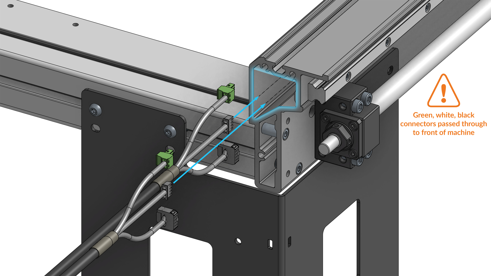

*Rear view, routing wires at back of machine, left Y rail*

## End Plate Preparation

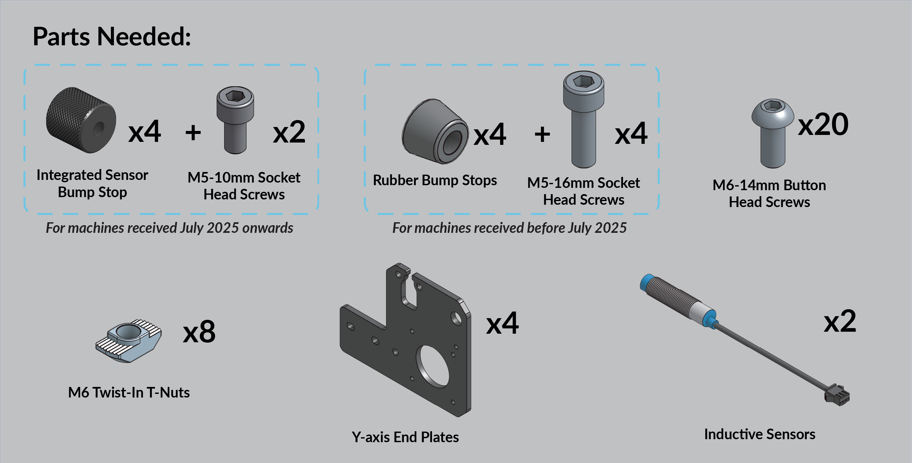

Thread two (2) M6-14mm button head screws into two (2) M6 twist-in T-nuts on each of the four (4) Y-axis end plates leaving the T-nuts **loose**. Note the orientation of the end plate when installing the T-nuts; match the face that will contact the crossbeam with the face the T-nuts are installed on.

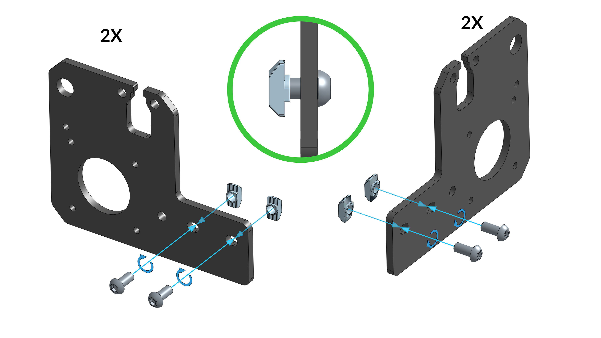

*Y-end plates, noting orientation of T-nuts*

Follow the section below that matches your bump-stop hardware. Kits received before July 2025 use the Rubber Bump Stops instructions.

### Integrated Sensor Bump Stops

Install two (2) integrated bump stops onto a pair of Y-axis end plates using two (2) M5-10mm socket head screws as shown.

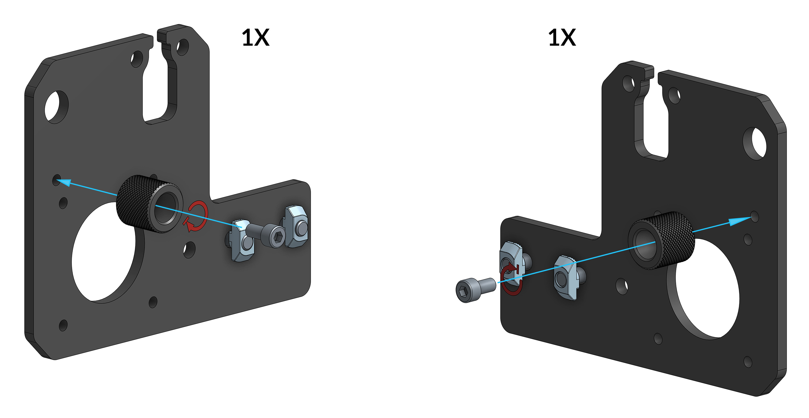

Loosely install all four (4) end plates onto the machine; the two end plates with bump stops should be at the **front** of the machine.

On two (2) inductive sensors, install a sensor nut, threading the nut roughly 20mm / 0.75 inches from the sensor end. Then insert a lock washer onto the sensor.

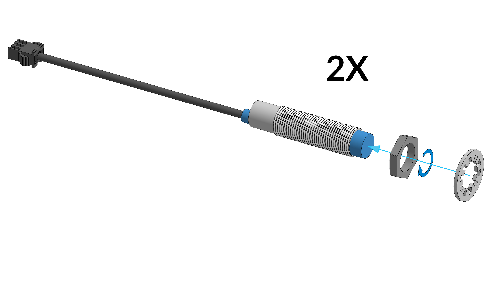

*Inductive sensor preparation*

Insert both sensors through the two (2) Y-axis end plates at the **back** of the machine. Ensuring the blue sensor tip is pointed towards the machine.

Hand tighten two (2)  bump stops at the ends of the inductive sensors until they bottom out, to secure them onto the back end plates. It is important that this bump stop is fully seated.

Then, tighten the rear sensor nut with lock washer on the back of the sensor, to clamp it on the end plate.

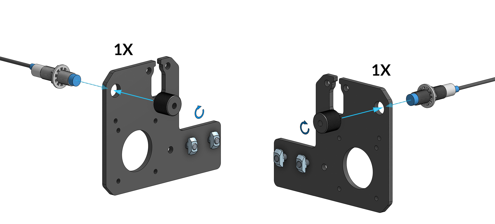

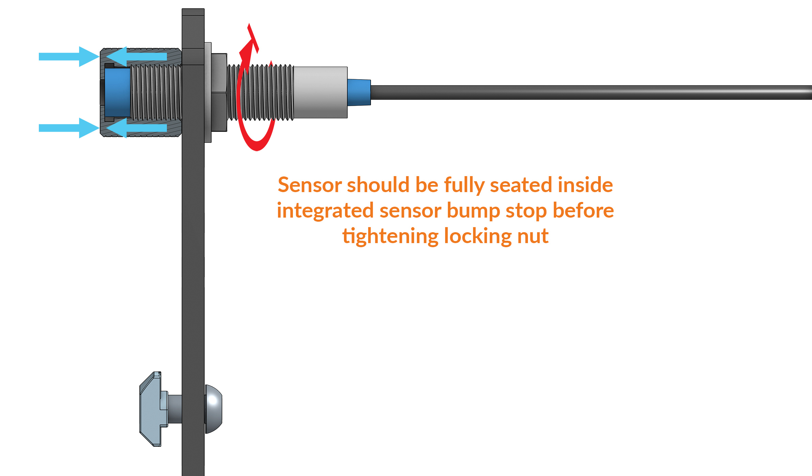

Your end plates should look like the following image:

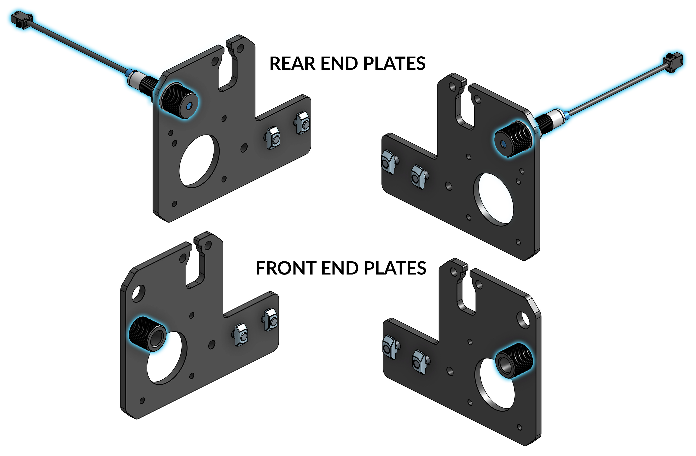

*Assembled end plates*

Securely fasten the two (2) front end plates. Leave the back end plates loose. They will be tightened during motor installation.

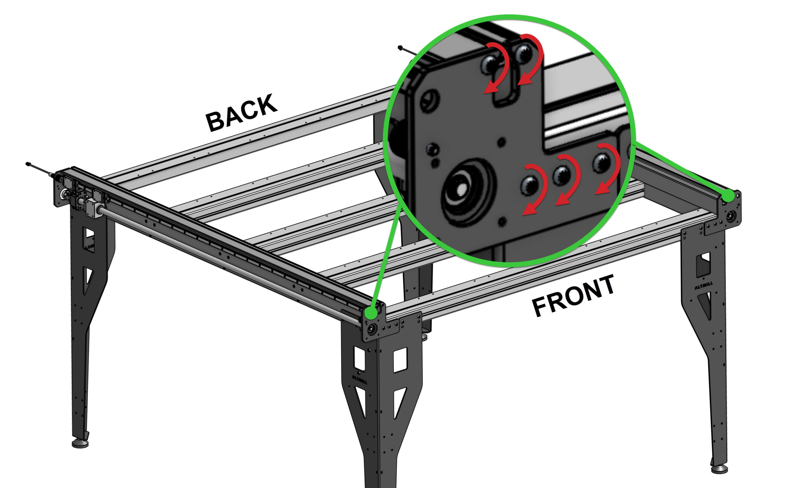

If you’ve received your machine before July 2025, your machine comes with rubber bump stops. Follow the Rubber Bump Stops instructions below.

### Rubber Bump Stops

Using a M5-16mm socket head screw, fasten one (1) rubber bump stop onto each of the four (4) Y-axis end plates. Fasten the bump stops on the same side of the plate that the T-nuts are on. The bump stops will be oriented inwards of the machine. **Note:** You do not need to tighten the bump stop excessively. It is rubber and will deform. Stop tightening once you notice the bump stop is beginning to squish at the base.

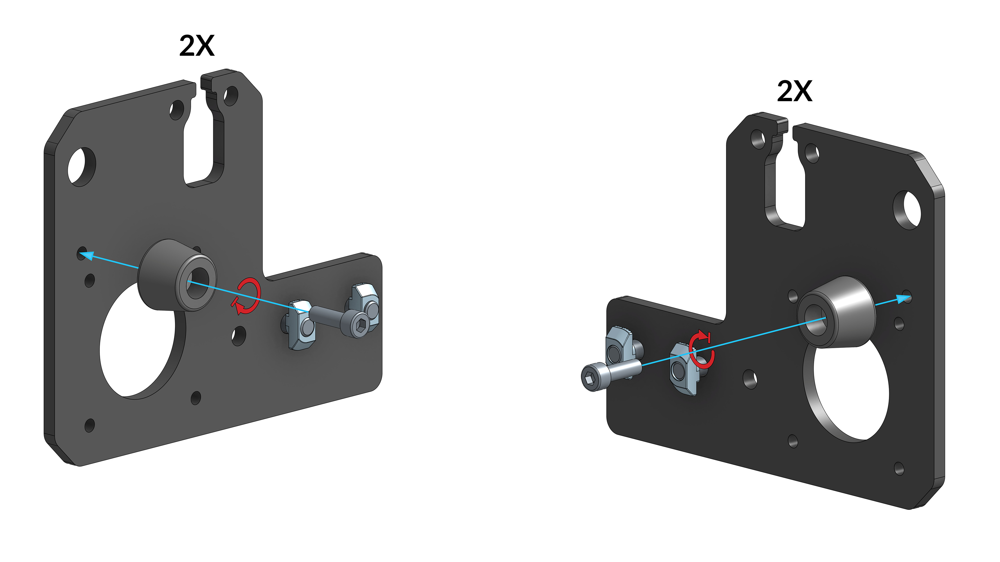

*Rubber bump stop installation*

Install all four (4) end plates onto the machine.

On two (2) inductive sensors, install a sensor nut, threading the nut roughly 20mm / 0.75 inches from the sensor end. Then insert a lock washer onto the sensor.

*Inductive sensor preparation*

Insert both sensors through the two (2) Y-axis end plates located at the **back** of the machine. Ensuring the blue sensor tip is pointed towards the machine.

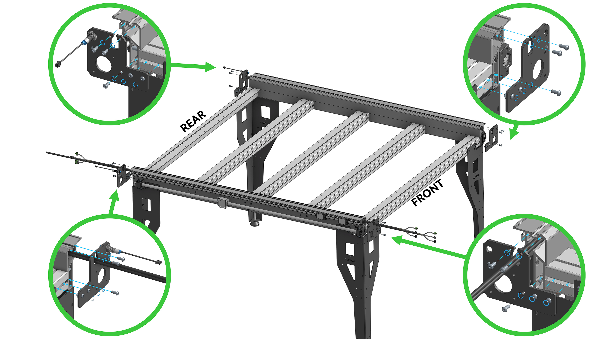

*Y-end plate positions on AltMill*

Place a lock washer and thread a nut onto both sensors to clamp them on the end plate like shown below.

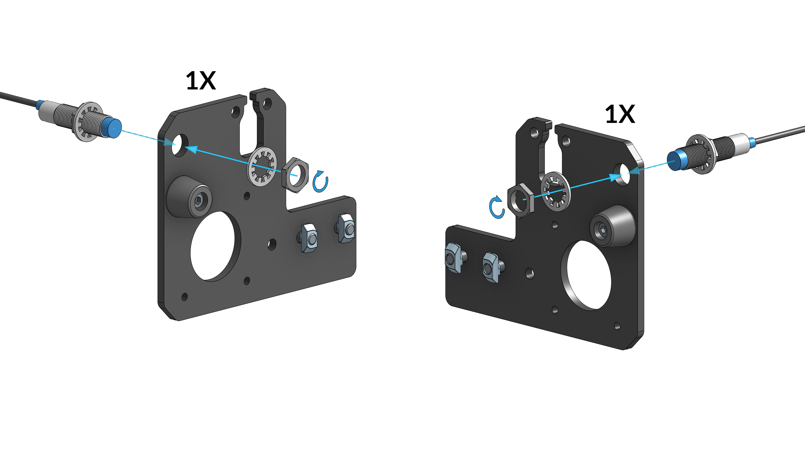

*Pair of end plates with inductive sensors installed*

The sensors can not stick out past the bump stop. Adjust the sensor position, it should be recessed 1mm - 2mm from the face of the bump stop.

This step is **important** as it ensures the sensor will not be damaged when the Y gantry plates contact the bump stop during use.

Later on, when you try homing, you may need to adjust sensor position if you encounter alarms.

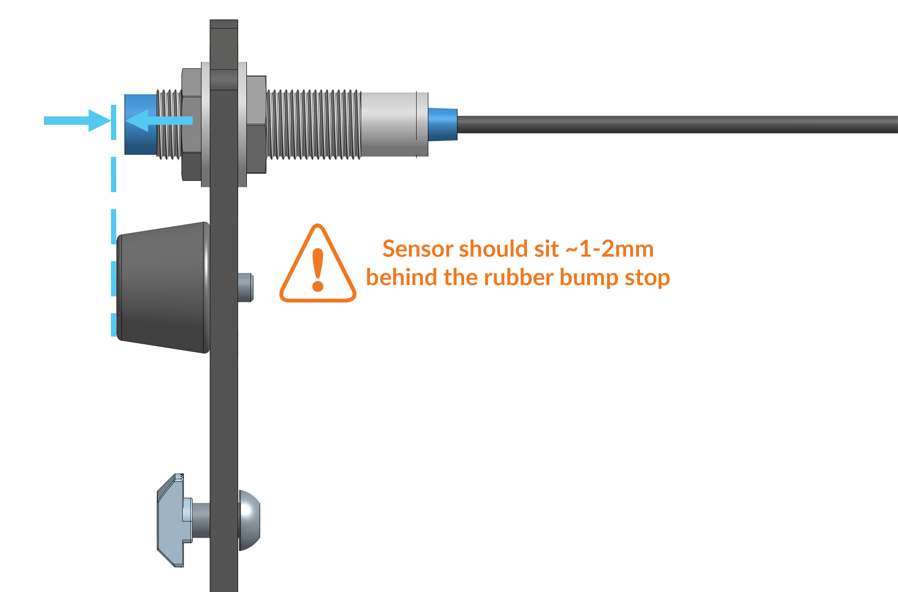

*Sensor offset from bump stop*
