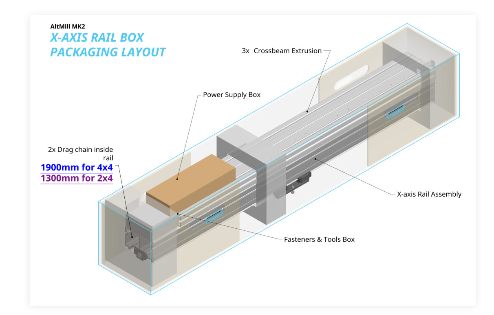
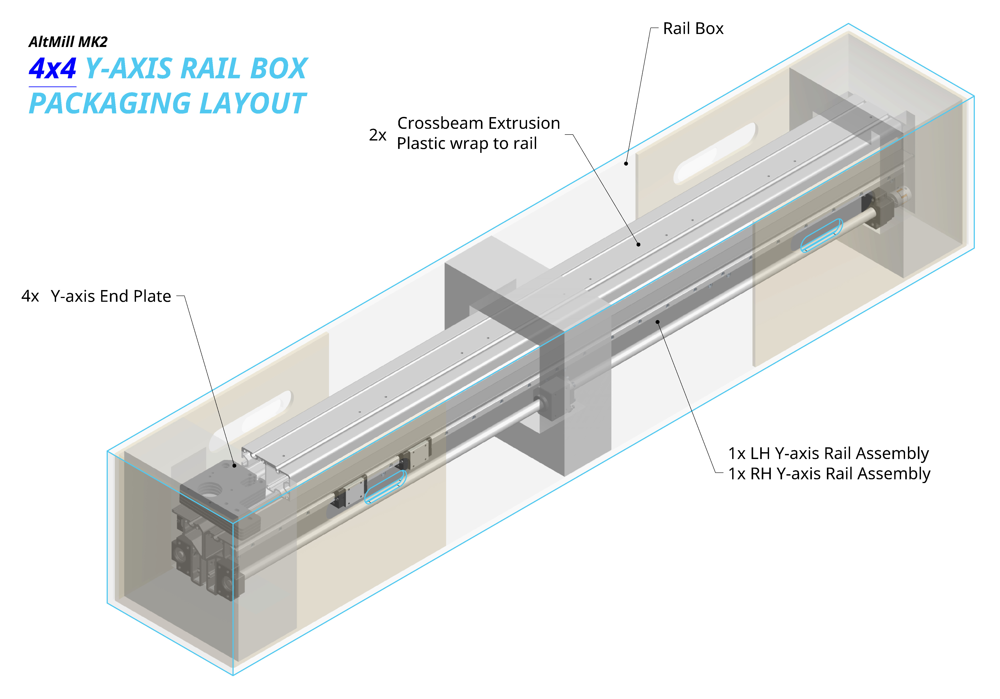
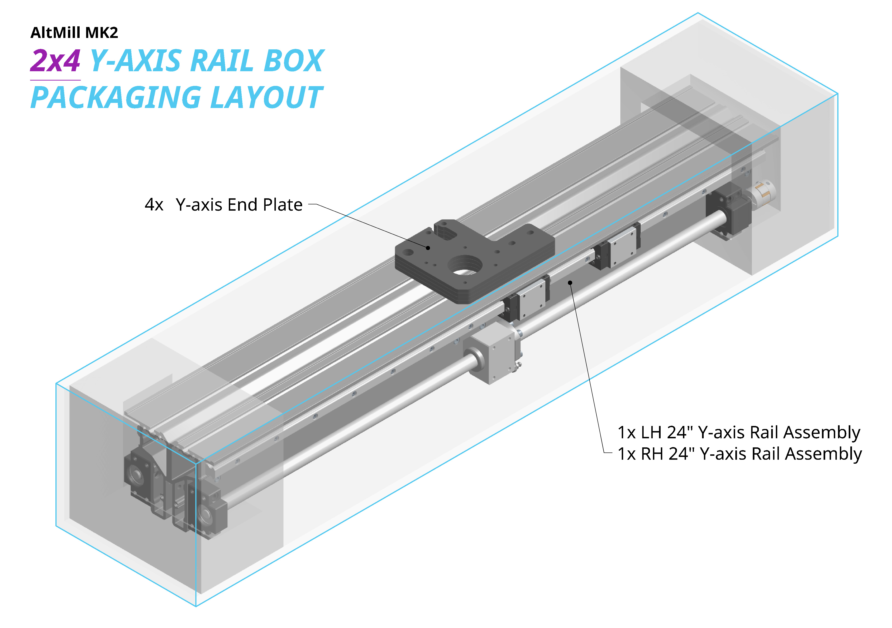
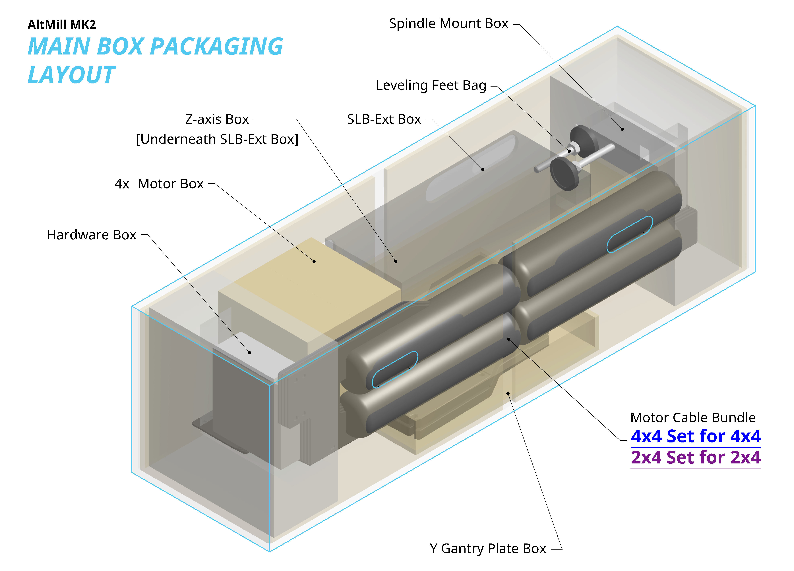

Make sure you have all the parts you need for a smooth assembly. Open all boxes and unpack the parts, but **leave any wrapping around the linear guide blocks on the left and right Y-axis rails in place until table assembly is complete**.

If the linear guide blocks arrive unwrapped, secure them with painter’s tape so they cannot slide off the rails. Sliding a block off its rail can release its ball bearings and damage the assembly.

> **Drag chains are stored inside the rails. Please check there.**

### AltMill MK2 Kit Parts List

#### X-Axis Rail Box

- 1x X-Axis Assembly
- 1x Drag Chain — packaged inside the X-axis assembly
- 1x 48V 10A Power Supply
- 3x Crossbeam Extrusion
- 1x 80mm Spindle Mount

{.aligncenter .size-medium}

#### Y-Axis Rail Box

- 1x Left Y-Axis Assembly
- 1x Right Y-Axis Assembly
- 4x Y-axis End Plate
- 2x Crossbeam Extrusion (**4x4 only**)
- 1x Drag Chain

{.aligncenter .size-medium}

{.aligncenter .size-medium}

#### Main Box

- 4x Table Leg
- 1x Left Y-axis Gantry Plate
- 1x Right Y-axis Gantry Plate
- 3x Closed Loop Stepper Motor — with pre-installed couplers
- 1x Z-Axis Assembly
- 4x Leveling Feet
- SLB-EXT Box
    - 1x SLB-EXT Controller with Enclosure
    - 1x 3D Printed E-stop Mounting Plate
    - 1x SLB E-Stop Button Module
    - 1x SLB E-Stop Cable
    - 1x USB-C Cable
- Hardware Box
    - 1x Drag Chain Bracket
    - 8x Integrated Sensor Bump Stop
    - 4x 3D Printed Cable Hanger Clip
    - Zip Ties
    - 4x Inductive Sensor with Pigtail
- Fasteners & Tool Box
    - Part 1 Table Assembly Bag
        - M6-14mm Button Head Cap Screws
        - M5-18mm Tall Crossbeam Socket Head Cap Screws
        - M6 Twist-in T-nuts
        - M5 T-nuts
        - M5-20mm Socket Head Cap Screws
    - Gantry & Electronics Bag
        - M4-16mm Socket Head Cap Screws
        - M5-10mm Socket Head Cap Screws
        - M5-16mm Socket Head Cap Screws
        - M6-25mm Button Head Cap Screws
        - M6-35mm Flanged Button Head Cap Screws
        - M6 Shoulder Screws
        - M5 Nylock Nut
    - 2x Eccentric Bushing
    - 1x 4mm Hex Key
    - 1x 3mm Hex Key
    - 1x AltMill Wrench
- 4x Motor Covers with M3-40mm Hardware
- X, Y1, Y2 and Z Motor Cables

**Older kits:** AltMill kits received before July 2025 include six rubber bump stops instead of the integrated sensor bump stops. Follow the corresponding instructions later in the assembly guide.

<!-- EDITOR: The update PDF adds M5-20mm screws to the table bag, contradicting the old instruction to discard them. This list follows the PDF; confirm their purpose and inclusion before publishing. Do not restore the discard instruction without checking. -->
<!-- RENDER UPDATE R02: Replace this older Main Box render. Show the Fasteners & Tool Box with both bags, tools and bushings. Remove loose couplers and show them fitted to the motors. -->

{.aligncenter .size-medium}

#### Spindle Kit Box

- 1.5kW or 2.2kW Spindle
- 1x Plastic VFD Mounting Spacer **or** 3D Printed Bracket
- Spindle Accessories Bag
    - 1x ⅛” ER20 Collet
    - 1x ¼” ER20 Collet
    - 1x ⅜” ER20 Collet
    - 1x ½” ER20 Collet
    - 1x ER20 Nut Wrench
    - 1x ER20 Shank Wrench
- VFD Unit
    - 1x VFD AC Power Cable
    - 1x VFD RS485 Cable
    - 1x Spindle Cable
- [Dust Shoe Box](https://www.youtube.com/watch?v=EDFtzKVT4R4)
