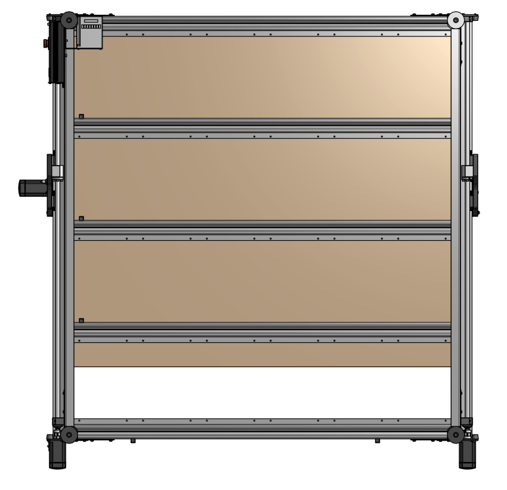
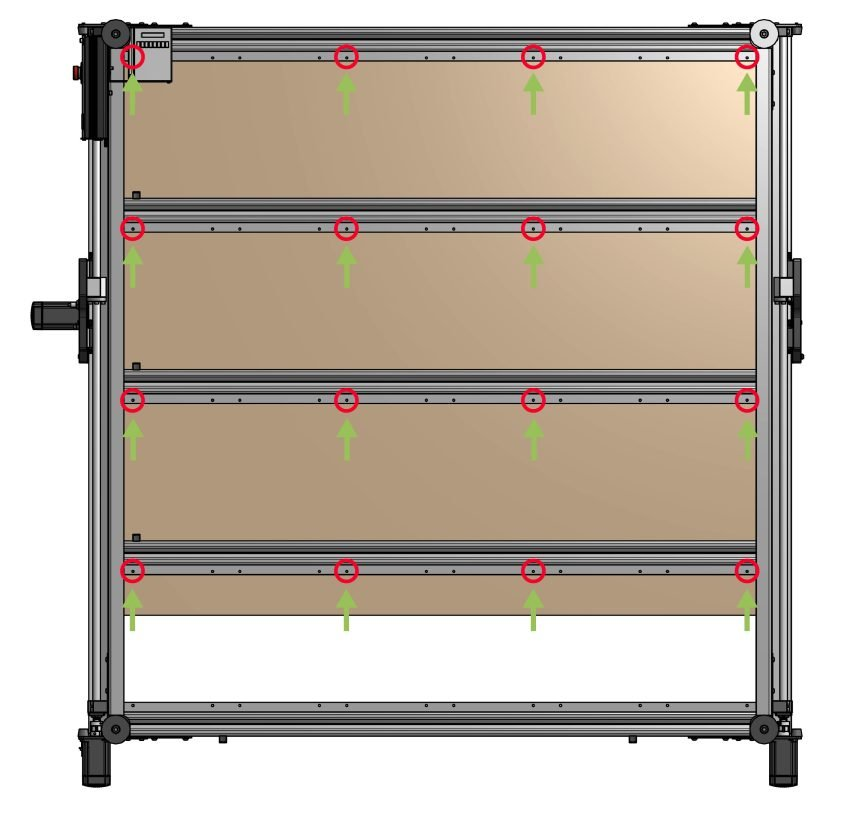
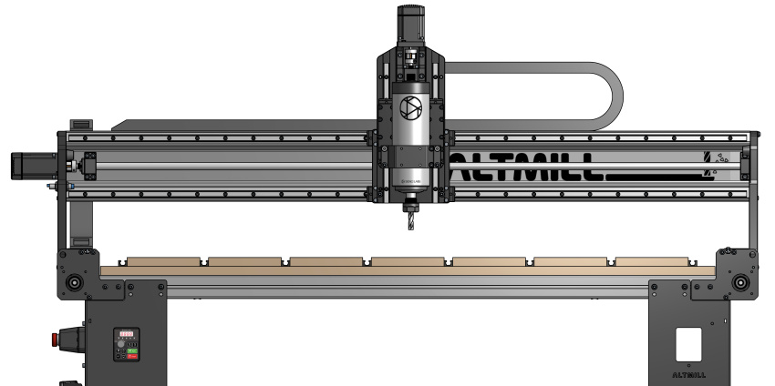
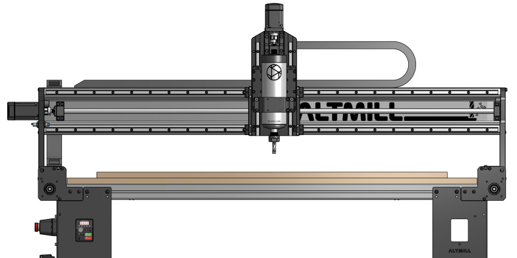
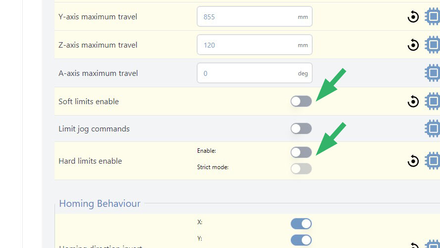
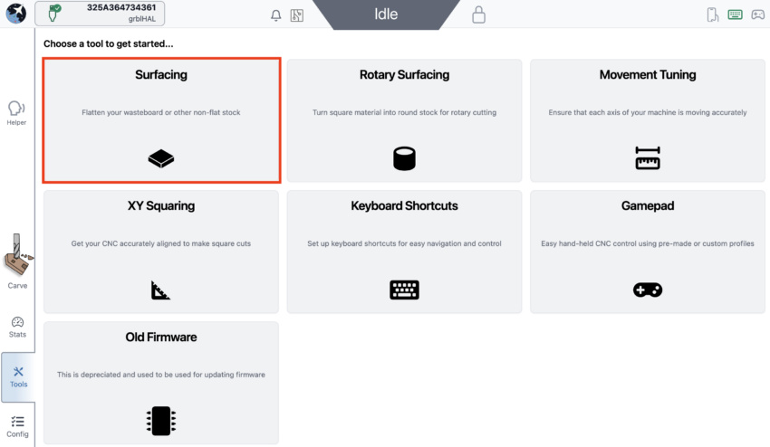
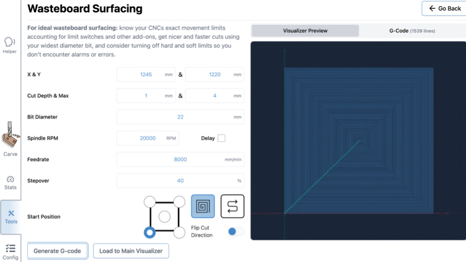
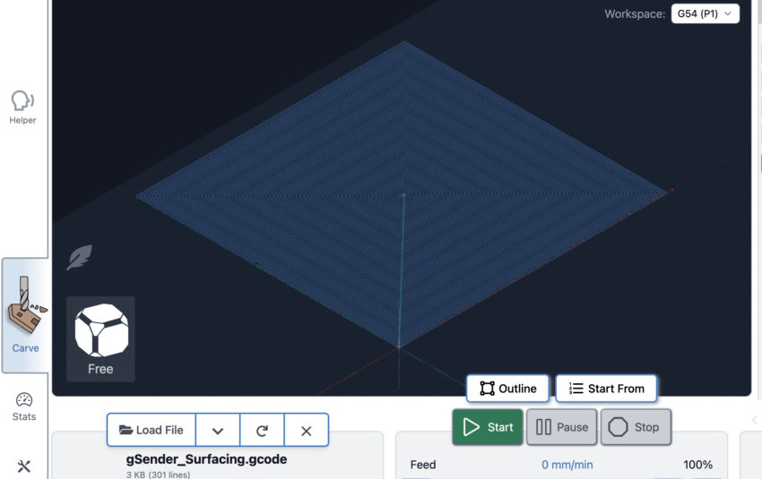
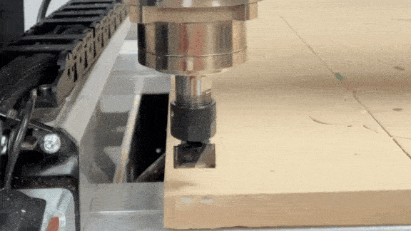
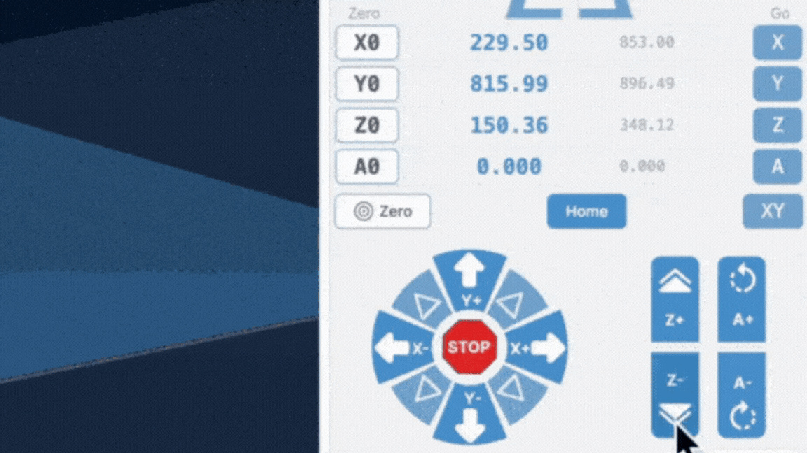

### Table Surface

The AltMill table should consist of 2 layers – one as the table surface and one as the wasteboard (spoilboard). The wasteboard acts as a replaceable top layer for material stock to be mounted on during machining. It could be a full sheet of MDF or a set of slats.

First we will set up the table surface. You will need at least one 4’x8’ sheet of ¾” thick MDF.

- For the 4×4 AltMill, cut this down in length to 51.75” to yield a 48×51.75” sheet – this will be the table surface.
- For the 2×4 AltMill, cut this sheet down again to a final size of 34.3”x51.75”

For reference, full dimensions of the table can be found here: [4×4 AltMill Table Dimensions](https://sienci.com/wp-content/uploads/2025/01/MK2-4x4-Key-Dimensions.pdf), [2×4 AltMill Table Dimensions](https://sienci.com/wp-content/uploads/2024/12/MK2-2x4-Key-Dimensions.pdf)

Lay this MDF sheet onto the top of the AltMill, filling the entire width of the frame, while lining up the front edge of the sheet with the front of the machine.

{.alignnone .size-medium .aligncenter}

<em>Underside view of table, with MDF sheet lined up to the front edge of table</em>

From underneath the table frame, install ¾” long #6 or #8 wood screws through the holes in each crossbeam and into the MDF sheet. There are many holes here that exist for supporting future T-track systems, but you may choose to use the four (4) holes per crossbeam as shown.

{.size-medium .aligncenter}

<em>Underside view of table, indicating crossbeam holes</em>

At this point, you have set up the table surface. Now, proceed with one of these wasteboard options:

- [Install the T-track set](#t-track-installation) alongside MDF slats
- [Install a sacrificial top sheet](#sacrificial-sheet-setup)
- [Skip to ‘surfacing’](#surfacing) where you would machine directly onto the single sheet of MDF without any sacrificial top sheet to create a flat working surface (not recommended).

#### T-track Installation

If you are installing the [T-track set](https://sienci.com/product/t-tracks-and-clamps-set-48-34/) as part of your wasteboard, take the remainder of your 4’x8’ sheet of MDF that was previously cut, which should measure about ~44”x48”. Cut this extra material into seven (7) ‘slat’ pieces that are ~6.125” wide.

If you’re installing these onto a 2×4 AltMill, you’ll want to trim each of these seven pieces to a length of 34.3”.

These will be placed in between each of the eight (8) T-tracks. Lay all 7 slat pieces and 8 T-track sections onto your table surface, lining these up with the front edge of the table.

{.aligncenter .size-medium}

<em>Front view of machine with slats and T-tracks placed on table surface</em>

Use ¾” long #6 or #8 wood screws to secure the T-tracks, and 1 ¼“ long #6 or #8 wood screws to secure the slats into the MDF table surface. You’ll want to create a recess in each slat for the heads of the wood screws, so that they sit below the top surface, as we will be surfacing these slats later on. Typically, 8 screws will be used on each slat but this may vary for your setup.

Once finished, you’re ready to move on to surfacing so that your projects sit flat on your machine!

#### Sacrificial Sheet Setup

**4×4 AltMill:** The 44”×48” and 48”×48” sacrificial-sheet examples below are for the 4×4.

If installing a plain sheet of MDF to use as your wasteboard, you can either reuse the remaining 44”x48” sheet of MDF, which will reduce the working surface area of your machine to that size, or you can recut a 48”x48” wasteboard sheet from a new piece of MDF, and keep the other half as a replacement for later. If cutting a new sheet, you may choose to use ½” thick MDF since this is a bit cheaper and easier to transport.

<!-- Q-WASTEBOARD-01: Confirm the preferred 2x4 sacrificial-sheet cut plan. The existing table dimensions are preserved, but no unverified top-sheet dimensions or new surfacing travel limits are introduced. -->

**2×4 AltMill:** Trim the sacrificial sheet to the footprint you want to use within the 34.3”×51.75” table surface. Do not use the 4×4 sheet dimensions unchanged. The table surface is larger than the machinable area; check the reachable area with your actual surfacing bit before choosing the wasteboard footprint. Material outside that area will not be surfaced by the same toolpath.

{.alignnone .size-medium .aligncenter}

<em>Front view of machine with remaining 44″x48″ MDF sheet</em>

Lay this MDF sheet onto the table, and secure this with wood screws placed in a grid pattern – typically 16 screws will be adequate but this may depend on how warped the MDF you have is. Be sure to recess the heads of each screw below the surface of the MDF since we’ll be machining the top surface of these slats.

Once finished, you’re ready to move on to surfacing so that your projects sit flat on your machine!

### Surfacing

Surfacing is simply the process of ‘flattening’ your AltMill wasteboard setup. Flattening is in quotes because we’re not actually making a true flat surface with this process, instead we’re trying to make a surface that’s parallel to the CNC. This is important because when you tell it to cut a 1mm deep circle into your material, you’d want it to be 1mm deep at all points along that circle, not deeper in some areas and shallower in others.

Surfacing can also:

- Eliminate warp or bumps in the material being used as your wasteboard
- Be used for maintenance purposes to clean off old marks and scars and leave you with a new, clean surface to glue, clamp, and mount your material to

When surfacing, you will want a cutting tool specific to this process, called a surfacing bit. These are made for light passes but are usually larger in diameter, so they can cover a large area quickly while leaving a good surface finish. Larger bits can also reach further outside the cutting area of the machine. We typically use the 22mm surfacing bit we sell on our [store](https://sienci.com/product/22mm-surfacing-bit/).

#### Step-by-step Guide

We have a video on how to surface your AltMill, as well as written steps.

<iframe allow="accelerometer; autoplay; clipboard-write; encrypted-media; gyroscope; picture-in-picture; web-share" allowfullscreen="" frameborder="0" height="675" loading="lazy" referrerpolicy="strict-origin-when-cross-origin" src="https://www.youtube.com/embed/hZ8ltb0w3Ao?feature=oembed&amp;enablejsapi=1&amp;origin=https://resources.sienci.com" title="CNC Tips ❘ Surfacing 101" width="1200"></iframe>

1. To generate the g-code for surfacing on your machine, power on your machine and connect to gSender.

2. Open the **Config** tool, and under **Homing/Limits**, disable the hard and soft limits. You will get an Alarm 2 if soft limits are enabled and you won’t be able to surface you spoil board.

{.aligncenter .size-full}

3. **Home** your machine, as you usually do after connecting.

4. Navigate to Tools, then to Surfacing.

{.alignnone .size-medium}

5. You will find the surfacing settings, please adjust them according to your needs.

**X & Y:** This is the max dimensions you wish to surface. <strong>These sizes will be determined by the size of your bit, and should only be used as a starting guide. If using a large surfacing bit, you may need to decrease the dimensions. </strong>

- For 4×4 — 1245mm (49″) & 1220mm (48″)
- For 2×4 — 1245mm (49″) & 650mm (25.6″)

**Cut Depth:** Keep this at **0.04in (1mm)** or less, cutting any deeper with a large bit can result in an uneven surface

**Max:** this is the total depth of cut into your wasteboard. This is normally set to **0.04in (1mm)**. Greater depth is necessary if your board is very warped or has deep imperfections. If the Max and Cut Depth are set to the same value, the machine will perform only one surfacing pass.

**Stepover:** Start with a stepover of about **40% of the tool diameter**. A smaller stepover places passes closer together, usually giving a smoother finish and a longer cutting time. A larger stepover spaces passes farther apart, reducing cutting time but potentially leaving a rougher finish.

**Spindle RPM:** A speed setting of around **20,000 RPM** works well for MDF and other woods.

**Feedrate:** Setting your feed rate to **8000 mm/min** should be suitable for the AltMill cutting MDF, however running this slower may produce a slightly nicer finish.

**Start Position:**We recommend to keep this at the bottom left corner of the square, which is the default setting. This means that the cutting will start at the bottom left corner of your wasteboard.

{.alignnone .size-full}

6. Once you adjusted the settings, you can click ‘**Generate G-code**’ to view the toolpath using the Visualizer Preview on the right side of the window.

7. Click ‘**Run on Main Visualizer**’ to load the file onto gSender.

{.size-medium .aligncenter}

8. Remove the dust shoe to **avoid damage to the dust shoe** when the machine is at the travel limits. However you should still run a vacuum to minimize MDF dust in the air.

9. **[Zero your machine](https://resources.sienci.com/view/cnc-machine-coordinates/)** at the Start Position you indicated (by default it is the bottom left corner of the wasteboard). Otherwise your machine does not know where to begin cutting.

i. Jog the machine to the corner of the MDF wasteboard

ii. With the surfacing bit installed, jog the machine down in the Z direction, until the bit touches the MDF

iii. Press **Zero** OR press **X0**, **Y0** and **Z0** individually

{.alignnone .size-full}

{.alignnone}

10. Put on a **mask or respirator****,** since MDF dust is very fine.

11. Then you can press **Start Job**!

12. Enable the Soft and Hard Limits

#### Alarms and Errors

If you run into alarms related to **soft or hard limits,** first make sure you have [homed your machine](https://resources.sienci.com/view/am-mk2-first-movements/#gsender-1-5-0-and-above). Then try to run the surfacing job again.

If you still are seeing alarms please see this [troubleshooting page.](https://resources.sienci.com/view/am-troubleshooting-homing-and-machine-limits/#alarm-2-machine-travel-exceeded-during-a-job)
