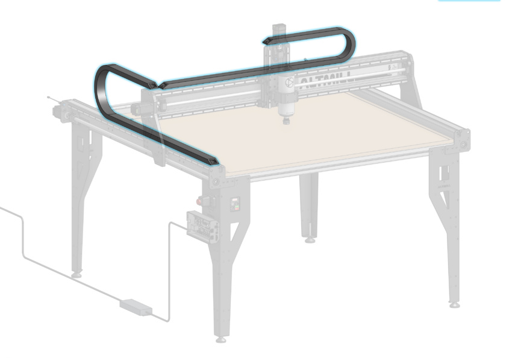

### Controller Mounting

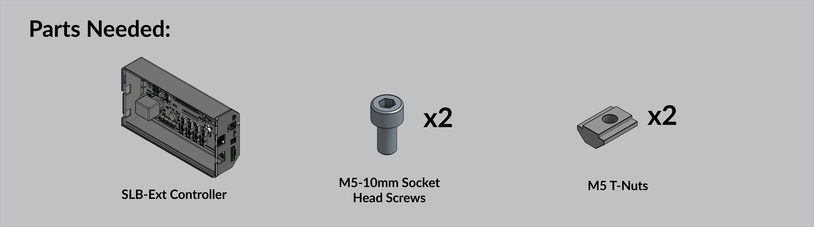

Insert two (2) M5-10mm socket head screws into the two (2) holes under the “ALTMILL” cutout in the side of the left leg. Thread M5 T-nuts onto the screws, leaving the T-nuts loose.

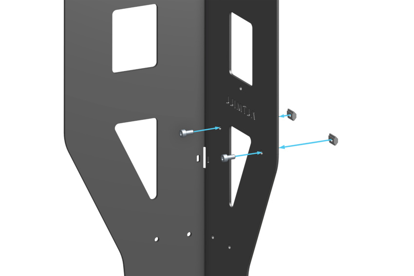

Slide the SLB-EXT enclosure onto the T-nuts. The T-nuts fit into the T-slot from the left side of the SLB-EXT enclosure. Orient the enclosure such that the Sienci Labs logo is on the bottom left corner when looking at the acrylic face plate.

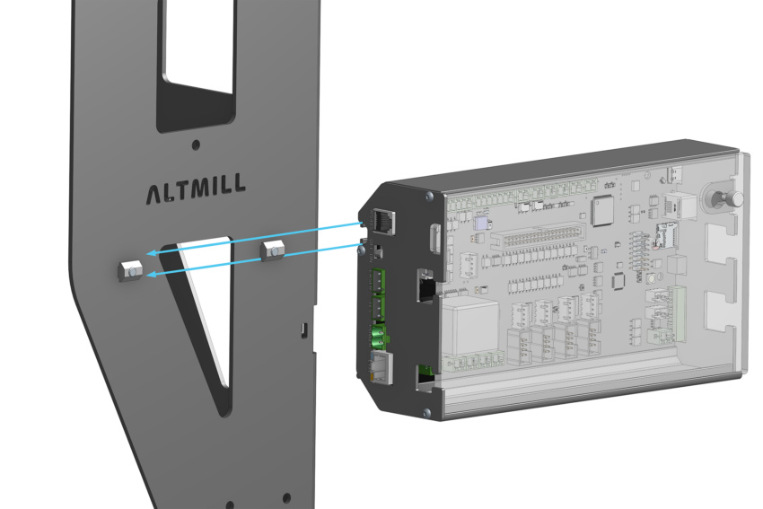

Tighten the M5-10mm screws, clamping the enclosure to the table leg.

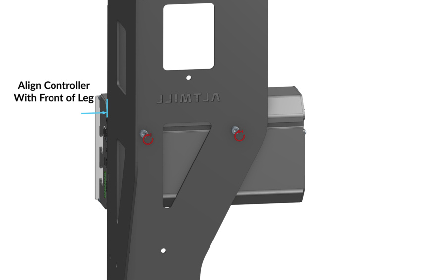

**Note:** If you thread the M5 T-nut too far onto the M5-10mm screw you will have a difficult time sliding the T-nut into the T-slot of the enclosure.

### Cable Management and Spindle VFD

<!-- Q-ATC-01: Confirm the exact ATC branch/return points, including shared Y2 routing and all four motor/sensor connections. The callout does not authorize skipping the whole page. -->

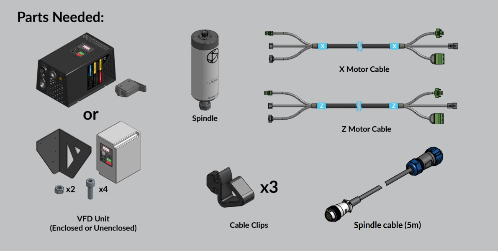

**Installing the ATC kit?** Follow the [ATC installation guide](https://resources.sienci.com/view/atc-unboxing/) for the spindle, VFD and associated cable routing. If you are installing the standard spindle kit, continue below. The shared Y2 cable routing and Sensor and Motor Connections steps on this page are still required for the machine.

Install three (3) cable hanger clips along the length of the rear crossbeam. Insert the hanger into the T-slot horizontally and rotate 90 degrees clockwise to lock the hanger into place.

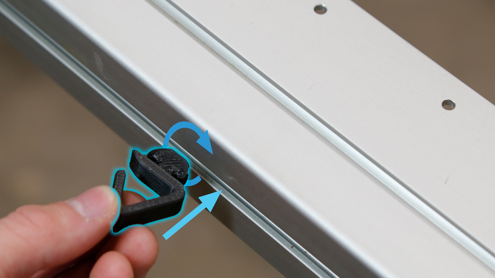

<em>Cable hanger installation</em>

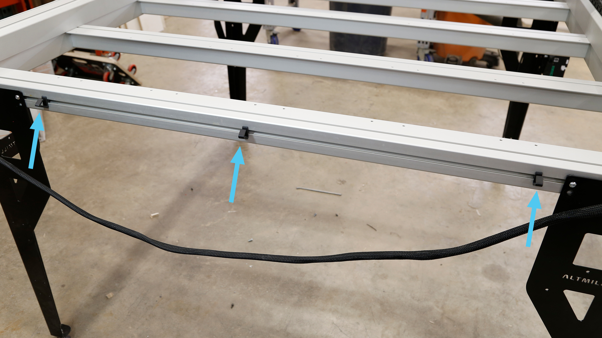

<em>Cable hanger location along crossbeam</em>

Insert the Y2 wire harness through the opening of the cable hangers. Leave both Y-axis motor cables unplugged from the motors during this step.

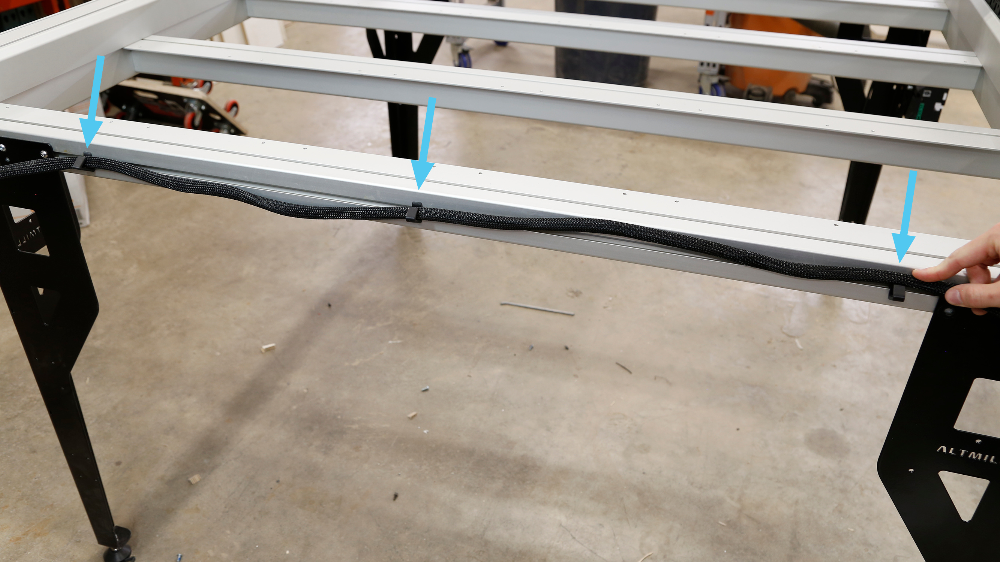

<em>Securing Y2 wire harness in cable hangers</em>

**If** you purchased the Sienci Labs Spindle Kit, please use either the Enclosed VFD (no VFD mounting bracket) or Unenclosed VFD (with VFD mounting bracket) instructions.

**If** you are using a third party spindle / router, follow the instructions for your specific spindle and come back to this assembly manual when you have mounted your spindle and are prepared to route the wires through the drag chains.   A 5m length towline rated cable is recommended for 2×4 and 4×4 AltMill models.

#### Enclosed VFD

[su_spoiler title="<strong>Enclosed VFD</strong>" open="yes" style="fancy" icon="chevron" anchor_in_url="yes"]

Use the plastic VFD mounting spacer to mount the E-stop module using two M5-30mm screws and two M5 nuts included with the spindle kit.

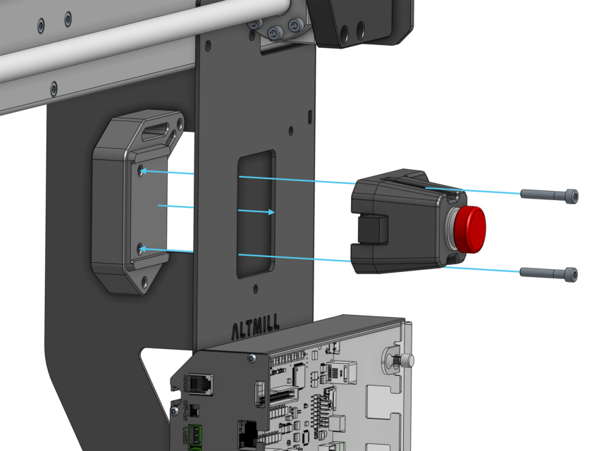

Mount the VFD unit inside the table leg using the remaining two M5-30mm screws included with the spindle kit. The VFD unit’s front screen should line up with the cutout in the front of the table leg.

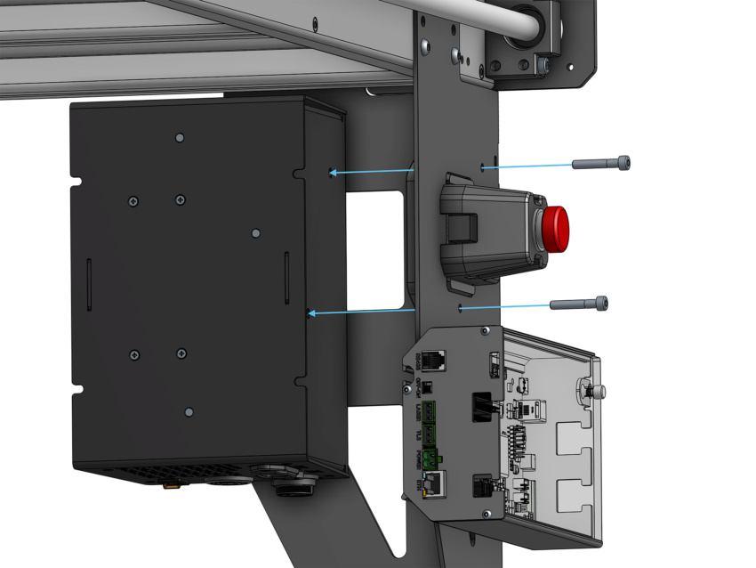

Plug in the included spindle control cable, AC power cable, and spindle cable into the bottom of the VFD unit. Plug in the AC power cable to your wall outlet or extension cable.

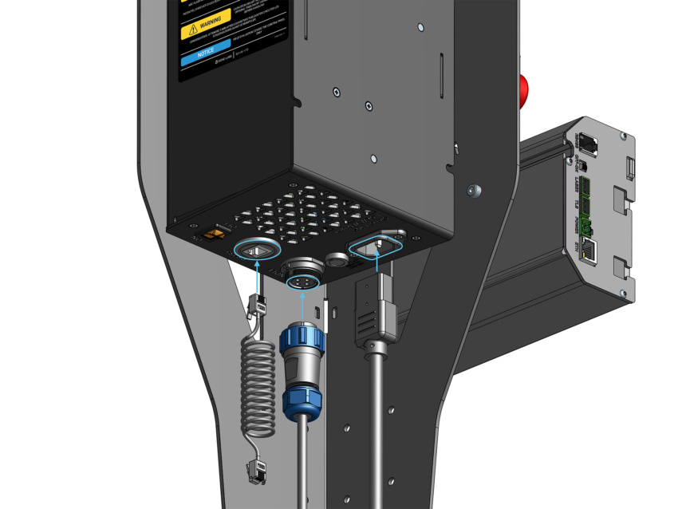

Plug in the other end of the spindle control cable to the ‘RS485’ connector on the rear of the SLB-EXT controller.

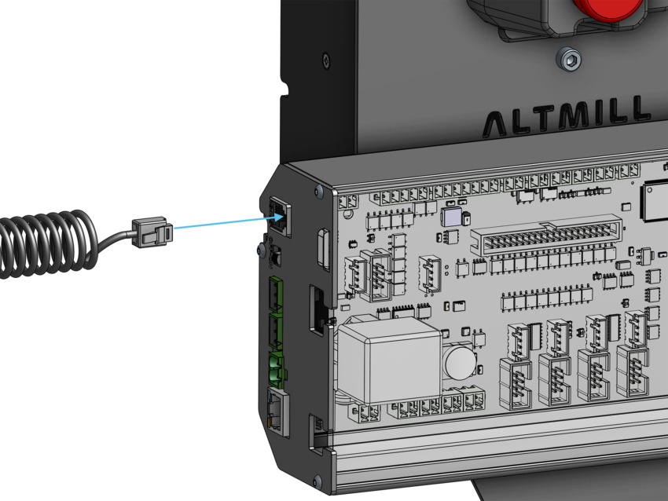

[/su_spoiler]

#### Unenclosed VFD

[su_spoiler title="<strong>Unenclosed VFD</strong>" open="no" style="fancy" icon="chevron" anchor_in_url="yes"]

Fasten the VFD to the VFD mounting bracket using two (2) M5-16mm socket head screws and M5 nylock nuts. The VFD is fastened to the long flange of the mounting bracket.

**Note**: The side of the included custom wrench can be used to hold the nylock nuts while tightening.

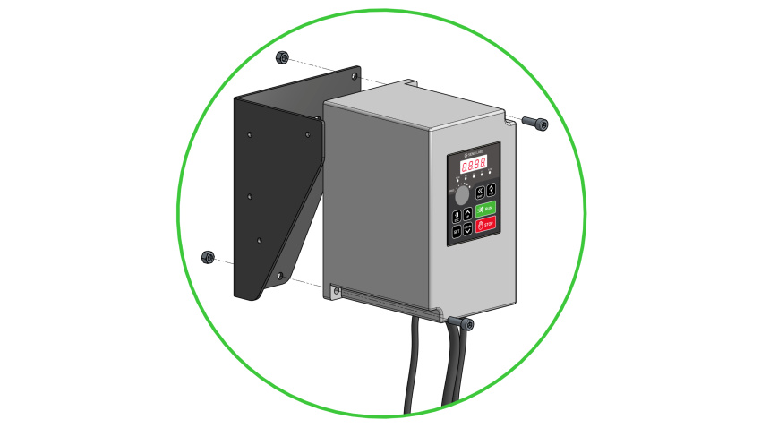

<em>Aligning holes between VFD unit and mounting bracket</em>

Fasten the VFD Mounting bracket to the inside of the **front left** table leg of the machine using two (2) M5-16mm socket head screws.

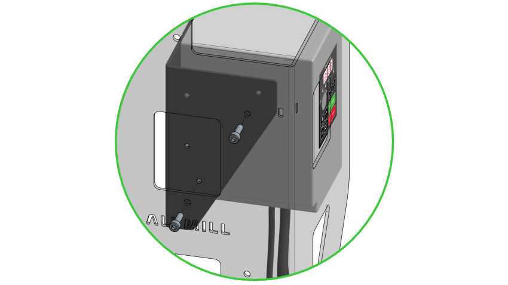

<i>VFD mounting bracket in position on front left table leg</i>

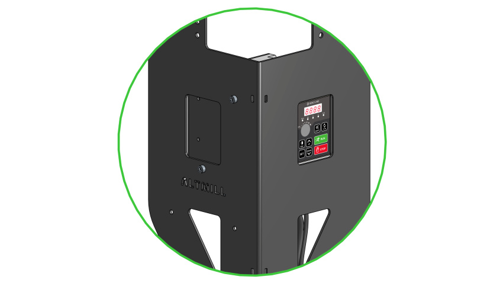

<em>VFD unit correctly mounted, control panel accessible through leg cutout </em>

[/su_spoiler]

Loosen the spindle clamping screws on the front of the spindle mount to allow the spindle to fit into the bore of the mount.

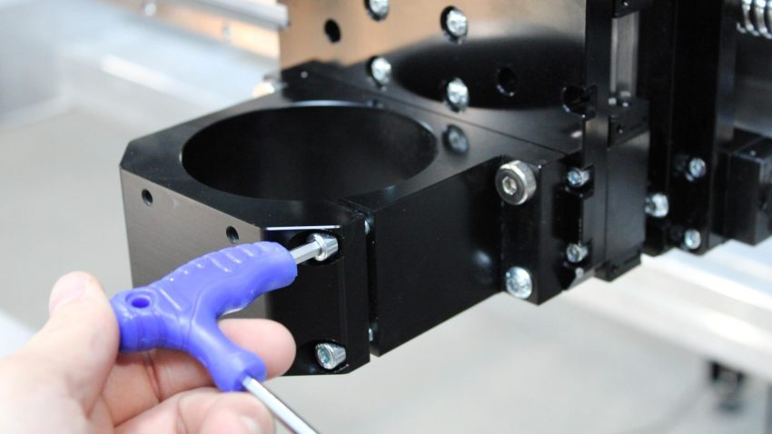

<em>Loosening clamping screws on spindle mount</em>

Place the styrofoam packaging on the front crossbeam of the table underneath the spindle mount. Adjust the height of the spindle mount, so that the distance from the bottom of the spindle mount to the top surface of the styrofoam is 110mm / 4.5 inches. Turn the ball screw using the motor coupler to adjust the height of the spindle mount.  Insert the spindle into the bore of the spindle mount until it rests on the top of the styrofoam.

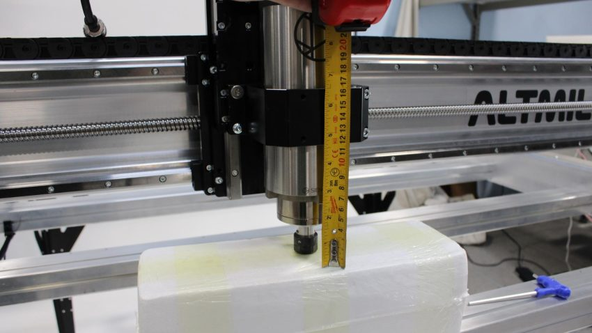

<em>Spindle mount height adjustment</em>

Fasten the two (2) spindle mount screws to secure the spindle in place.

Bring the spindle cable attached to the VFD around the back of the table leg, and moving from the front of the table to the back, bring the cable underneath the gantry, plugging the cable into the top of the spindle from the back of the gantry.

**Note:** It is **important** that this cable is routed in this path to allow it to be run through the drag chains.

**Note:** Match the keyed features on the cable connector with the slots of the spindle body receptacle, allowing the connector to mesh.

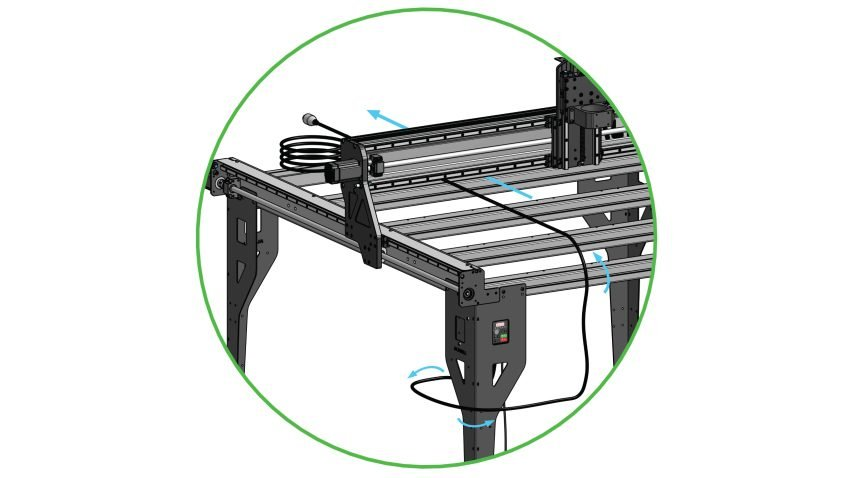

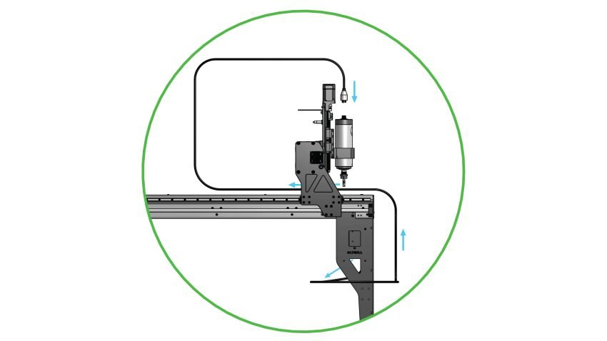

<i>Cable routing</i>

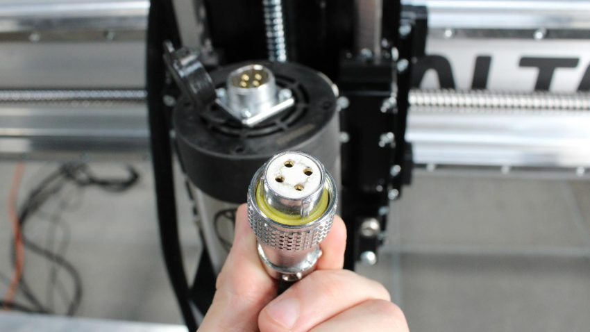

<i>Connector keys to mesh with spindle body receptacle</i>

Thread the connector onto the receptacle by rotating the collar on the cable side clockwise.  Pull on the connector to ensure it is secured.

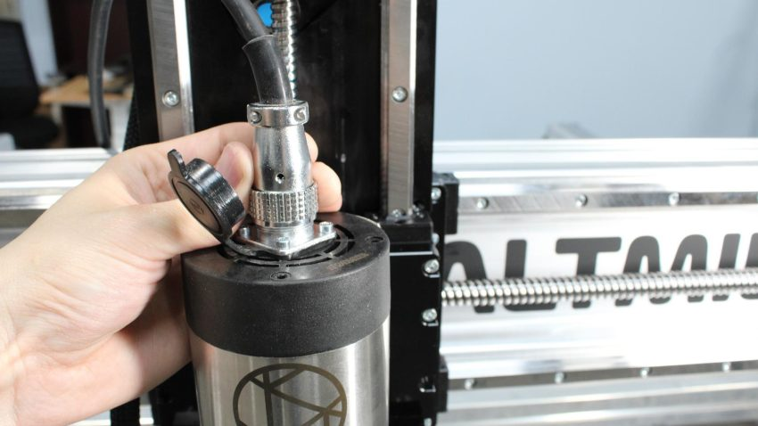

<em>Spindle cable collar threaded onto spindle connector </em>

Place the drag chain on the X rail. Fit the spindle cable and the Z-axis wire harness into the open drag chain. Press the clips down to secure the cables. To save on time, it is recommended to remove half the clips from the chain, in the case that you need to open the drag chain again.

**Note**: Check the drag chain ends to ensure they will interface correctly with the drag chain. Remember one link has a knobbed flange and the other a holed flange.

**Note:** Ensure the Z-axis wire harness is oriented such that the motor side connectors are exiting the drag chain opposite the X-axis motor.

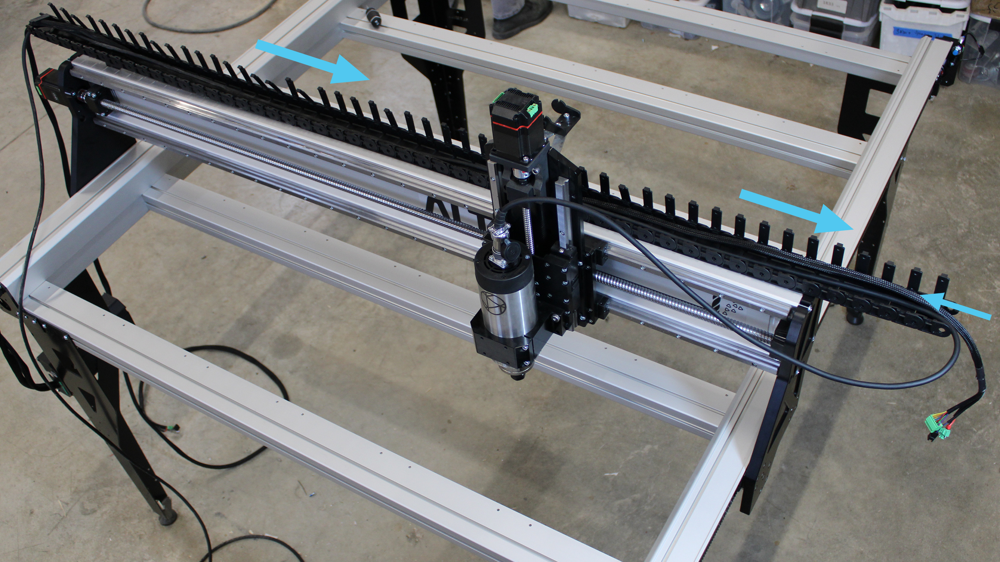

<em>Routing through X-axis drag chain</em>

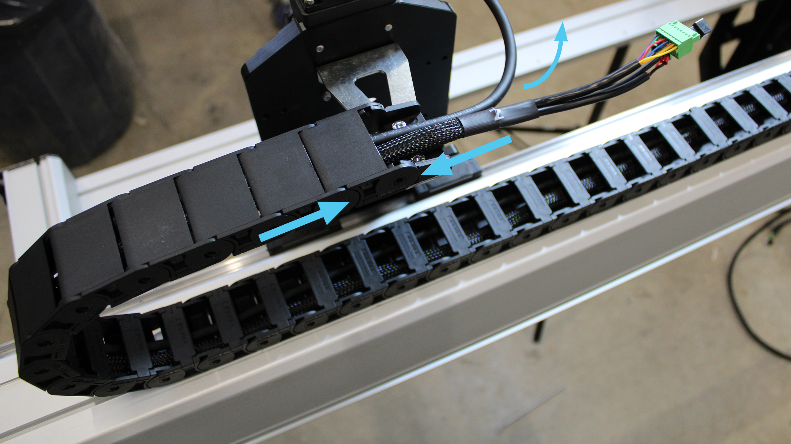

Install the drag chain onto the drag chain end links.

<em>X-axis drag chain secured on drag chain end link</em>

Place the drag chain on the left side Y-axis rail. Fit the X-axis wire harness, Z-axis wire harness, and spindle cable into the open drag chain. Press the clips down to secure the cables. To save on time, it is recommended to remove half the clips from the chain, in the case that you need to open the drag chain again.

**Note**: Check the drag chain ends to ensure they will interface correctly with the drag chain. Remember one link has a knobbed flange and the other a holed flange.

**Note:** Ensure the X-axis wire harness is oriented such that the motor side connectors are exiting the drag chain at the X-axis motor, not the opposite.

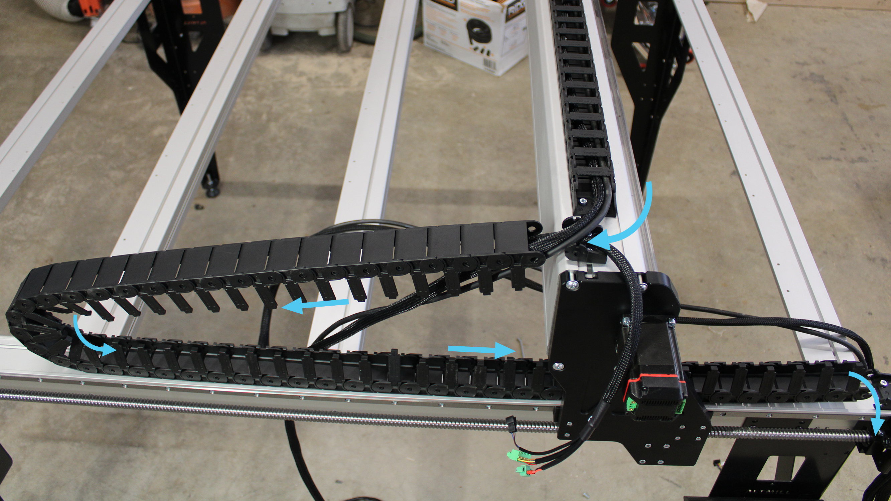

<em>Routing through the left Y-axis drag chain</em>

Install the drag chain onto the end links.

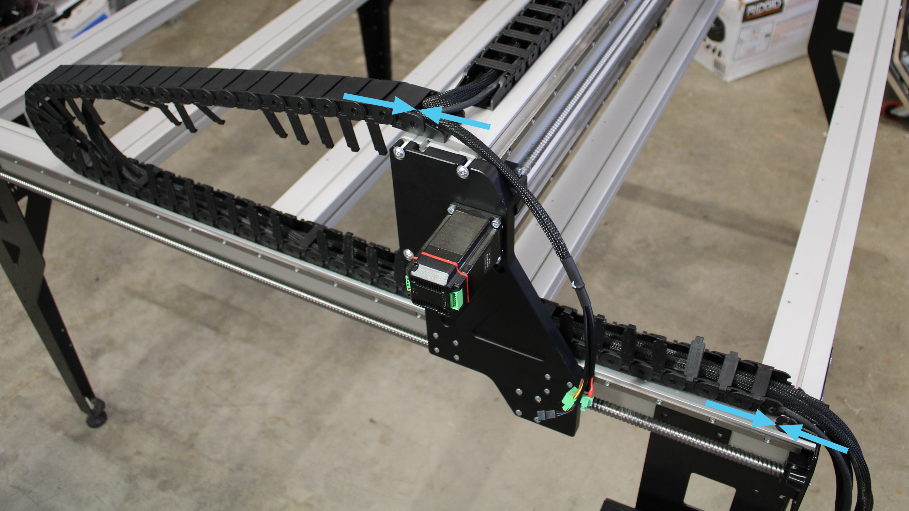

<em>Securing left Y-axis drag chain on drag chain end links</em>

### Sensor and Motor Connections

Plug the black connector exiting the X-axis wire harness into the plug of the inductive sensor.

Plug the power and signal connectors from the X-axis wire harness into the motor.

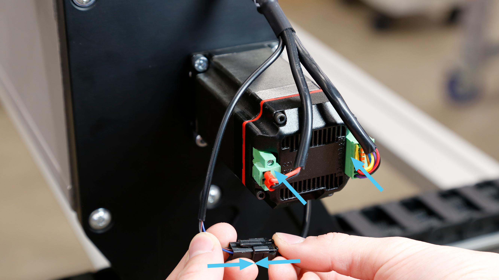

<em>X-axis power and signal connectors plugged in, sensor connector secured</em>

Use a small flathead screwdriver to fasten the screws of the power connector into the motor plug.

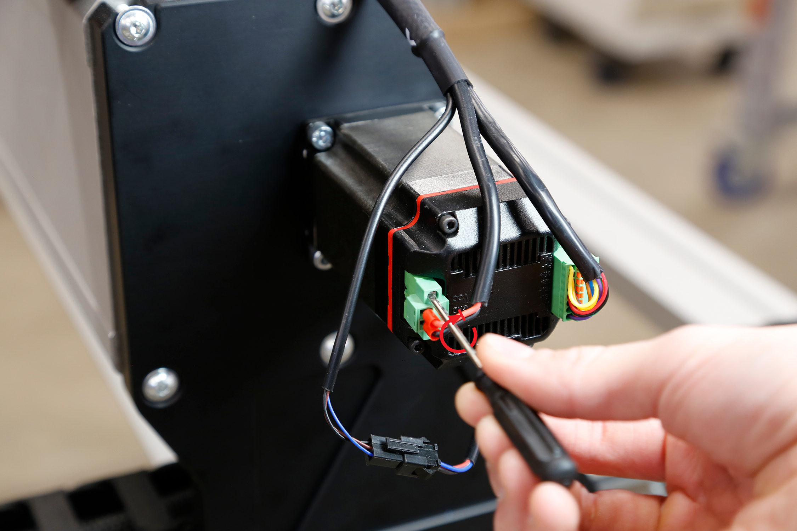

<em>Tightly securing screws on power connector</em>

Remove the top-left and bottom-right M3 screws from the X-axis motor using the 2.5mm Allen-key provided in the M3-40mm socket head screw bag.

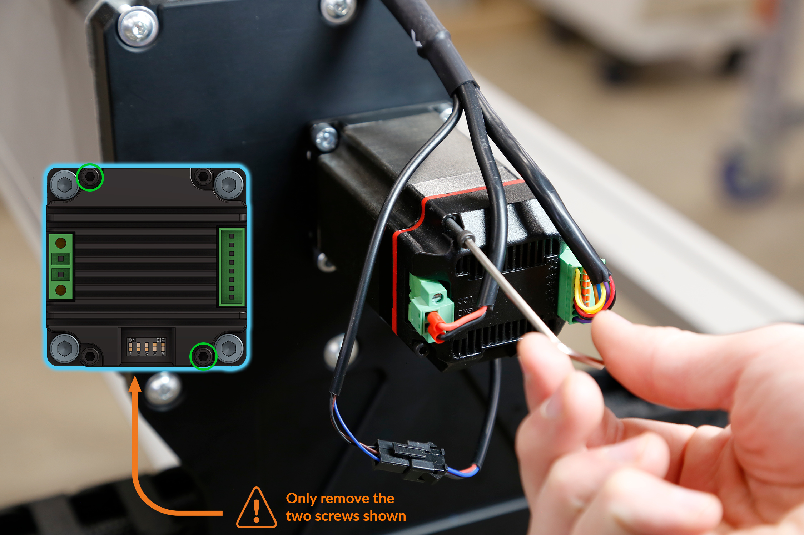

<em>Removing 2 motor screws at a diagonal</em>

Install the motor cover onto the back of the motor using M3-40mm screws. Orient the motor cover so the wires exit upwards.

**Note:** Install the motor cover gently to avoid damaging the wires attached to the connectors.

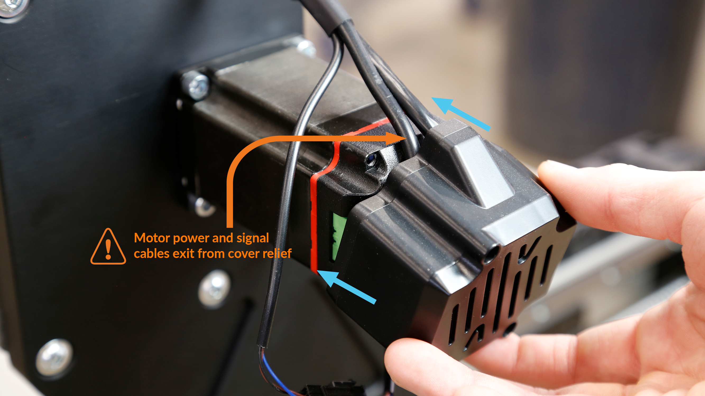

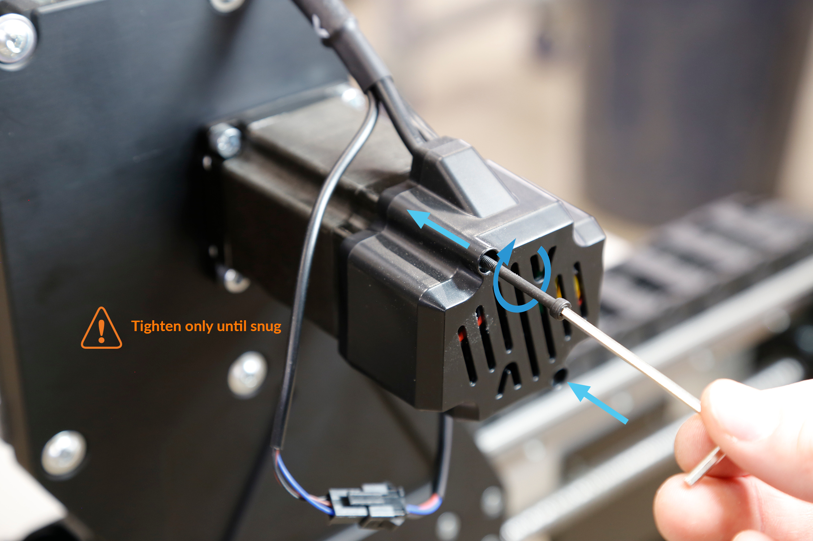

<em>Motor cover installation</em>

Repeat the previous steps for the Z, Y1 and Y2 motors.

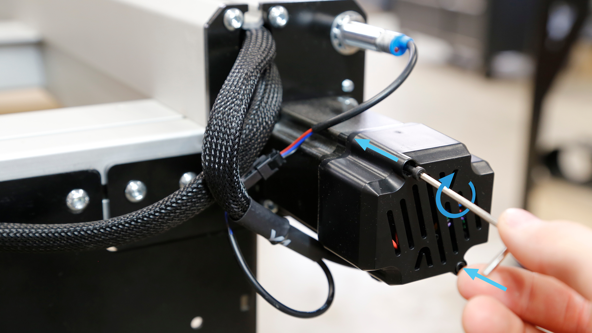

<em>Assembling motor cover onto Y-axis</em>

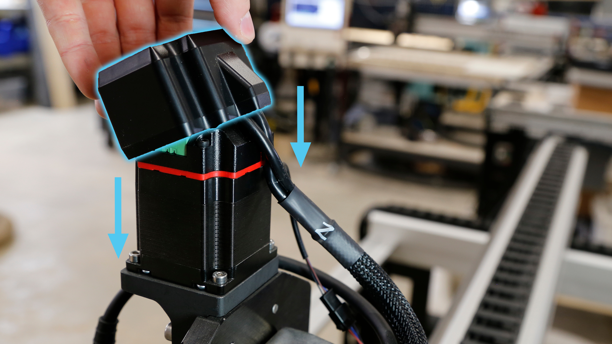

<em>Assembling motor cover onto Z-axis</em>

