

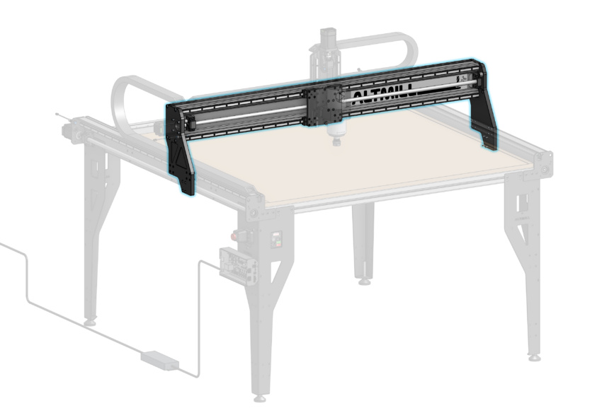{.aligncenter .size-medium}

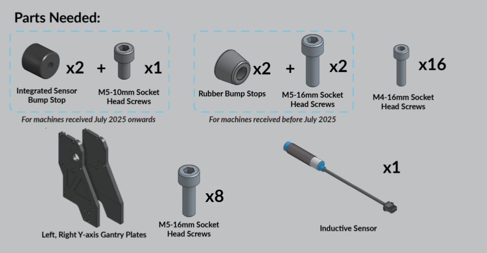{.alignnone .size-full}

### Y Gantry Plate Installation

With table assembly complete, remove any wrapping or temporary painter’s tape securing the linear guide blocks and ball screw nut. Keep the guide blocks on their rails while removing this protection.

Remove the plastic clip supporting the ball screw nut.

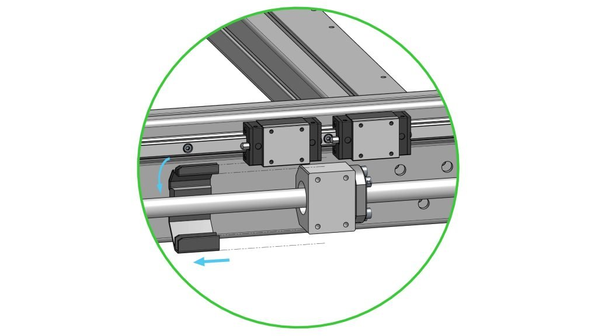{.aligncenter}

<em>Support clip removal</em>

Take note of the difference between the left and right side Y-axis gantry plates. The large hole indicates the left Y-gantry.

Additionally, take note of the Y-gantry plate orientation. In the image below, the front of each plate is pointed toward the center of the image.

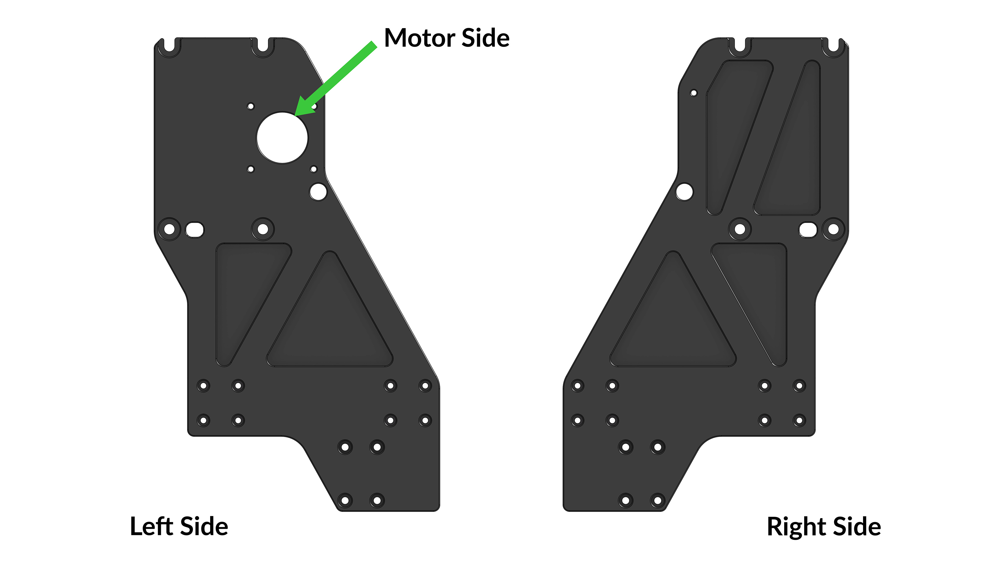{.aligncenter}

<i>Left and right Y-axis gantry plates with forward direction pointed toward center</i>

Move the linear guide blocks toward the front of the machine.

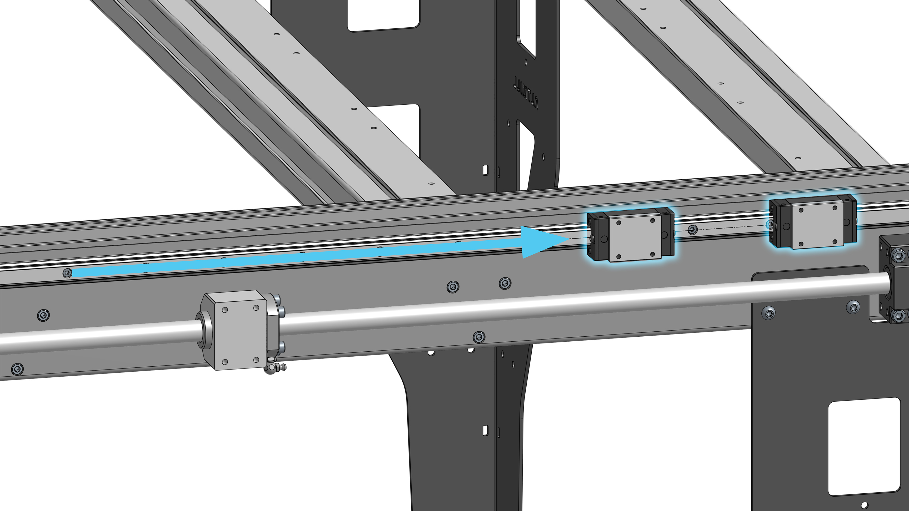{.alignnone .size-full}

<i>Linear guide blocks away from ball screw nut, toward front of machine</i>

Rest the reference edge of the Y-axis gantry plate on the top face of the two linear bearings. Use M4-16mm socket head screws to fasten the plate to the linear bearings. Start with two (2) screws, installing one screw in each bearing before moving on to install the remaining six (6) screws. **Leave** the eight (8) screws **loose** at this point to allow for easy installation of X-axis rail in the future.

**Repeat** the process on the other side of the machine.

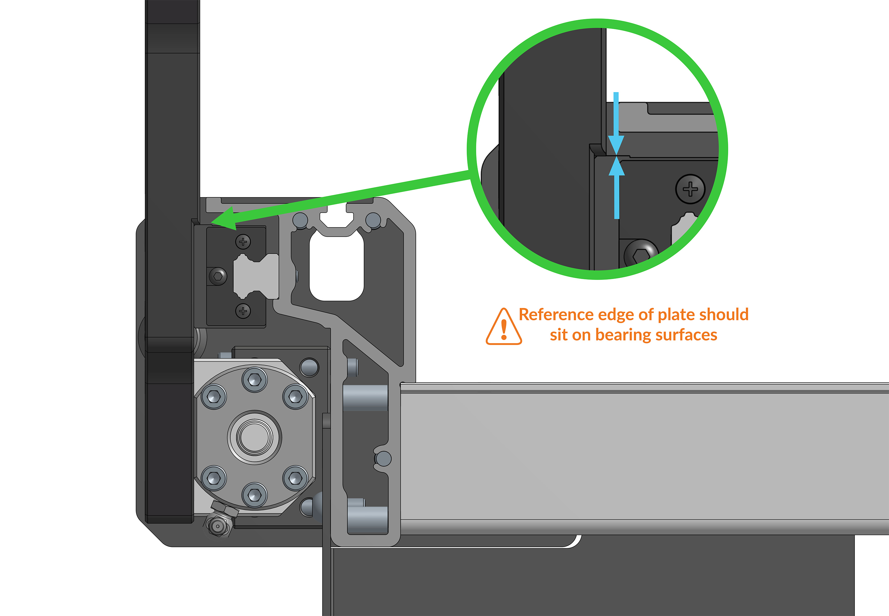{.aligncenter}

<i>Y-gantry plate reference edge sitting on linear bearings</i>

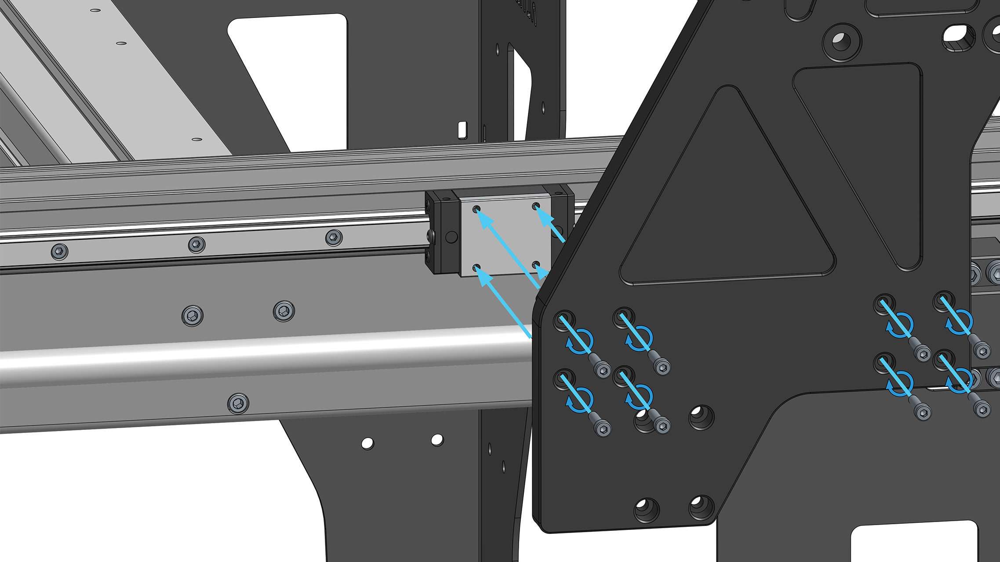{.alignnone .size-full}

<i>Y-axis gantry plate, linear bearing M4-16mm screw location, </i><b><i>leave loose</i></b>

Push the Y-axis gantry plate to the front of the machine, hard-stopping on the bump stop.

Push the ballscrew nut toward the front of the machine and align the threaded holes of the nut with the mounting holes of the Y-axis gantry plate.

Install four (4) M5-16mm socket head cap screws through the Y-axis gantry plate into the ball screw nut, **leaving** the screws **loose** at this point to allow for easy installation of X-axis rail in the future.

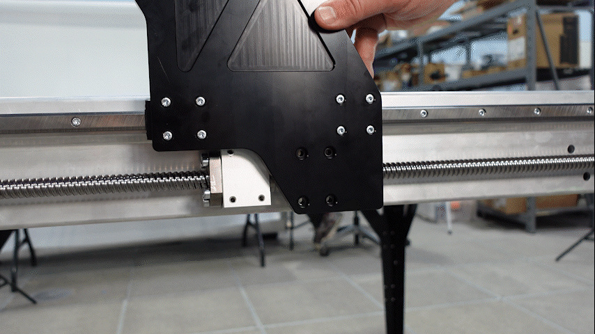{.aligncenter}

**Repeat** the process on the other side of the machine.

<i>Aligning Y gantry to aluminum ball screw nut block</i>

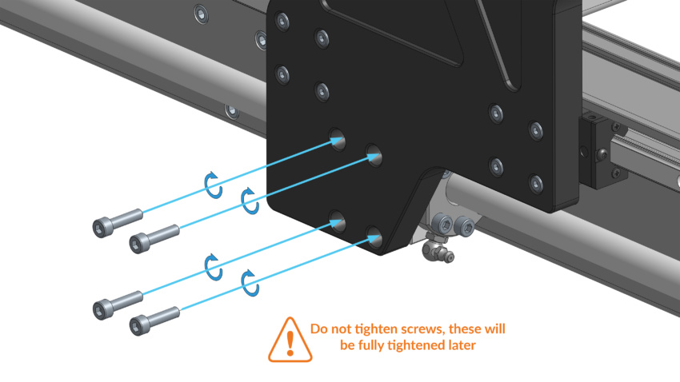{.aligncenter .size-medium}

<i>Y-axis gantry plate fastened to ball screw nut using M5-16mm screws, </i><b><i>leave loose</i></b>

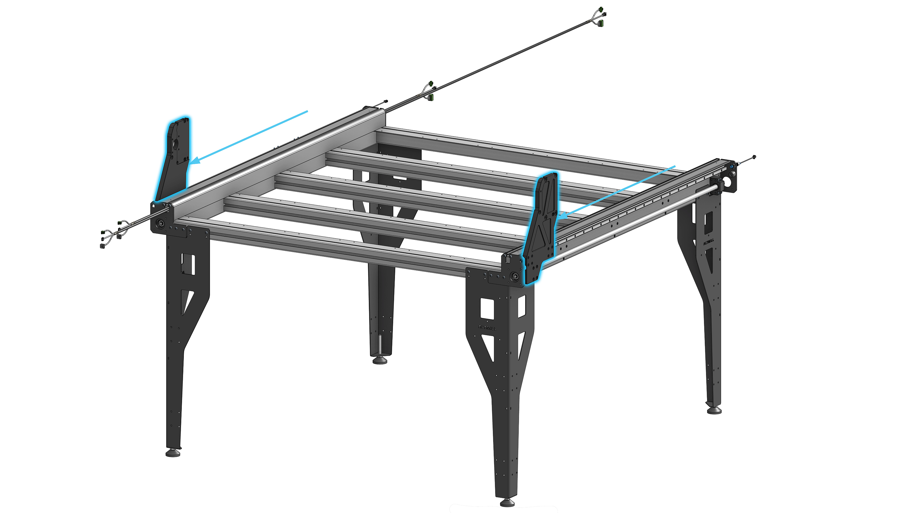{.aligncenter}

<i>Y-axis gantries pushed against front bump stops</i>

[su_spoiler title="<strong>Integrated Sensor Bump Stops</strong>" open="yes" style="fancy" icon="chevron" anchor_in_url="yes"]

Install one bump stop into the right-side Y-axis gantry plate using an M5-10mm socket head screw as shown below.

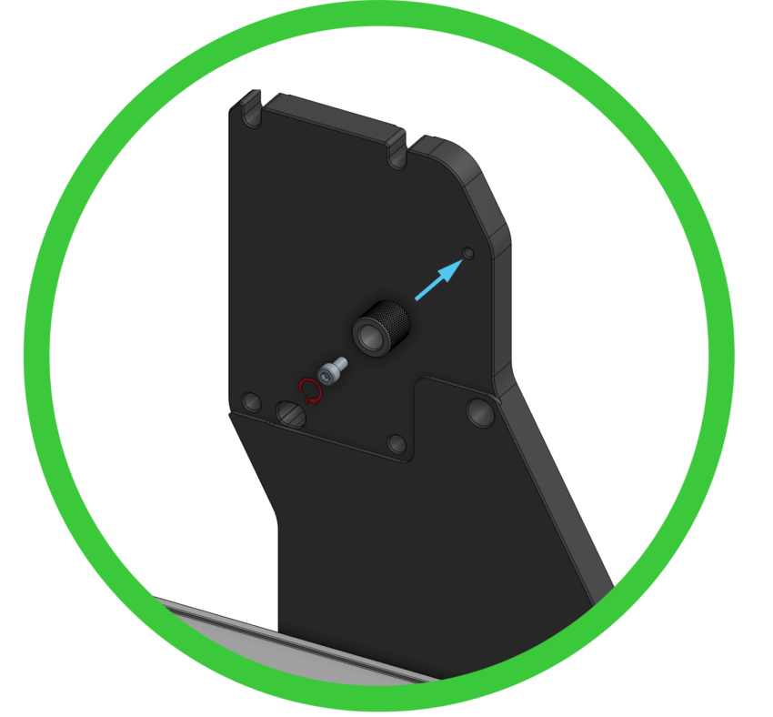{.aligncenter}

<i>Installing single integrated sensor bump stop onto right Y-axis gantry plate</i>

Prepare one inductive sensor by threading a nut onto it approximately 45mm / 1.5 inches, and add a lock washer.

Pass this inductive sensor through the hole of the left side Y-axis gantry plate. Hand-tighten the remaining integrated sensor bump stop over the end of the sensor until it bottoms out and is fully seated, as with the two sensors installed earlier. Then tighten the sensor nut and lock washer against the plate to secure the sensor.

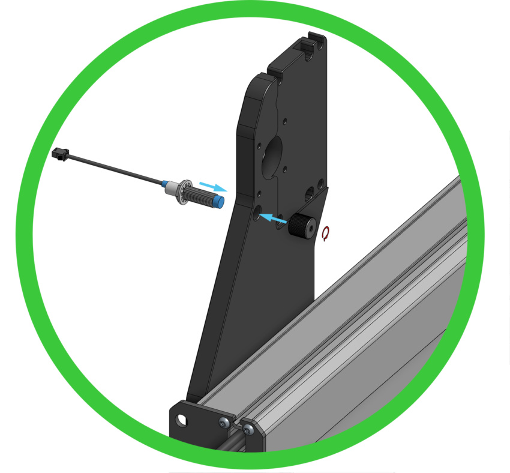{.aligncenter}

<i>Installing integrated sensor bump stop over X-axis sensor</i>

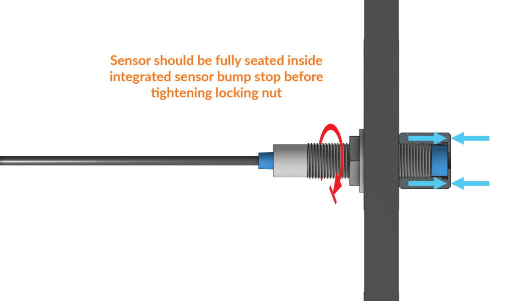{.aligncenter .size-large}

[/su_spoiler]

If you’ve received your machine before July 2025, your machine comes with rubber bump stops. Open the tab below for specific instructions.

[su_spoiler title="<strong>Rubber Bump Stops</strong>" open="no" style="fancy" icon="chevron" anchor_in_url="yes"]

Install the remaining two (2) bump stops onto both left and right Y-axis gantry plates using two (2) M5-16mm socket head screws.

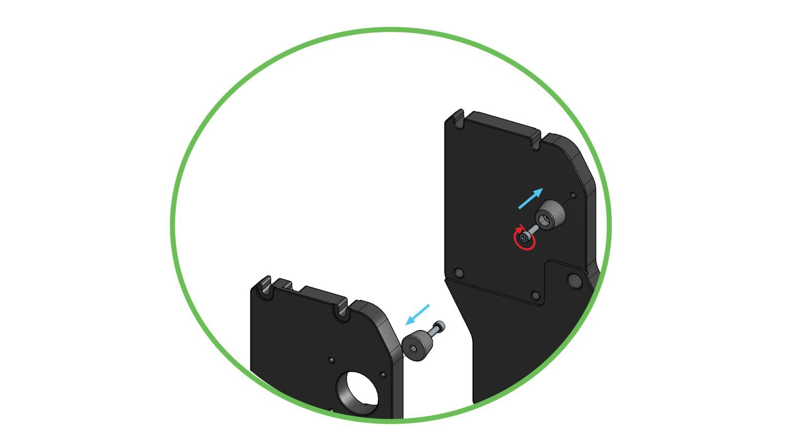{.aligncenter}

<i>Installing bump stops onto Y-axis gantry plates</i>

Prepare one inductive sensor by threading a nut onto it approximately 45mm / 1.5 inches, and add a lock washer.

Pass the sensor through the left Y-axis plate, and install a lock washer and a nut onto the sensor to clamp it onto the plate.

The sensor can not stick out past the bump stop. Recess the sensor stick-out distance by 1mm – 2mm from the face of the bump stop. You can use the flat face of the provided wrench to place on the bump stop face and use as a reference for sensor stick-out.

This step is **important** as it ensures the sensor will not be damaged when the X-axis gantry plate contacts the bump stop during use.

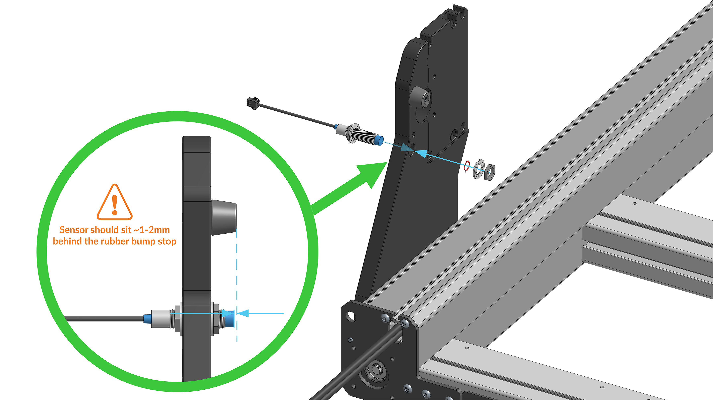{.aligncenter}

<i>X-axis sensor installation</i>

[/su_spoiler]

### X-axis Assembly Installation

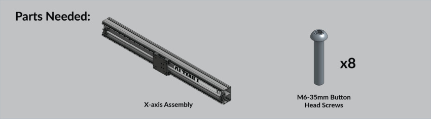{.aligncenter .size-medium}

Please make sure to check the inside of the X-axis assembly, since the <strong>drag chains are stored inside</strong>,<strong> ensure to remove the drag chains first and set aside.</strong>

Place the rail on the table upright such that the ALTMILL logo is upright and facing the front of the machine. It is important to note the positioning notch of the X-axis gantry plate is upward.

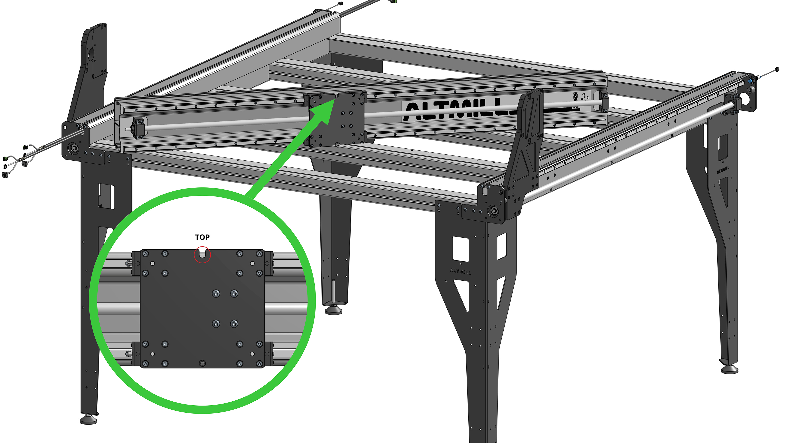{.alignnone}

<i>X-axis rail placed on table, noting orientation of X-axis gantry plate</i>

Insert two (2) M6-35mm flanged button head cap screws into each end of the X-axis rail. **DO NOT** thread screws completely into the rail. Leave 25 mm / 1 inch of threading exposed to be seated into the slots of the Y-axis gantry plates.

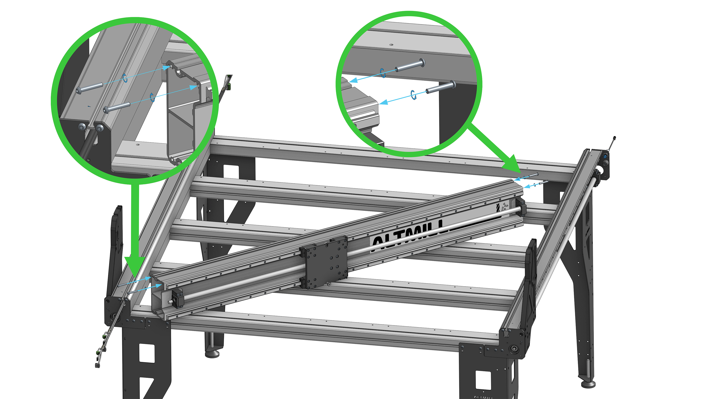{.alignnone}

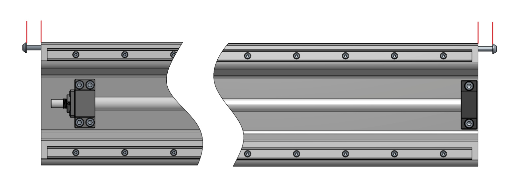{.alignnone}

<i>M6-35mm flange screws installed into X-axis rail with 25mm / 1 inch of thread exposed </i>

It is **recommended** to perform this step with **two (2) people**

Lift the X-axis assembly, making sure the X-axis gantry plate is toward the front of the machine. Seat the four (4) M6-35mm flange screws into the slots on the top of the two (2) Y-axis gantry plates.

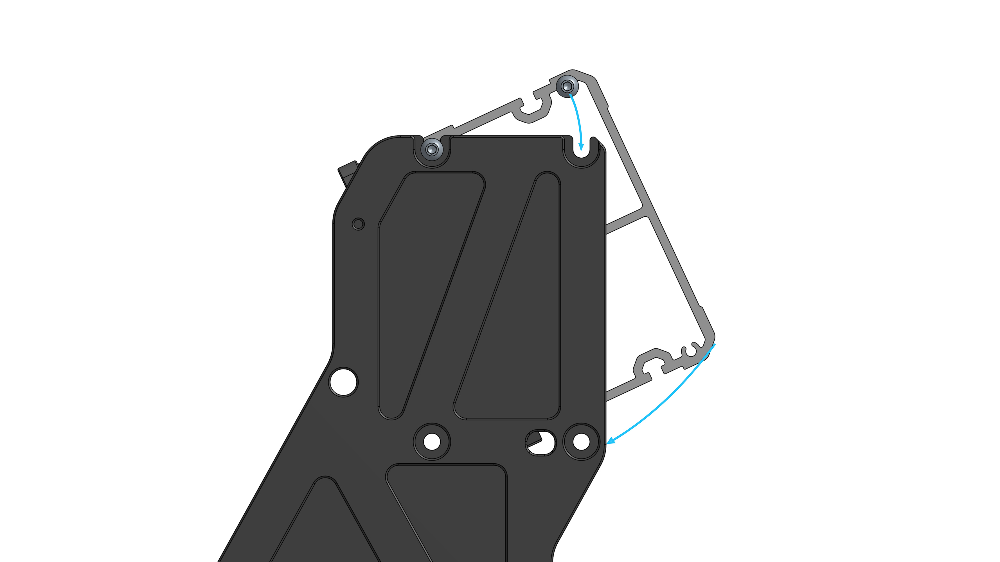{.aligncenter}

<i>X-axis rail seated on top of Y-axis gantry plates</i>

Tighten the eight (8) M4-16mm screws, clamping the Y-axis gantry plate to the linear bearings. Visually check to ensure the reference edge of the Y-axis gantry plate is sitting flush on top of the linear bearings.

Ensure the Y-axis gantry plate is pushed all the way to the front limit of the machine, contacting the ball bump stop.

Tighten the four (4) M5-16mm screws, clamping the Y-axis gantry plate to the ball screw nut.

**Repeat** the process on the other side of the machine.

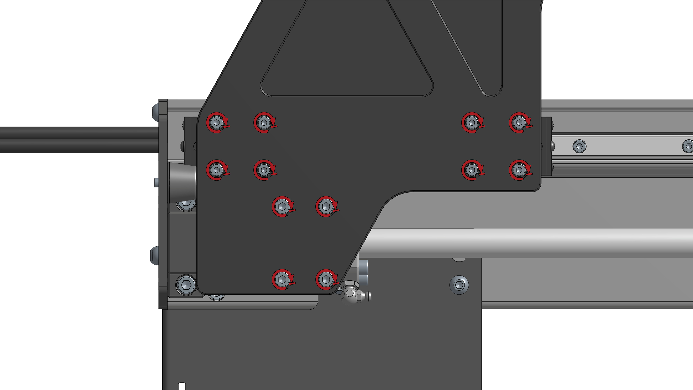{.alignnone}

<i>Y-axis gantry plate M4 and M5 screws tightened into linear bearings and ball screw nut</i>

Install the remaining four (4) M6-35mm flanged button head cap screws into the two (2) lower holes of the X-axis rail on each side. Leave screws **loose**.

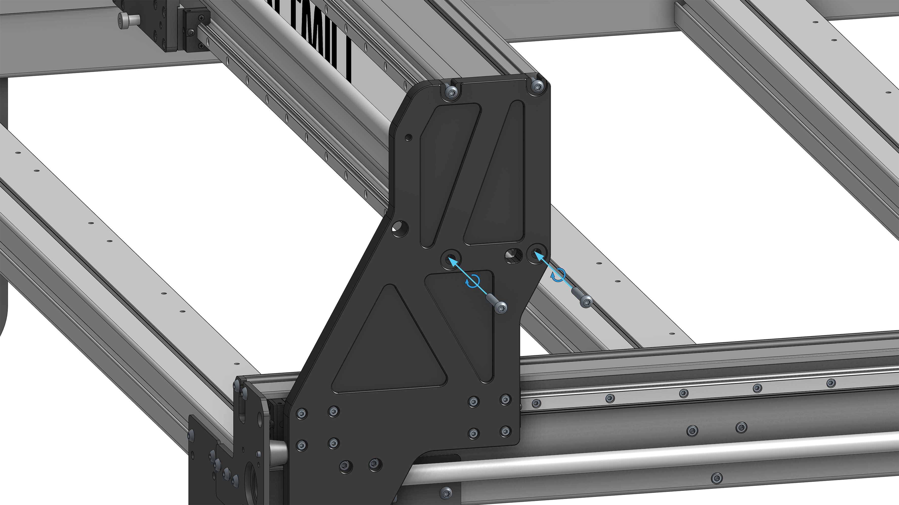{.aligncenter}

<i>Screws into X-axis rail through Y-axis gantry plate</i>

On the **left side** Y-axis gantry plate, use a bar clamp contacting the back face of the X-axis rail and the front edge of the Y-axis gantry plate, to squeeze the two together. This will ensure the reference edges of the Y-axis gantry plate are contacting the front machined faces of the X-axis rail.

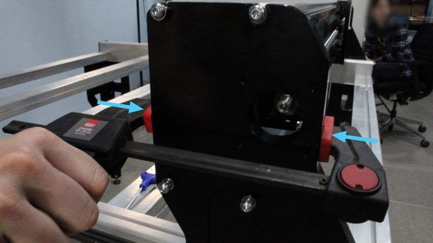{.size-medium .aligncenter}

<em>Clamping X-axis rail into Y-axis gantry plate for alignment</em>

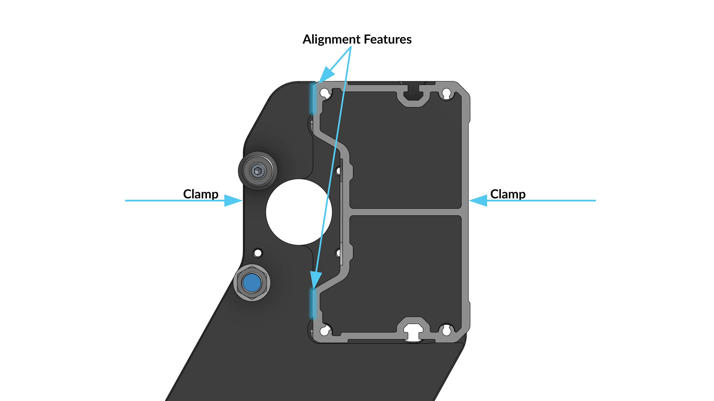{.aligncenter}

<em>Cross section showing </em><i>vertical reference edges on Y-axis gantry plate</i><em> </em>

Fully tighten the eight (8) M6-35mm flanged screws, clamping the Y-axis gantry plates to the X-axis rail. Leave the clamp pressing the Y-axis Gantry Plate and the X-axis Rail together until all eight (8) screws are tightened.

**Note:** Do not be alarmed by the X-axis rail sticking out slightly past the back edge of the Y-axis gantry plate. The components are intended to be that size.

Remove the clamp.

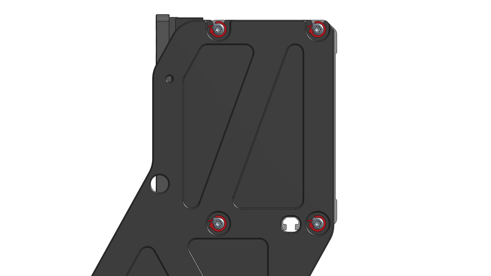{.aligncenter}

<i>M6-35mm flanged screws clamping Y-axis gantry plates to X-axis rail  </i>

