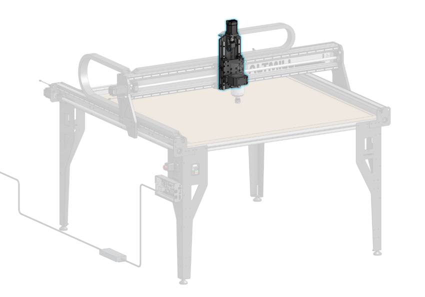

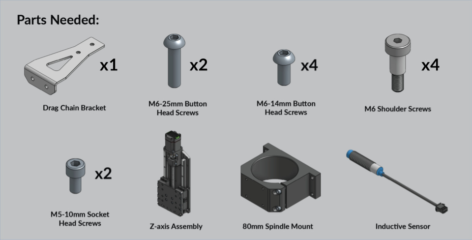

**Installing the ATC kit?** Review the [ATC preparation instructions](https://resources.sienci.com/view/atc-before-you-begin/) and [ATC Spindle Setup](https://resources.sienci.com/view/atc-spindle-setup/) before fitting the standard spindle mount and drag-chain bracket. The ATC uses different mounting and drag-chain hardware.

<!-- Q-ATC-01: Confirm the ATC branch and return sequence for new builds. Do not finalize this handoff until shared Z-axis, motor and sensor tasks are accounted for. -->

Orient the spindle mount on the Z-gantry plate of the Z-axis assembly such that the two bolts pre-installed into the spindle mount, for the purpose of clamping the spindle, are on the right side of the spindle mount.

Insert the M6 shoulder screws into the two (2) upper holes of the spindle mount and fasten them into the counterbored holes of the Z-axis gantry plate. Tighten the shoulder screw on the right side of the spindle mount first. Insert the M6-25mm button head screws through the two (2) bottom holes of the spindle mount and tighten into the Z-axis gantry plate.

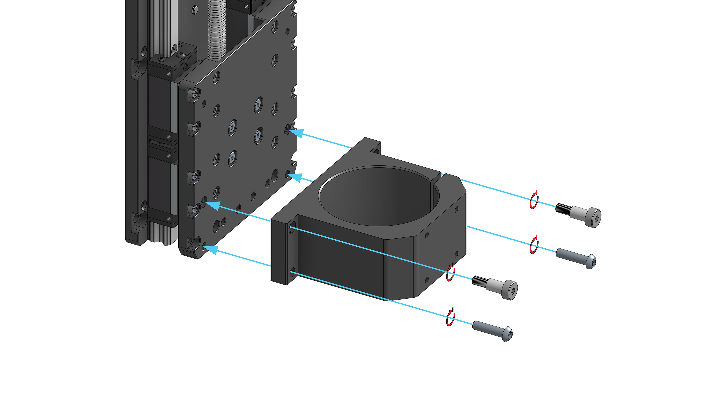

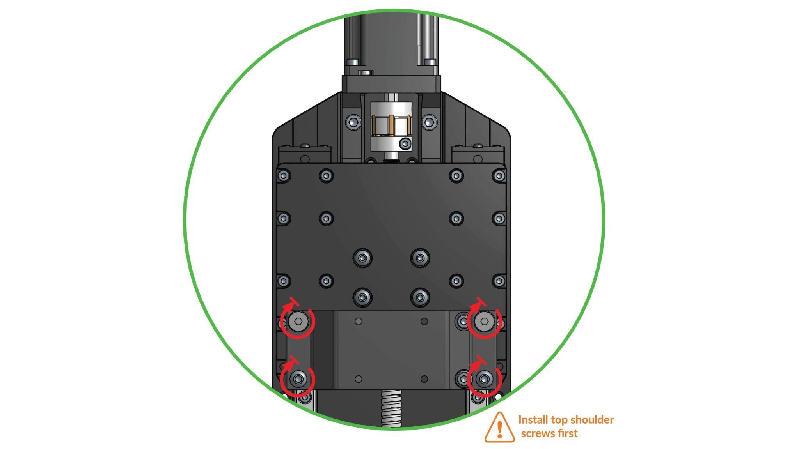

<i>Spindle mount installation</i>

Using two (2) M5-10mm socket head screws, fasten the drag chain bracket onto the back of the Z-axis assembly. Orient the drag chain bracket such that the short edge flange contacting the Z-axis assembly is pointing downward.

<i>Attach drag chain bracket onto Z-axis assembly</i>

**Threaded Z-axis Sensor Mounting**

If you received your machine on or after December 2025, your Z-axis carriage plate uses a threaded sensor hole. If you’re assembling a machine received prior to this date, skip ahead to the ‘unthreaded sensor mounting’

Prepare the last inductive sensor by threading a nut onto it until it reaches the middle of the sensor, and add a lock washer.

Slide the Z-axis gantry up to its highest position until it can’t move further. Thread the inductive sensor loosely through the back of the Z-axis assembly until the sensor bottoms out and locates inside the plate, do not tighten this further.

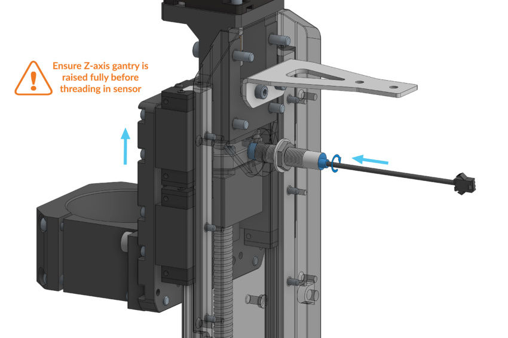

Next, loosen the sensor by 2 turns. This will locate the depth of the sensor correctly to ensure it triggers at the correct distance.

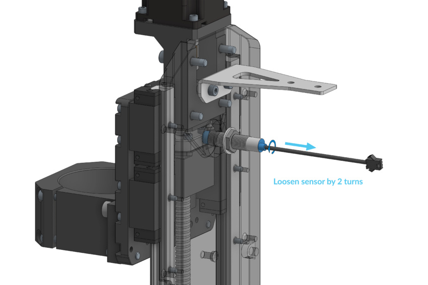

Lastly, lock the sensor in place by tightening the lock nut on the sensor using the side of the included wrench. Avoid spinning the sensor while doing so.

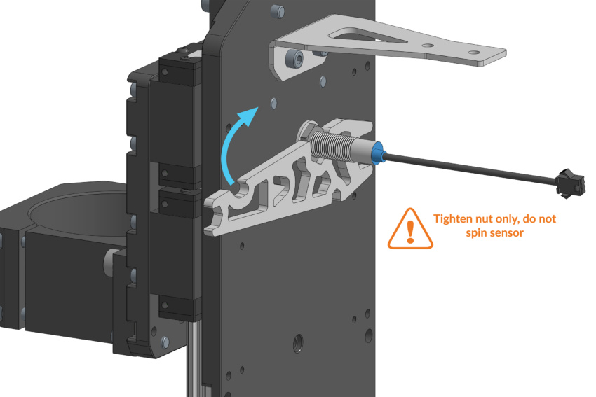

**Unthreaded Z-axis Sensor Mounting**

Follow these instructions if you’ve received your machine prior to December 2025, and have a sensor mounting hole that is unthreaded. 

Prepare the last inductive sensor by threading a nut onto it approximately 12mm / 0.5 inches, and add a lock washer.

**Note:** You will need to turn the motor coupler to shift the Z-axis gantry plate downward to allow you to access the inserted sensor.

Insert the inductive sensor through the back of the Z-axis assembly such that the blue tip is pointed toward the Z-axis ballscrew. Thread a nut onto the sensor to clamp it onto the Z-axis assembly. **Note:** Do not install a lock washer onto the pocket side of the sensor as there is limited thread available for the clamping nut.

The sensor **cannot** stick out past the recessed pocket of the Z-axis carriage plate, to ensure the Z-axis ball screw nut does not contact the sensor tip when brought to the upper limit of Z-axis travel. <strong>Warning!</strong> This is the initial position for the sensor installation. You may need to adjust the sensor if you get an Alarm 10 when homing the machine. 

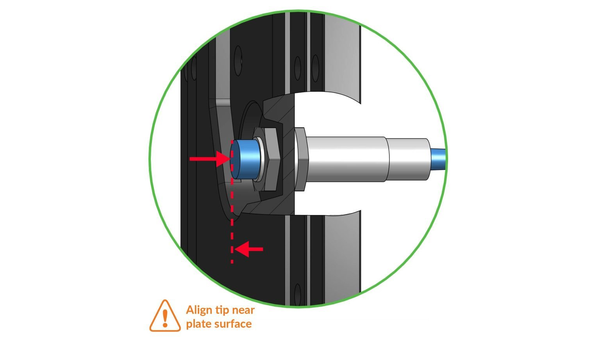

<i>Inductive sensor install </i><i>on Z-axis Carriage Plate</i>

Install one (1) M6 shoulder screw into the counterbore threaded hole on the back of the Z-axis assembly.

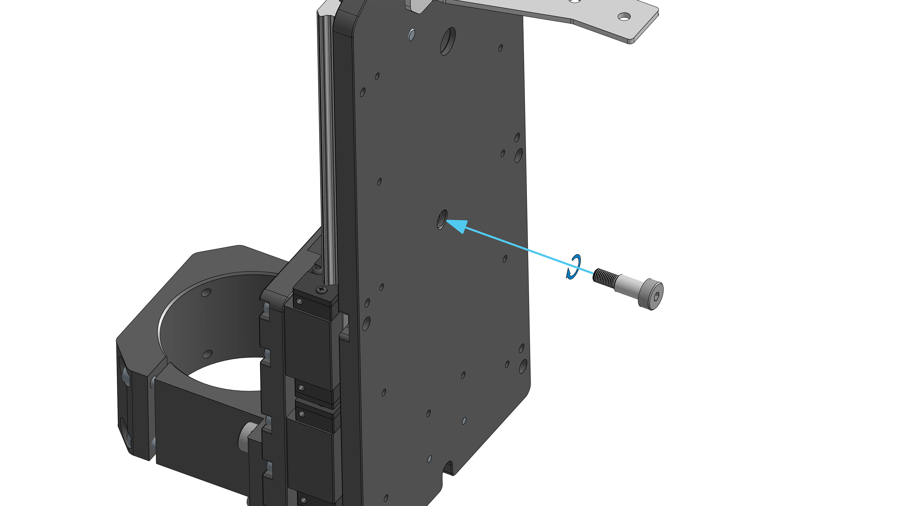

<em>Shoulder screw onto Z-axis Assembly</em>

Install one (1) M6 shoulder screw into the counterbore threaded hole on the bottom of the X-axis Gantry Plate. **Do not** tighten this screw completely. You will tighten this screw during the next step.

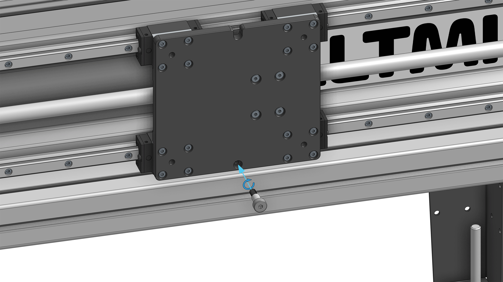

<em>Shoulder screw onto X-axis gantry</em>

Seat the two M6 shoulder screws onto the slots on the bottom of the Z-axis carriage plate and the top of the X-axis gantry plate. Tighten the bottom shoulder screw threaded into the X-axis gantry plate, clamping the two plates together.

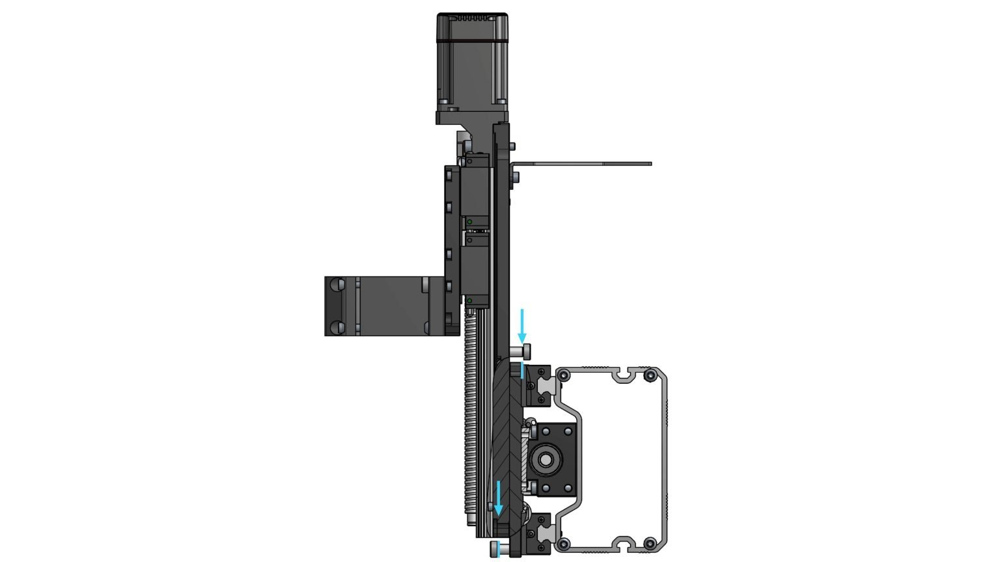

 <i>Cross section view indicating location of two shoulder screws</i>

Install four (4) M6-14mm button head screws, clamping the Z-axis assembly to the X-axis gantry plate. You will need to turn the motor coupler to shift the Z-axis gantry plate upward to allow you to access the four (4) mounting holes.

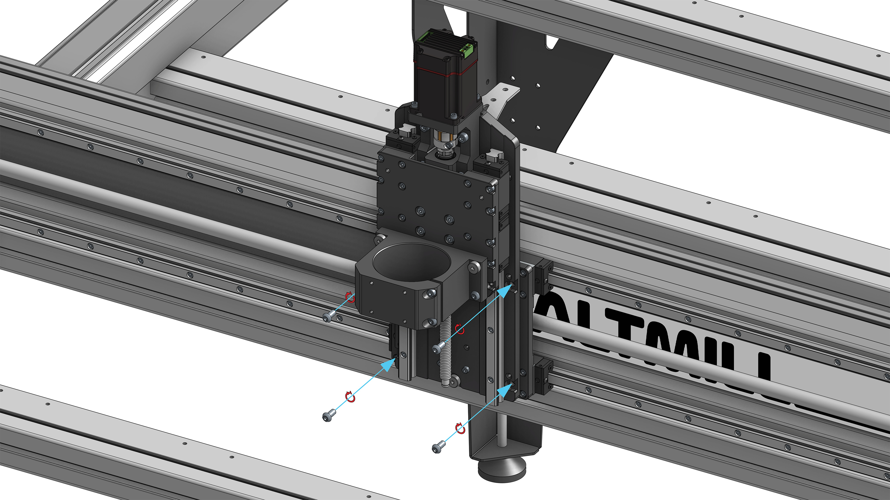

<i>M6-14mm button head screws clamping Z-axis assembly to X-axis gantry plate</i>

