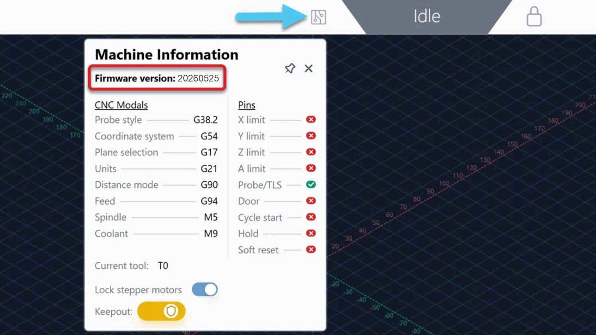

# Technical Manual

## Terminology

For this document we will refer to SLB/SLB-EXT as 1st generation (abbreviated to “gen”) SLB controllers. Consequently, SLB-LITE/SLB-EXT V2 are referred to as 2nd gen controllers. If not specified, assume we are talking about SLB-LITE/SLB-EXT V2.

## Differences between 1st and 2nd Gen SLBs

We have highlighted some of the major differences and improvements between the two generations of SLBs below. More details can be found in the specific sections further in this document. 

- Upgraded to a modern RP2350 microcontroller with better reliability, simplified flashing process, and improved driver support
- Integrated motor signal, motor power, and limit switch connectors into one locking connector and cable for each axis
- In 1st gen controllers when the E-stop was triggered, power was cut to the motors, requiring a power cycle at the controller to restore functionality. Now, the E-stop now doesn’t cut power, it turns OFF the motors enable signal – meaning motors still get disabled but you don’t need to power cycle anymore to get functionality
- E-stop is now directly attached to the board, and programmable E-stop action buttons have been removed, however a separate remote E-stop can be connected
- Ethernet port is moved to the expansion board, purchased separately from the main board
- Power distribution is completely re-designed to meet electrical safety requirements (Class 2 power) 
- New firmware, which changes how certain functions are handled, as well as the new or modified firmware settings between the 1st and 2nd gen SLBs. 
    - Use this official grblHAL reference document for the latest updated firmware settings https://grblhal.org/docs/reference/settings/ 

### Machine-to-Controller Compatibility

By default, the SLB-LITE was designed for the LongMill MK3 and the SLB-EXT V2 was designed for the AltMill MK2. This means that any other configuration will require some modification, whether that be to the firmware, machine profile/settings, and/or electrical components. Please note that our team cannot provide full technical support for these modifications.

#### Sienci Labs CNCs

| Controller | Machine | Status | Notes / Required Changes |
|---|---|---|---|
| **SLB-LITE** | LongMill MK3 | 🟢 **Default, current** | Current standard pairing |
| **SLB** | LongMill MK3 | 🟡 **Needs changes** | Downgrade motors to open loop and switch to AltMill motor cables |
| **SLB-LITE** | LongMill MK2.5 | 🔴 **Not recommended** | No significant performance improvements |
| **SLB-LITE** | AltMill | 🔴 **Not recommended** | Power insufficient for larger CNCs |
| **SLB-EXT** | LongMill MK3 | 🟡 **Needs changes** | Switch to AltMill motor cables or use motor connector adapters |
| **SLB-EXT** | AltMill | 🟢 **Default, current** | Current standard pairing |
| **SLB-EXT V2** | AltMill | 🔵 **Default, upcoming** | Upcoming standard pairing |
| **SLB-EXT V2** | LongMill MK3 | 🔴 **Not recommended** | No need for that amount of power |

#### 3rd Party CNCs

**SLB-LITE**
- Designed for 1.2Nm motors on all axes, 24V motor power
- Suitable for smaller, beginner CNCs like Shapeoko/X-Carve/Genmitsu
- If using controller for 3rd party CNC, we recommend purchasing the Closed Loop Motor Kit which contains the SLB-LITE, compatible motors and their cables

**SLB-EXT V2**
- Designed for 2Nm motors on X and Y axes, 1.2Nm on Z-axis, 48V motor power
- Suitable for larger CNCs like Onefinity 4x8, Elite
- If using controller for 3rd party CNC, this requires custom wiring for motor and limit switch connections (Molex MicroFit 3.0 2x7p connector)
    - Can wire into the connector to pass power through the board and out from the motors, or skip the power passthrough which would require motor connector adapters 

## Dimensions

Below are drawings of the top case and board, showing the part dimensions in millimeters.

{.aligncenter .size-medium}

{.aligncenter .size-medium}

## Power

One of the major differences between the **SLB-LITE** and **SLB-EXT V2** is how power is distributed through the board to the motors. 

- The SLB-LITE distributes power directly from a single power supply input, going through the board to each of the five (5) motor inputs. Motor power is switched on and off using the controller power switch. 
- The SLB-EXT V2 distributes power through six (6) independent input channels – five (5) dedicated to motor outputs, one (1) for the controller’s onboard power requirements. 
    - This reduces the maximum power through each independent output at a time, ensuring a high level of safety alongside individual circuit protection provided from the 6-channel power supply. Since power remains electrically isolated from the controller, the motor power is switched on and off by the power supply. 

## Status LEDs

On the controllers, there are 12 LEDs in a circle that will automatically light up and animate based on the machine's current state. Below is a chart listing the colour and animation for each state, and what the states mean. 

| State | Description | Colour & Animation |
|---|---|---|
| **Idle** | Machine ready, waiting for commands | ⚪ **Solid white** |
| **Cycle / Running** | G-code is running, like a job or a macro | 🟢 **Solid green** |
| **Jogging** | Machine is jogged | 🟢 **Green comet** with short bright head and dim tail |
| **Hold** | Job is paused | 🟡 **Yellow pulse** between dim and bright, full ring |
| **Safety Door** | Spindle and coolant disabled, waiting on switch to close (advanced) | 🟡 **Yellow blink**, alternating half-rings |
| **Homing** | Homing is in progress | 🔵 **Blue sweep**, mirrored from opposite sides |
| **Check Door** | Safety door detected as opened, door state initiated (advanced) | 🩵 **Cyan checkerboard**, rotating |
| **Alarm** | An alarm is triggered | 🔴 **Red chase** with fading tail |
| **E-stop** | E-stop is triggered | 🔴 **Red blink**, full ring |
| **Tool Change** | Tool change is in progress | 🟣 **Magenta dotted pattern**, rotating |
| **Sleep** | De-energizes motors, spindle and coolant until reset | ⚫ **Solid grey** |
                                
{.aligncenter .size-full}

You may find it helpful in understanding how the machine responds and processes commands. If the machine is not in Idle state, you may need to clear or wait until the current state has elapsed to process other commands. For example, if the machine is in Homing, you won't be able to jog the machine until the homing process is completed. If the machine is in Alarm, then the alarm needs to be cleared to proceed.

Additionally, there are lights next to the I/O which can indicate whether the specific functionality is behaving correctly, in real-time.

{.aligncenter .size-medium}

## E-stop

{.aligncenter .size-medium}

When activated, the E-stop LED on the board turns ON, as…
1) the enable signals for the motors turn OFF, and 
2) both the enable and PWM signals for the spindle/laser turn OFF, completely deactivating these components on a hardware level. 

This functionality is controlled by any of these four (4) inputs:

- The physical, NC (normally closed) E-stop button that's installed on top of the enclosure 
- An input for an optional, NO (normally open) E-stop button; this is useful if the controller is mounted far away from the machine/user 
- A power monitoring feedback loop
 	- Incoming voltage is checked by the protection chip 
 	- If voltage is within an acceptable range, power is delivered as normal and the controller sends the "power good" PGOOD signal [PGOOD LED ON]
 	- Otherwise, in cases of undervoltage, overvoltage or overcurrent, the chip cuts power to the controller, and the PGOOD signal turns OFF [PGOOD LED OFF], thus triggering the E-stop 
- STP pin connected to GND on the expansion board; this is useful for hooking up a sensor that needs to trigger an E-stop, e.g. spindle overheat sensor
Optional E-stop
If you connected the extra E-stop on the board, the expected behaviour is as follows:
Optional E-stop released AND onboard E-stop released – machine is ready to use
Optional E-stop pressed AND/OR onboard E-stop pressed – E-stop triggered

## Motors and Limit Switches

{.aligncenter .size-medium}

The controllers have five (5) connections for X, Y1, Y2, Z and A-axis motors, as well as limit switches on each axis. On our machines, the boards support NEMA 23 closed loop motors with external drivers, STEP/DIR/EN/AL signals. Limit switches are inductive-style, with 5V/Sig/GND signals, and can be NO or NC since the signal can be inverted in the firmware settings.

### A-axis

The controllers are able to run the A-axis independently from the other axes, meaning it can support a true 4th axis system. We recommend using the Sienci Labs Vortex, as the workflows on gSender were designed with the Vortex in mind. Using 3rd party 4th axis systems is possible, however it will require firmware settings adjustment and potentially custom wiring.

## Ring and Rail Lights

Connect compatible **WS2812 LED lights** to the controller’s Ring and Rail ports to add lighting to your machine. You can connect up to two strips, with a combined maximum of **60 LEDs** and **2 A**.

By default, these lights change colour and animation to match the machine’s status, just like the 12 lights around the E-stop button. You can also set them to white or green, turn them off, or adjust their brightness.

**Ring and Rail lights always work together.** Both ports receive the same signal, so you cannot control them independently.

### Choose What Your Lights Do

Use the following G-code commands to change the lighting:

| What you want to do | Command |
|---|---|
| Make Ring and Rail lights follow the machine’s status | `M356 P1 Q0` |
| Set Ring and Rail lights to white | `M356 P1 Q1` |
| Turn Ring and Rail lights off | `M356 P1 Q2` |
| Set Ring and Rail lights to green | `M356 P1 Q3` |
| Make the lights around the E-stop follow the machine’s status | `M356 P0 Q0` |
| Make all lights follow the machine’s status | `M356 Q0` |

Turning the lights off does not turn off the machine or disable the E-stop.

### Adjust Brightness

Brightness uses a scale from **0 to 255**, where 0 is the lowest setting and 255 is full brightness.

| Brightness | Command |
|---|---|
| 25% | `M356 S64` |
| 50% | `M356 S128` |
| 100% | `M356 S255` |

These commands adjust the overall LED brightness.

### Understand the Commands

Each part of the command controls a different setting:

| Command part | What it controls |
|---|---|
| `M356` | Changes the lighting settings |
| `P1` | Applies the lighting mode to Ring and Rail lights |
| `P0` | Applies the lighting mode to the 12 lights around the E-stop |
| No `P` value | Applies the setting to all lights |
| `Q0` | Automatic: follows the machine’s status |
| `Q1` | White |
| `Q2` | Off |
| `Q3` | Green |
| `S0`–`S255` | Brightness, from lowest to highest |

For example, `M356 Q0 S64` makes all lights follow the machine’s status at approximately 25% brightness.

> Note: For advanced users: Please note that if you use M150 command to manually program on the pixel level, the first pixel offboard is 13, not 0, since the first 1-12 pixels refer to the LED ring around the E-stop. Additionally, you can use M150 R<red>, M150 G<green>, and M150 B<blue> for the colours.

## Spindle

{.aligncenter .size-medium}

### Spindle Connection

The **SPINDLE** port supports both **5 V PWM** and **Modbus** to control a compatible spindle and its variable frequency drive (VFD).

### Spindle Port Pins

| Pin | Function | Description |
|---|---|---|
| 1 | Spindle detect | Detects a connected spindle through a connection to ground on Pin 5. Automatic detection is still in development and is not yet available. |
| 2 | E-stop output | Signals when the hardware E-stop is active by connecting Pin 2 to ground on Pin 5 through an optocoupler. This output is not currently used in the spindle setup. |
| 3 | Modbus A | Used with Pins 4 and 5 for Modbus communication. |
| 4 | Modbus B | Used with Pins 3 and 5 for Modbus communication. |
| 5 | Ground (GND) | Ground connection shared by the control signals. |
| 6 | PWM | Provides the 5 V PWM control signal, used with Pin 5. |

### Choose a Control Method

**We recommend Modbus if your VFD supports it**, as it provides more robust communication between the controller and VFD.

Sienci spindles using the **H-100 VFD** can be configured through the **Accessory Installation wizard in gSender**.

### Using a Third-Party VFD

Some third-party VFDs can work with the controller, but they require manual setup. You will need the manufacturer’s VFD manual to adjust the settings on both the VFD and in gSender.

See the [MODVFD Setup guide](https://sienci.zendesk.com/hc/en-us/articles/41538568827668-MODVFD-Setup) for setup instructions.

VFDs that may be compatible include:

- H-100
- Huanyang v1
- Huanyang P2A
- Durapulse GS20
- Yalang YS620
- Nowforever

Compatibility is not guaranteed, as models and product versions can vary. Our team can provide general setup guidance, but using a third-party VFD is a modification made at your own risk.

> **Does your VFD require a 0–10 V signal?**  
> The controller provides 5 V PWM, not a 0–10 V analog signal. If your VFD does not accept 5 V PWM, use Modbus if supported, or a compatible **PWM-to-0–10 V analog signal converter**.

## Laser

{.aligncenter .size-medium}

The LASER port of the controller supports 5V PWM laser diode accessories, with either 2-pin (GND, PWM) or 3-pin (GND, PWM and Enable) inputs. 

### Set Up Your Laser

1. Check your version of gSender, and the controllers firmware version.

    | What to check | Minimum version |
    |---|---|
    | **gSender** | **1.6.0** or newer |
    | **Controller firmware** | **20260318** or newer |

    ✅ The image below shows firmware 20260525, which meets the requirement.

    {.aligncenter .size-medium}

2. Download the [Laser Config File](https://drive.google.com/file/d/19erTPAXCojBliCOjNlOmmlJeOfpwEBqe/view?usp=drive_link) (20260318 and up), then load it in gSender. It will automatically apply the firmware settings needed for your laser.

3. Press Run Job. Your controller will disconnect.
4. Reconnect back to gSender and on the main screen, open the Spindle/Laser tab at the bottom right corner. In the dropdown, select PWM2, this is the laser output. You can only control one output at a time.

    {.aligncenter .size-medium}

5. Switch the toggle to Laser. Wear your laser safety glasses. Then once you are ready, press Laser Test to check that the laser activates! 

For more details on the laser functionality on gSender, see this page.
https://resources.sienci.com/view/gs-add-ons/#laser-diode-support 

## Probe/Touch Plate

{.aligncenter .size-medium}

You can connect a Sienci Labs touch plate, or a standard block-style touch plate with compatible [connectors](#connectors-list) to the PROBE port on the controller. 

For step-by-step instructions on installing and using the Sienci Labs AutoZero touch plate, see this page https://resources.sienci.com/view/addons-autozero/ 

### 3rd Party Touch Plate

Set up your touch plate on gSender, by navigating to Config then to the Probe heading. Once these settings are adjusted, you can check for continuity. Tap the touch plate and magnet together then check that the yellow light turns on, next to the PROBE port. If the yellow light stays on even though the plate and magnet aren’t touching, you may need to toggle the **invert probe pin** setting in Config. 

{.aligncenter .size-full}

To learn how gSender handles the probing process, see this page. https://resources.sienci.com/view/gs-using-gsender/#probing 

## TLS

{.aligncenter .size-medium}

Short for “tool length sensor,” the TLS is a common CNC accessory that automates zeroing in the Z-axis - this is especially helpful if you have long, complicated jobs that require multiple end mills.

If you have the Sienci Labs TLS, go here to set it up using the Accessory Installation wizard on gSender https://resources.sienci.com/view/addons-tls/#gsender-setup 

If you have a 3rd party TLS, keep reading!

### 3rd Party TLS

If the wiring is not labelled, you can use a multimeter and check any two wires until you find a set that opens when the TLS is pressed, those two will be for signal and GND; the third will be for power.

Once you’ve mounted the TLS and plugged it into the controller at the TLS port, press it and see if the orange TLS light on your controller responds.

If TLS is NO → Orange light turns ON
The light will be ON when TLS is pressed

If TLS is NC → Orange light turns OFF
The light will stay OFF if TLS is disconnected

If you find the TLS is not behaving as expected, you may need to invert the probe signal as follows: On gSender, in Config, go to the Probe heading. Find Invert Probe Inputs ($6), and toggle the **Toolsetter option to the opposite setting.** Press Apply Settings then turn OFF/ON the controller to have the setting take effect.

{.aligncenter .size-medium}

Then manually configure the firmware settings as outlined below:

- Go back to the main Carve screen on gSender
- Jog the machine towards you and install your longest end mill into the spindle. This is to ensure there is enough clearance during tool changing.
- Home the machine. You must have limit switches installed to do homing, otherwise you cannot use the TLS.

{.aligncenter .size-medium}

- Jog the machine so the end mill is positioned over the center of your TLS, slightly above the metal button, about 0.5-1″ (10-20mm).
- Go back to Config. Under the Tool Changing tab, adjust the following settings:
- gSender strategy
    - Select “Fixed Tool Sensor”
- Fixed sensor location
    - Press the Grab button
- First tool behaviour
    - “Prompt for first tool”
- Set tool change location
    - Toggle ON

{.aligncenter .size-medium}

- Press Apply Settings.
- Go back to the main Carve screen. Jog the machine to a place where you can change out your end mill safely and easily, like at the front left of your machine. Then jog all the way up on the Z-axis – this ensures you can access the tool easily while changing it out.
- In Config, navigate back to Tool Changing tab, then find the Manual tool change location
    - Press the Grab button
    - Press Apply Settings.
- In Config, go to the Spindle/Laser tab and adjust these settings:
    - Spindle/laser controls
        - Toggle ON
    - Spindle on delay ($394)
        - 11 OR whatever your manufacturer states
    - Spindle off delay ($539)
        - 11 OR whatever your manufacturer states

{.aligncenter .size-medium}

- Press Apply Settings, then turn OFF/ON the controller.
- Re-connect to gSender.

Now that you have the TLS set up, familiarize yourself with how gSender handles tool changes with a TLS – see it in action in this video https://youtu.be/fswJHOhdZgE?si=rvBe-N1_WLb1euFX&t=610 . 

## Aux

{.aligncenter .size-medium}

Short for “auxiliary”, the AUX port outputs 5V to any powered accessory like a relay, SSR, solenoid for a mister or LED strip; up to 250mA per plug. This can be more convenient for powering less power-hungry components since the power comes straight from the controller.

To set up an auxiliary accessory, go to Config, and navigate to Accessory Outputs heading. There, you can customize what M commands control the accessory. Apply the settings, then turn OFF/ON the controller. Now, you can switch the accessory ON/OFF in several ways; injecting the g-code into your job file via post processor, setting up macro buttons or automations [https://resources.sienci.com/view/gs-macros/] , or entering the g-code manually into the console. 

- Spindle/Laser Enable (M3/M4): turns the output on with M3 or M4, and off with M5
- Mist Enable (M7): turns on/off with M7/M9
- Flood Enable (M8): turns on/off with M8/M9
- M62-M65 Only: available as a backup to control each port with a unique M command:
    - Turn on/off with M62/63 (but wait in line before running)
    - Turn on/off immediately with M64/65
    - Enter $pins into the console to see which pins are which

## Expansion

{.aligncenter .size-medium}

The expansion board will be available for both the SLB-LITE and SLB-EXT V2. The main features include ethernet connectivity, four (4) accessory (AUX) outputs, and ATC spindle support.

The pinout for the header connector is shown below:

{.aligncenter .size-medium}

Comes with Power, UART, Neopixel, I2C, Shift Register Expansion, E-Stop, SPI, Ethernet SPI Support pins (IRQ and CS), one spare MCU IO, 4 spare shift register outputs and GND. 

Into it we can plug our EXTV2 Expansion which offers 
- Ethernet
- 4 x AUX Output
- ATC Spindle support

Ethernet https://resources.sienci.com/view/gs-using-gsender/#ethernet-connection 

## Connectors List
Power
- SLB-LITE: 5.5mm OD, 2.1mm ID barrel jack (24-48V, 4A)
- SLB-EXT V2: Molex MicroFit 3.0 2x6P connector, with isolated channels powering each motor (24-48V, 4A max per channel)

Connectivity
- USB-C connector for serial connection to controller
- MicroSD card slot for local file storage and macro functionality

Motors & Limit Switches
- Molex MicroFit 3.0 2x7P connector

Tool Length Sensor (TLS)
- Phoenix-style 3.81-3P pluggable terminal connector (5V, NC input)

Probe/Touchplate 
- Phoenix-style 3.81-2P pluggable terminal connector (NO input)

Auxiliary (Aux)
- Phoenix-style 3.81-2P pluggable terminal connector (5V output)

Laser
- Phoenix-style 3.81-2P pluggable terminal connector (5V PWM output)

Ring LED  
- JST XHP-3P connector (5V, Neopixel Signal Output)

Rail LED 
- JST XHP-3P connector (5V, Neopixel Signal Output)

Optional External E-stop
- Phoenix-style 3.81-2P pluggable terminal connector (NO input)

Spindle/Router
- RJ12 connector for PWM and MODBUS communication with routers and spindle VFDs

Expansion:  
- 26 Pin IDC type connector

## Open Source

The SLB-LITE/SLB-EXT V2 project is licensed as “CERN-OHL-S”. This means that if you use our publicly available code and/or designs, you must license your code and hardware changes under the same license, giving attribution to us. Additionally if you use our firmware on other hardware, then that hardware should have the same license too. 

You can read more about the license here [https://gitlab.com/ohwr/project/cernohl/-/wikis/Documents/CERN-OHL-version-2] , in the LICENSE file contained in most repos, or in the License headers of the affected files.

Find the board design, firmware and other documents in the following repos:

SLB-LITE: https://github.com/Sienci-Labs/SuperLongboard-Lite

SLB-EXT V2: https://github.com/Sienci-Labs/SuperLongboard-EXT-V2

